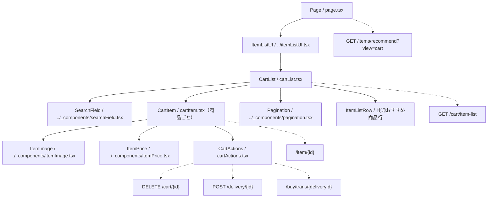

# /item-list/cartページ

## 概要

本人のカート商品を検索・ページ送りし、商品詳細への移動、カートからの削除、購入手続きの開始を行う。おすすめ商品はServer Componentで取得し、カート一覧はクライアントのSWRで取得する。
この文書は現在の実装概要。変更時はルートおよび `client` 配下の上位 `AGENTS.md` にも従う。

## 各コンポーネントの役割

### コンポーネント構成図

パスは `client/src/app/item-list/cart` を基準とする。実線は包含関係、点線は取得・操作先を示す。

### Page

- `page.tsx`。非同期Server Componentで `fetchRecommend()` を先に実行する。
- 取得した `data.items` を `CartList` の `relatedItemList` に渡し、カートの初期一覧は取得しない。
- `ItemListUI` が `Container` と `TitleAndBack` を組み立て、画面タイトル「カート」を表示する。
- メタデータはタイトル「カート」、説明「カートに追加した商品をご覧いただけます。」、robotsは `index: false`・`follow: false`。
- おすすめ取得の失敗をPage内ではcatchせず、共通サーバー通信のリダイレクト・例外処理に委ねる。

### CartList

- `cartList.tsx`。Client Componentとして入力値 `searchValue`、確定済み検索語 `searchKeyword`、ページ番号 `pageNumber`（初期値1）を管理する。
- `getListUrl` をSWRキーにし、`fetcher` で `{ itemList, totalPages }` を取得する。未取得時の表示用総ページ数は1。
- 入力変更時は毎回ページを1へ戻す。空白のみの入力なら確定済み検索語も解除し、空でない入力は送信時まで検索条件に反映しない。
- Enterまたは検索アイコンの操作で入力値を検索条件に反映し、ページを1へ戻す。
- 商品がある場合だけ `CartItem` と `Pagination` を表示し、各行へ同じSWRの `mutate` を渡す。
- カート商品がある表示領域内で、`relatedItemList.length > 1` の場合だけ共通 `ItemListRow` を表示する。空カートやおすすめ1件では表示しない。
- 空配列なら「商品が見つかりません」を表示する。未取得時・取得失敗時の専用表示は現状ない。

### CartItem

- `cartItem.tsx`。`Item` と `mutate` を受け取り、商品情報の下に `CartActions` を配置する。
- 画像・商品名・属性ラベル・動画タイトル・価格を囲む `Link` は `/item/{id}` に遷移する。
- `ItemImage` に画像URLと商品statusを渡すが、`showSold: false` のため売切れ表示は行わない。
- 性別が `men`・`women`・`unisex` ならメンズ・レディース・ユニセックスを表示し、`age_type === "kids"` ならキッズも表示する。
- 商品名と `Video?.title` はnullishなら空文字で表示する。
- `ItemPrice` は `showSale: true` とし、`Sale` がなければセールフラグをfalse、各割引数値を0として渡す。
- 画像・価格・検索・ページングの詳細は [共通部品の指示](../_components/AGENTS.md) を参照する。

### CartActions

- `cartActions.tsx`。Client Componentで、商品情報と一覧の `mutate` を受け取る。
- 「購入手続きへ」で `fetchBuy(item.id)` を呼び、返却された `deliveryId` を使い `router.push` で `/buy/trans/{deliveryId}` へ移動する。
- 購入時の `ApiError` は `INVALID_ITEM` なら販売中でない旨、それ以外なら再試行を促すトーストを表示する。その他の例外はalertで案内する。
- 「カートから削除」で現在の `itemList` から対象IDを除く楽観的更新を行い、直後の再取得は抑止する。`totalPages` はそのまま維持する。
- 削除成功時は `mutate()` で再取得し、成功トーストを表示する。失敗時も再取得して復元を試み、`ApiError` では追加表示せず、それ以外はalertを出す。
- 購入ボタンはstatusによる無効化を行わず、購入可否はAPIが判定する。送信中の二重操作防止、削除確認、空になったページから前ページへ戻す処理は現状ない。

## API

### 一覧取得：api/client.ts

- `getListUrl(pageNumber, searchKeyword)` は `${NEXT_PUBLIC_API_URL}/cart/item-list?page={pageNumber}` を生成する。
- 検索語を `trim()` し、空でなければ `encodeURIComponent` を通した `keyword` を追加する。画面からstatus条件は送信しない。
- 再exportする共通 `fetcher` は、取得できたトークンをBearerヘッダーに付けてGETし、HTTPエラー時は通常の `Error` を投げる。
- バックエンドは本人のカートを20件単位で、カートの `createdAt`・`id` の降順に取得する。status未指定時は `active`・`soldout` が対象。

### おすすめ取得：api/server.ts

- `fetchRecommend()` は共通 `apiFetchServer` で `GET /items/recommend?view=cart` を呼び、`{ items: Items[] }` を返す。
- 共通関数は `API_URL` を基点とし、有効な認証トークンを付与する。認証不足・401では `/login`、404では `notFound()`、その他のHTTPエラーでは例外となる。
- この結果はPageからPropsで渡し、カートのSWR更新・削除ではおすすめを再取得しない。

### 購入・削除：api/buy.ts / api/cart.ts

- `fetchBuy(itemId)` は `POST /delivery/{itemId}`、戻り値の型は `{ deliveryId: number }`。bodyは指定しない。
- `fetchRemoveCart(itemId)` は `DELETE /cart/{itemId}`。bodyは指定しない。
- 両者は共通クライアント `apiFetch` を使用し、`NEXT_PUBLIC_API_URL` を基点にトークン必須判定・Bearer付与・JSON読取り・`ApiError` 送出を行う。
- キャッシュ変更、通知、画面遷移は `CartActions` が担当する。

### 表示データの型と接続時の確認点

- フロントの一覧型は `{ itemList: Item[]; totalPages: number }`。`Item` は [../types.ts](../types.ts) にあり、商品情報・status・性別/年齢・nullableな `Video` / `Sale` 等を持つ。
- おすすめの `Items` は `@/types/itemListTypes` の別の型で、共通 `ItemListRow` に渡す。
- 現行バックエンドの `getCartItemListUseCase` は `itemList: { item: 商品情報 }[]` を返す一方、フロントは平坦な `Item[]` を直接描画する。共通fetcherには展開変換がないため、接続時は両者のレスポンス形状を確認する。

## デザイン・CSS

### CartList・CartItem CSS

- `cartList.module.css` を使用し、一覧を幅100%・最大900px、商品情報をFlexで配置する。
- 行hover時に背景・影・左アクセント線を表示する。商品名・動画タイトル等は `line1` で1行に制限する。
- 属性ラベルは `typeRow` / `typeText`、空データ案内は `noItem`、おすすめとの間隔は `related` が担う。
- 幅768px以上で画像とテキストの間隔・文字サイズを調整し、359px以下で商品リンクの右余白をなくす。

### CartActions CSS

- `cart.module.css` で削除・購入ボタンを横並びにし、上側に点線の区切りを表示する。
- ボタンは通常120×35px、450px以上で140×38pxに拡大する。削除はテーマ色の文字、購入はアクション色の背景と白文字。
- hover時は背景や下線、縦方向の移動を適用する。色は既存のCSS変数に合わせる。

### 共通部品のCSS

- 画像・価格・検索欄・ページネーションは `../_components/listParts.module.css`、おすすめ行は共通 `ItemListRow` 側のスタイルを使用する。
- ページ枠・見出しは `ItemListUI` 側の部品が担う。画面固有と共通のスタイルを区別して変更する。
