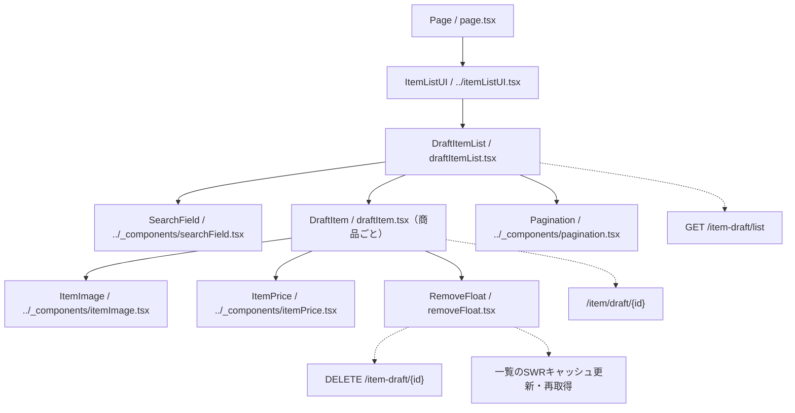

# /item-list/draftページ

## 概要

認証本人の下書き商品を、作成日時の降順（同日時はIDの降順）で20件ずつ表示する。検索、下書き編集画面への遷移、下書き削除に対応する。並び順・取得件数・所有権の判定はバックエンドが担う。
この文書は現在の実装概要であり、変更時はルートおよび `client` 配下の上位 `AGENTS.md` にも従う。

## 各コンポーネントの役割

### コンポーネント構成図

パスは `client/src/app/item-list/draft` を基準とする。実線は包含関係、点線は操作先を示す。

### Page

- `page.tsx`。非同期Server Componentで、`ItemListUI` の子に `DraftItemList` を配置する。
- 共通の `ItemListUI` が `Container` と `TitleAndBack` を組み立て、画面タイトル「下書き商品」を表示する。
- `generateMetadata` はタイトル「下書き商品一覧」、説明「下書き保存した商品をご覧いただけます。」を設定する。
- robotsは `index: false`・`follow: false` とする。
- Page自身では一覧APIを取得せず、クライアント側のSWRに委ねる。

### DraftItemList

- `draftItemList.tsx`。Client Componentとして、入力中の `searchValue`、確定済みの `searchKeyword`、`pageNumber`（初期値1）を管理する。
- `getListUrl` の戻り値をSWRキーにし、`fetcher` で `{ itemDraftList, totalPages }` を取得する。
- 入力を変更するたびにページを1へ戻し、空白のみの入力になった場合は確定済みの検索条件も解除する。
- Enterまたは検索アイコンの操作で入力値を検索条件に反映し、ページを1へ戻す。空でない入力は変更しただけでは検索条件に反映しない。
- レスポンスの各要素の `itemDraft` を取り出し、商品がある場合は `DraftItem` をIDをキーにして並べ、末尾に `Pagination` を配置する。ページ変更はSWRキーの変更を通じて再取得する。
- 各商品行へ同じSWRの `mutate` を渡し、削除時に現在の一覧キャッシュを更新できるようにする。
- 空配列なら「商品が見つかりません」を表示する。未取得時の専用ローディング表示や、取得失敗時の専用エラー表示は現状ない。

### DraftItem

- `draftItem.tsx`。`ItemDraft` と一覧の `mutate` を受け取り、1商品分の行を描画する。
- 画像・商品情報・価格を囲む `Link` は `/item/draft/{id}` に遷移する。削除メニューはリンクの外側に置く。
- `ItemImage` に `first_image_url` を渡し、`status: null`・`showSold: false` で売切れ表示を無効にする。
- 商品名と動画タイトルは `null` / `undefined` なら空文字として表示する。
- `createdAt` を `formatRelativeTime` で整形し、「保存日時」として表示する。更新日時は使用しない。
- `ItemPrice` に現在価格（nullなら文字列 `-`）を渡し、`sale_flag: false`・`showSale: false` でセール情報を非表示にする。
- `RemoveFloat` に下書きIDと `mutate` を渡す。共通4部品の詳細は [共通コンポーネントの指示](../_components/AGENTS.md) を参照する。

### RemoveFloat

- `removeFloat.tsx`。Client Componentとして `floatVisible` を管理し、縦三点アイコンでメニューを開閉する。
- メニュー表示時は画面全体のオーバーレイも表示し、オーバーレイをクリックすると閉じる。
- 「下書きから削除」を押すと、数値IDをwrapped配列の `itemDraft.id` と照合して一覧キャッシュから除く楽観的更新を行う。この時点では再取得せず、`totalPages` も変更しない。
- `fetchRemoveItem` に下書きIDの文字列を渡して削除し、成功時は `mutate()` で再取得して「下書き商品を削除しました」のトーストを表示する。
- 失敗時も `mutate()` で再取得して復元を試みる。`ApiError` なら失敗トースト、それ以外ならシステムエラーのalertを表示する。
- 削除前の確認ダイアログ、送信中の二重操作防止、削除後に空になったページから前ページへ戻す処理は現状ない。

## API

`api/client.ts` は一覧URL生成と削除通信を担当し、共通 `@/lib/fetcher` を再exportする。

### getListUrl

- `getListUrl(pageNumber, searchKeyword)` は `${NEXT_PUBLIC_API_URL}/item-draft/list?page={pageNumber}` を生成する。
- 検索語を `trim()` した結果が空でない場合だけ、`encodeURIComponent` でエンコードして `keyword` を追加する。
- ページ数の検証や検索そのものは行わない。20件単位の取得と並び順はバックエンドの仕様による。
- `fetcher` はトークンが取得できればBearerヘッダーを付けてGETし、成功時はJSONを返す。HTTPエラーでは通常の `Error` を投げる。

### fetchRemoveItem

- `fetchRemoveItem(itemDraftId)` は共通 `apiFetch` に `method: "DELETE"` を指定して呼び出す。bodyは指定しない。
- IDから `/item-draft/{id}` を構築する。共通関数は `NEXT_PUBLIC_API_URL` とパスをそのまま連結するため、先頭スラッシュの有無を含め既存の接続方法を確認する。
- 共通 `apiFetch` がトークン必須の判定、Bearerヘッダーの付与、レスポンスJSONの読取り、`ApiError` の送出を担う。
- キャッシュ更新・成功通知・エラー表示はAPI関数ではなく `RemoveFloat` が担当する。

### 表示データの型

- [types.ts](types.ts) の `ItemDraft` を使用する。項目は `id`・`name`・`price`・`first_image_url`・`title`・`createdAt`。
- IDは `number`、文字項目は `string | null`、価格は `number | string | null`、`createdAt` はISO日時の `string`。JSONを変換せず型と参照を合わせる。
- 一覧レスポンスは `{ itemDraftList: { itemDraft: ItemDraft }[]; totalPages: number }`。データ未取得時の表示用総ページ数は1とする。

## デザイン・CSS

### DraftItem・DraftItemList CSS

- `draftItemList.module.css` を両コンポーネントが `styles` としてimportする。
- 一覧は幅100%・最大900pxとし、商品行はFlexで画像・テキスト・価格・削除メニューを配置する。
- 商品行のhover時に背景・影と左側のアクセント線を表示する。色や影は既存のCSS変数を使う。
- 商品名・日時・動画タイトルは `line1` で1行に制限する。空データの案内は `noItem` で整える。
- 幅768px以上では画像とテキストの間隔・文字サイズを調整し、359px以下ではリンク領域の右余白をなくす。

### RemoveFloat CSS

- `removeFloat.module.css` を使用し、縦三点アイコンとメニューを商品行に対して絶対配置する。
- メニューは白背景・影付きで `z-index: 500`、画面全体のオーバーレイは固定配置で `z-index: 499` とする。
- オーバーレイは透明な背景と `backdrop-filter: blur(2px)` を指定する。
- 削除項目のhover時はゴミ箱アイコンと文言の色・拡大率を変える。
- 幅359px以下では縦三点アイコンを非表示にする。

### 共通部品のCSS

- 画像・価格・検索欄・ページネーションは `../_components/listParts.module.css` を使用する。
- ページ枠・見出しは共通 `ItemListUI` 側の部品が担う。変更時は画面固有CSSと共通部品の影響範囲を確認する。
