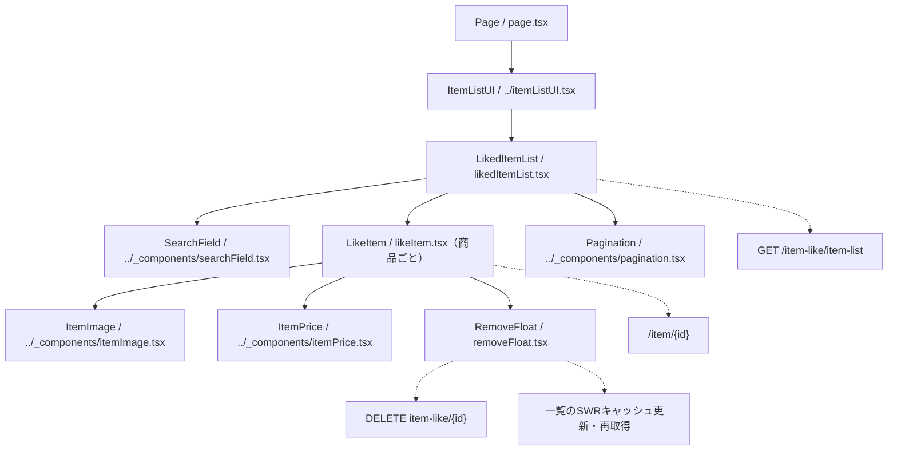

# /item-list/likeページ

## 概要

認証本人のいいねした商品を検索・ページングして表示し、商品詳細への遷移と一覧からの削除に対応する。バックエンドはいいね登録の作成日時の降順（同日時は登録IDの降順）で20件ずつ取得し、商品statusは既定で `active`・`soldout` を対象とする。
この文書は現在の実装概要であり、変更時はルートおよび `client` 配下の上位 `AGENTS.md` にも従う。レスポンス形は「表示データの型とAPI接続」を参照する。

## 各コンポーネントの役割

### コンポーネント構成図

パスは `client/src/app/item-list/like` を基準とする。実線は包含関係、点線は操作先を示す。

### Page

- `page.tsx`。非同期Server Componentで、`ItemListUI` の子に `LikedItemList` を配置する。
- 共通 `ItemListUI` が `Container` と `TitleAndBack` を組み立て、画面タイトル「いいねした商品」を表示する。
- `generateMetadata` のタイトルは「いいね商品一覧」、説明は「いいねした商品の一覧をご覧いただけます。」。
- robotsは `index: false`・`follow: false` とする。
- Page自身は一覧APIを取得せず、クライアント側のSWRに委ねる。

### LikedItemList

- `likedItemList.tsx`。Client Componentとして、入力中の `searchValue`、確定済みの `searchKeyword`、`pageNumber`（初期値1）を管理する。
- `getListUrl` の戻り値をSWRキーにし、`fetcher` で一覧を取得する。フロントの期待型は `{ itemList: Item[]; totalPages: number }`。
- 入力を変更するたびにページを1へ戻す。空白のみの入力になった場合は確定済みの検索条件も解除する。
- Enterまたは検索アイコンの操作で入力値を検索条件に反映し、ページを1へ戻す。空でない入力は変更しただけでは検索条件に反映しない。
- 商品がある場合は `LikeItem` をIDをキーにして並べ、末尾に `Pagination` を配置する。ページ変更はSWRキーの変更を通じて再取得する。
- 各商品行へ現在のSWRの `mutate` を渡し、削除時に一覧キャッシュを更新できるようにする。
- 空配列なら「商品が見つかりません」を表示する。未取得時の専用ローディング表示や、取得失敗時の専用エラー表示は現状ない。
- 未取得時の表示用総ページ数は1。検索条件とページ番号はローカルstateに保持し、URLクエリとは同期しない。

### LikeItem

- `likeItem.tsx`。`Item` と一覧の `mutate` を受け取り、1商品分の行を描画する。
- 画像・商品情報・価格を囲む `Link` は `/item/{id}` に遷移する。削除メニューはリンクの外側に置く。
- `ItemImage` に画像URLと商品statusを渡し、`showSold: true` で売切れ時の `SOLD` 表示を有効にする。
- 商品名は `null` / `undefined` なら空文字として表示する。日時の表示は行わない。
- 性別区分に応じてメンズ・レディース・ユニセックスを表示し、`age_type === "kids"` ならキッズも表示する。adult・bothのラベルは表示しない。
- 動画タイトルは `item.Video?.title ?? ""` を「動画：」の横に表示する。
- `ItemPrice` に現在価格と `Sale` の値を渡し、`showSale: true` とする。`Sale` がない場合はフラグをfalse、割引関連数値を0として扱う。
- `RemoveFloat` に商品と `mutate` を渡す。共通4部品の詳細は [共通コンポーネントの指示](../_components/AGENTS.md) を参照する。

### RemoveFloat

- `removeFloat.tsx`。Client Componentとして `floatVisible` を管理し、縦三点アイコンでメニューを開閉する。
- メニュー表示時は画面全体のオーバーレイを置き、オーバーレイをクリックすると閉じる。
- 「いいねした商品から削除」を押すと、対象商品IDを一覧キャッシュの `itemList` から除く楽観的更新を行う。この時点では再取得せず、`totalPages` も変更しない。
- `fetchRemoveItem` に `item-like/{id}` を渡す。商品本体の削除ではなく、本人のいいね登録を削除する操作である。
- 成功時は `mutate()` で再取得し、「いいねした商品を削除しました」のトーストを表示する。
- 失敗時も `mutate()` で再取得して復元を試みる。`ApiError` なら「いいねした商品の削除に失敗しました」のトースト、それ以外ならシステムエラーのalertを表示する。
- 削除前の確認ダイアログ、送信中の二重操作防止、削除後に空になったページから前ページへ戻す処理は現状ない。

## API

`api/client.ts` は一覧URL生成と削除通信を担当し、共通 `@/lib/fetcher` を再exportする。

### getListUrl

- `getListUrl(pageNumber, searchKeyword)` は `${NEXT_PUBLIC_API_URL}/item-like/item-list?page={pageNumber}` を生成する。
- 検索語を `trim()` した結果が空でない場合だけ、`encodeURIComponent` でエンコードして `keyword` を追加する。statusは送信しない。
- ページ数の検証や検索はバックエンドに委ねる。バックエンドは検索語を日本語正規化し、検索記号をエスケープして `search_text` の部分一致に使用する。
- `fetcher` はトークンが取得できればBearerヘッダーを付けてGETし、成功時はJSONをそのまま返す。HTTPエラーでは通常の `Error` を投げる。

### fetchRemoveItem

- `fetchRemoveItem(path)` は共通 `apiFetch` に `method: "DELETE"` を指定して呼び出す。bodyは指定しない。
- 呼出し元のパスは `item-like/{id}`。共通関数は `NEXT_PUBLIC_API_URL` とパスをそのまま連結するため、先頭スラッシュの有無を含め既存の接続方法を確認する。
- 共通 `apiFetch` がトークン必須の判定、Bearerヘッダーの付与、レスポンスJSONの読取り、`ApiError` の送出を担う。
- キャッシュ更新・成功通知・エラー表示は `RemoveFloat` が担当する。

### 表示データの型とAPI接続

- `../types.ts` の `Item` を使用する。レスポンスは `{ itemList: { item: Item }[]; totalPages: number }` とし、描画時に要素の `item` を取り出す。
- IDは数値、商品名・画像URLはnullable。Videoはnullableなtitleのみ、Saleはnullableな割引率・割引額・変更前価格とsale_flagを持ち、関連IDは返却されない。
- 価格は `number | string` とし、このページでnull価格は許容しない。共通ItemPriceが数値文字列を含む価格を桁区切りと「円」で表示する。
- 楽観的削除はキャッシュのラッパー構造を維持し、`item.id` を数値IDで比較する。HTTPパスの文字列化は通信境界で行う。
- 共通fetcherはレスポンスをそのまま返す。APIは変更せず、フロントの型・描画・キャッシュ操作を返却構造に合わせる。

## デザイン・CSS

### LikeItem・LikedItemList CSS

- `likedItemList.module.css` を両コンポーネントが `styles` としてimportする。
- 一覧は幅100%・最大900pxとし、商品行はFlexで画像・テキスト・価格・削除メニューを配置する。
- 商品行のhover時に背景・影と左側のアクセント線を表示する。色や影は既存のCSS変数を使う。
- 商品名・区分ラベル・動画タイトルは `line1` で1行に制限する。区分ラベルは背景色・角丸を持ち、空データの案内は `noItem` で整える。
- 幅768px以上では画像とテキストの間隔・文字サイズを調整し、359px以下ではリンク領域の右余白をなくす。

### RemoveFloat CSS

- `removeFloat.module.css` を使用し、縦三点アイコンとメニューを商品行に対して絶対配置する。
- メニューは白背景・影付きで `z-index: 500`、画面全体のオーバーレイは固定配置で `z-index: 499` とする。
- オーバーレイは透明な背景と `backdrop-filter: blur(2px)` を指定する。
- 削除項目のhover時はゴミ箱アイコンと文言の色・拡大率を変える。
- 幅359px以下では縦三点アイコンを非表示にする。

### 共通部品のCSS

- 画像・価格・検索欄・ページネーションは `../_components/listParts.module.css` を使用する。
- ページ枠・見出しは共通 `ItemListUI` 側の部品が担う。変更時は画面固有CSSと共通部品の影響範囲を確認する。
