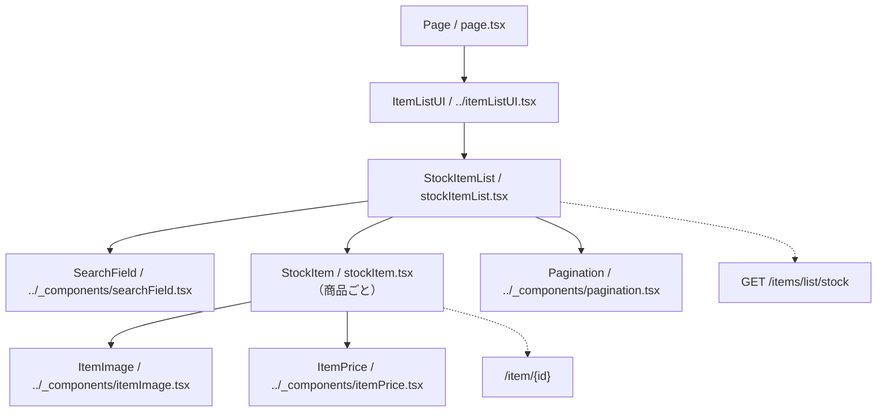

# /item-list/stockページ

## 概要

認証本人が出品した商品の在庫を確認するページ。検索、ページ切替、商品詳細への遷移に対応する。在庫数の編集操作は持たない。
バックエンドは `active`・`soldout` の商品を出品日時の降順（同日時はIDの降順）で20件ずつ取得する。所有権・取得件数・並び順はバックエンドが担う。
この文書は現在の実装概要であり、変更時はルートおよび `client` 配下の上位 `AGENTS.md` にも従う。

## 各コンポーネントの役割

### コンポーネント構成図

パスは `client/src/app/item-list/stock` を基準とする。実線は包含関係、点線は操作先を示す。

### Page

- `page.tsx`。非同期Server Componentとして `ItemListUI` の子に `StockItemList` を配置する。
- `ItemListUI` が `Container` と `TitleAndBack` を組み立て、画面タイトル「在庫一覧」を表示する。
- `generateMetadata` のタイトルは「在庫一覧」、説明は「出品した商品の在庫を確認できます。」とする。
- robotsは `index: false`・`follow: false` とする。
- Page自身ではAPIを取得せず、一覧のクライアント側SWRに委ねる。

### StockItemList

- `stockItemList.tsx`。Client Componentとして入力中の `searchValue`、確定済みの `searchKeyword`、`pageNumber`（初期値1）を管理する。
- `getListUrl` が返すURLをSWRキーにして `fetcher` で取得し、`data.itemList` と `data.totalPages` を参照する。総ページ数は未取得時に1とする。
- 入力変更時はページを1へ戻し、空白のみの入力になれば確定済み検索条件も解除する。空でない入力変更だけでは検索条件を確定しない。
- Enterまたは検索アイコンの操作で `searchValue` を検索条件に反映し、ページを1へ戻す。
- 商品がある場合はIDをキーに `StockItem` を並べ、末尾に `Pagination` を置く。ページ変更はSWRキーの変更を通じて再取得する。
- 各行へSWRの `mutate` を渡すが、現状の商品行はこれを利用せず、在庫更新や削除の操作はない。
- 空配列なら「商品が見つかりません」を表示する。未取得時の専用ローディング表示や取得エラーの専用表示は現状ない。

### StockItem

- `stockItem.tsx`。`Item` と `mutate` をPropsに定義するが、描画では `item` だけを使用する。
- 画像・商品情報・価格を囲む `Link` は `/item/{id}` に遷移する。
- `ItemImage` に画像URLとstatusを渡し、`showSold: false` として売切れ表示を無効にする。
- 商品名は `null` / `undefined` なら空文字で表示する。動画タイトルは `item.Video?.title ?? ""` を表示する。
- 「在庫数：」に続けて `item.attributes.inventory?.current.toLocaleString()` を表示する。inventoryがない場合は数値を表示せず、色・サイズ別在庫の集計は行わない。
- `ItemPrice` に価格と `Sale` を渡し、`showSale: true` とする。Saleがなければセールフラグはfalse、割引関連値は0を渡す。
- 共通画像・価格・検索・ページネーションの詳細は [共通コンポーネントの指示](../_components/AGENTS.md) を参照する。

## API

### getListUrl・fetcher

- `api/client.ts` の `getListUrl(pageNumber, searchKeyword)` が `${NEXT_PUBLIC_API_URL}/items/list/stock?page={pageNumber}` を生成する。
- 検索語を `trim()` して空でない場合だけ、`encodeURIComponent` でエンコードした `keyword` を追加する。
- フロントはstatus条件や取得件数を送らず、ページと検索語のみを指定する。
- 共通 `@/lib/fetcher` を再exportする。取得できたトークンをBearerヘッダーに付けてGETし、成功時はJSON、HTTPエラー時は通常の `Error` を返す／投げる。
- バックエンドでは検索語を正規化し、検索記号をエスケープした部分一致検索を行う。本人の商品への絞込みはバックエンドの責務とする。

### 表示データの型と接続上の現状

- [../types.ts](../types.ts) の `Item` を使用し、クライアントは `{ itemList: Item[]; totalPages: number }` を前提に直接商品行へ渡す。
- `Item` はID、商品名、価格、status、性別・年齢区分、画像URL、`attributes`、nullableな `Video`・`Sale` を持つ。
- 在庫の表示対象は `ItemAttributes.inventory.current`。inventory自体は任意項目で、色・サイズ別在庫とは別に定義されている。
- 現行バックエンドの `getStockItemListUseCase` は `itemList: { item: 商品データ }[]` を返し、クライアントの直接配列という想定と一致していない。共通fetcherに展開処理はないため、接続変更時は双方の実装を確認する。
- 返却形式の不一致は [対応Todo](../../../../../docs/todo/P1-bug/align-item-list-response-with-client.md) を参照する。

## デザイン・CSS

### StockItem・StockItemList CSS

- 両コンポーネントは `stockItemList.module.css` を `styles` としてimportする。
- 一覧は幅100%・最大900px。商品行はFlexで画像・テキストと価格を並べる。
- 行のhover時は背景・影・左側のアクセント線を表示する。色や影は既存のCSS変数を使用する。
- 商品名・在庫数・動画タイトルは `line1` で1行に制限する。在庫ラベルと数値には `stockLabel`・`stock` を適用する。
- 空データの文言には `noItem` を適用し、最大768pxの表示領域を設ける。
- 幅768px以上では画像との間隔・文字サイズを調整し、359px以下ではリンク領域の右余白をなくす。

### 共通部品のCSS

- 画像・価格・検索欄・ページネーションは `../_components/listParts.module.css` を使用する。
- ページ枠・見出しは共通 `ItemListUI` 側の部品が担う。変更時は画面固有CSSと共通部品の適用先を確認する。
