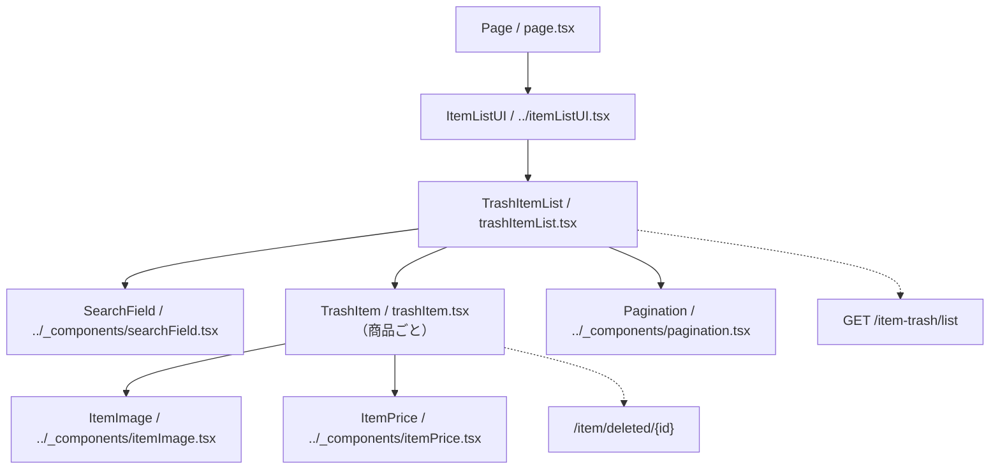

# /item-list/trashページ

## 概要

本人が削除した商品の一覧を検索・ページ送りし、削除済み商品の詳細へ移動する。バックエンドは `createdAt`・`id` の降順に20件ずつ取得する。
この文書は現在の実装概要。変更時はルートおよび `client` 配下の上位 `AGENTS.md` にも従う。

## 各コンポーネントの役割

### コンポーネント構成図

パスは `client/src/app/item-list/trash` を基準とする。実線は包含関係、点線は取得・操作先を示す。

### Page

- `page.tsx`。非同期Server Componentで、`ItemListUI` 内に `TrashItemList` を配置する。
- 共通の `ItemListUI` が `Container` と `TitleAndBack` を組み立て、画面タイトル「削除した商品」を表示する。
- メタデータのタイトルは「削除した商品一覧」、説明は「最近1か月以内に削除した商品をご覧いただけます。」とする。
- robotsは `index: false`・`follow: false` に設定する。
- Page自身ではAPIを取得せず、一覧の取得・検索・ページ送りをクライアント側へ委ねる。

### TrashItemList

- `trashItemList.tsx`。Client Componentとして `searchValue`、確定済みの `searchKeyword`、`pageNumber`（初期値1）を管理する。
- `getListUrl` の戻り値をSWRキーにし、`fetcher` で `{ itemTrashList, totalPages }` を取得する。未取得時の表示用総ページ数は1。
- 入力変更時はページを1へ戻す。空白のみの入力なら確定済み検索語も解除し、空でない入力は送信時まで検索条件に反映しない。
- Enterまたは検索アイコンの操作で入力値を検索条件に反映し、ページを1へ戻す。
- 商品がある場合だけ `TrashItem` をIDをキーとして並べ、末尾に `Pagination` を配置する。ページ変更はSWRキー変更を通じて再取得する。
- 各商品行に `mutate` を渡すが、現在の `TrashItem` はこれを使用しない。画面内に復元・完全削除の操作はない。
- 空配列なら「商品が見つかりません」を表示する。未取得時と取得失敗時の専用表示は現状ない。

### TrashItem

- `trashItem.tsx`。`ItemTrash` を受け取り、画像・商品名・削除日時・動画タイトル・価格を表示する。
- 商品情報全体を囲む `Link` は `/item/deleted/{itemTrash.id}` に遷移する。
- `ItemImage` には画像URLと `status: null` を渡し、`showSold: false` で売切れ表示を無効にする。
- 商品名と動画タイトルはnullishなら空文字で表示する。
- `createdAt` を `formatRelativeTime` に渡して「削除日時」として表示し、日時の独自計算は行わない。
- `ItemPrice` は `showSale: false`、セールフラグfalse・割引数値0とし、現在価格のみを表示する。
- 型上のPropsにはSWRの `mutate` も含むが、関数では受け取って使用していない。共通4部品の詳細は [共通部品の指示](../_components/AGENTS.md) を参照する。

## API

### getListUrl / fetcher：api/client.ts

- `getListUrl(pageNumber, searchKeyword)` は `${NEXT_PUBLIC_API_URL}/item-trash/list?page={pageNumber}` を生成する。
- 検索語を `trim()` し、空でなければ `encodeURIComponent` を通した `keyword` を追加する。
- 共通 `@/lib/fetcher` を再exportする。取得できたトークンをBearerヘッダーに付けてGETし、成功時はJSON、HTTPエラー時は通常の `Error` を返す／投げる。
- バックエンドで本人の `seller_id` に限定し、検索語は正規化したうえで商品名・動画タイトルの部分一致に使用する。取得と件数計算はバックエンドが担う。
- メタデータには「最近1か月以内」とあるが、現行一覧取得のwhere条件には期間制限がない。画面側も期間による絞込みを行わないため、取得条件と説明文は区別して確認する。

### 表示データの型と接続時の確認点

- [../types.ts](../types.ts) の `ItemTrash` は `id`・`name`・`price`・`first_image_url`・`title`・`createdAt` を持つ。
- 文字項目は `string`、価格は `number`、`createdAt` は `Date` と定義されているが、JSON取得後に日付を `Date` へ変換する処理はない。
- 一覧の `TrashItemData` は `ComponentProps<typeof TrashItem>["itemTrash"]` から導出する。フロントが想定するレスポンスは `{ itemTrashList: ItemTrash[]; totalPages: number }`。
- 現行バックエンドの `getItemTrashListUseCase` は `itemTrashList: { itemTrash: 商品情報 }[]` を返す一方、フロントは平坦な配列を直接描画する。共通fetcherには展開変換がないため、接続時は両者のレスポンス形状を確認する。

## デザイン・CSS

### TrashItem・TrashItemList CSS

- `trashItemList.module.css` を両コンポーネントが `styles` としてimportする。
- 一覧は幅100%・最大900pxとし、画像・商品テキスト・価格をFlexで配置する。
- 商品行のhover時に背景・影・左側のアクセント線を表示する。色や影は既存のCSS変数を使う。
- 商品名・日時・動画タイトルは `line1` で1行に制限する。日時は `dateDiv` / `dateText`、空データの案内は `noItem` を使用する。
- 幅768px以上で画像とテキストの間隔・文字サイズを調整し、359px以下ではリンク領域の右余白をなくす。

### 共通部品のCSS

- 画像・価格・検索欄・ページネーションは `../_components/listParts.module.css` を使用する。
- ページ枠・見出しは共通 `ItemListUI` 側の部品が担う。画面固有CSSと共通部品の影響範囲を確認する。
