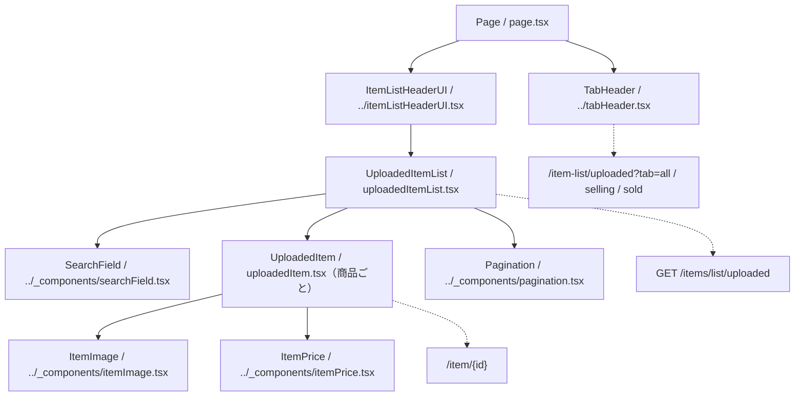

# /item-list/uploadedページ

## 概要

認証本人が出品した商品を「全商品」「販売中のみ」「売り切れ」のタブで確認する。検索、ページ切替、商品詳細への遷移に対応する。
バックエンドは出品日時の降順（同日時はIDの降順）で20件ずつ取得する。所有権・status条件・並び順はバックエンドが担う。
この文書は現在の実装概要であり、変更時はルートおよび `client` 配下の上位 `AGENTS.md` にも従う。

## 各コンポーネントの役割

### コンポーネント構成図

パスは `client/src/app/item-list/uploaded` を基準とする。実線は包含関係、点線は操作先を示す。

### Page

- `page.tsx`。非同期Server Componentとして `searchParams` をawaitし、`tab` 未指定時は `all` を使う。
- `TabHeader` に `tab`、`UploadedItemList` に `uploadedTab` として同じ値を渡す。
- タブヘッダーをページ先頭に配置し、一覧は `ItemListHeaderUI` の子に置く。
- `ItemListHeaderUI` は `Container` と `Back` を組み立てる。`ItemListUI` の見出し付き構成とは異なる。
- metadataのタイトルは「出品した商品」、説明は「出品した商品を確認できます。」、robotsは `index: false`・`follow: false` とする。
- PageのProps型は `tab?: "all" | "selling"` だが、実際のタブと一覧APIは `sold` にも対応する。URL値を実行時に検証する処理はない。

### TabHeader・ItemListHeaderUI（親ディレクトリの共通部品）

- `../tabHeader.tsx` はClient Componentで、`all`・`selling`・`sold` の3タブを表示する。
- タブ操作は `router.push` で `/item-list/uploaded?tab={値}` へ遷移し、選択中のボタンに `active` を付ける。
- 表示文言は「全商品」「販売中のみ」「売り切れ」。検索語やページ番号はタブ遷移のURLに含めない。
- `../itemListHeaderUI.tsx` は共通のコンテナ・戻る操作とchildrenを配置し、一覧データや検索状態は管理しない。
- これらは親ディレクトリの部品なので、変更時は参照元と共通CSSへの影響を確認する。

### UploadedItemList

- `uploadedItemList.tsx`。Client Componentで `uploadedTab` を受け取り、入力中の `searchValue`、確定済みの `searchKeyword`、`pageNumber`（初期値1）を管理する。
- タブ・ページ・検索語から `getListUrl` でSWRキーを生成し、`fetcher` で一覧を取得する。総ページ数は未取得時に1とする。
- 入力変更時はページを1へ戻す。空白のみの入力なら検索条件も解除し、空でない入力だけでは検索条件を確定しない。
- Enterまたは検索アイコンで入力値を検索条件に反映し、ページを1へ戻す。
- 商品がある場合はIDをキーに `UploadedItem` を並べ、末尾の `Pagination` の操作でページを更新する。
- 各行へ `mutate` を渡すが、現状の行は使用せず、削除・編集の直接操作はない。
- 空配列なら「商品が見つかりません」を表示する。未取得時の専用ローディング表示・取得失敗の専用表示はない。
- タブProps変更を監視して検索・ページ状態を初期化する処理はなく、タブ値はSWRキー生成に使用する。

### UploadedItem

- `uploadedItem.tsx`。Propsに `Item` と `mutate` を定義するが、描画では `item` だけを使用する。
- 画像・商品情報・価格を囲む `Link` は `/item/{id}` に遷移する。
- `ItemImage` に画像URL・statusと `showSold: true` を渡し、売切れ商品の `SOLD` 表示を有効にする。
- 商品名と `Video` のタイトルは、`null` / `undefined` なら空文字として表示する。
- 性別区分に応じて「メンズ」「レディース」「ユニセックス」を表示し、`age_type === "kids"` の場合は「キッズ」も表示する。
- `adult`・`both` の年齢区分を表すラベルはなく、性別区分とキッズ判定に該当する場合にラベル行を描画する。
- `ItemPrice` は `showSale: true` とし、Saleがなければフラグfalse・割引関連値0を渡す。
- 共通4部品の詳細は [共通コンポーネントの指示](../_components/AGENTS.md) を参照する。

## API

### getListUrl・fetcher

- `api/client.ts` の `getListUrl(pageNumber, searchKeyword, uploadedTab)` が `${NEXT_PUBLIC_API_URL}/items/list/uploaded` のURLを生成する。
- `all` では `?page={番号}`、`selling` ではさらに `status=active`、`sold` では `status=soldout` を付ける。
- タブ値が未指定または上記以外なら `null` を返し、SWRの取得を停止する。Pageではタブ未指定時に `all` を渡す。
- 検索語を `trim()` して空でない場合だけ、`encodeURIComponent` でエンコードした `keyword` を追加する。
- 共通 `@/lib/fetcher` を再exportする。取得できたトークンをBearerヘッダーに付けてGETし、成功時はJSON、HTTPエラー時は通常の `Error` を返す／投げる。
- バックエンドは本人の商品に絞り込み、status未指定なら `active`・`soldout` を対象とする。検索は正規化・記号エスケープ後の部分一致とする。

### 表示データの型と接続上の現状

- [../types.ts](../types.ts) の `Item` を使用し、クライアントは `{ itemList: Item[]; totalPages: number }` を前提に直接商品行へ渡す。
- `Item` はID、商品名、価格、status、性別・年齢区分、画像URL、`attributes`、nullableな `Video`・`Sale` を持つ。この画面ではattributesを描画に使わない。
- 現行バックエンドの `getUploadedItemListUseCase` は `itemList: { item: 商品データ }[]` を返し、クライアントの直接配列という想定と一致していない。
- 共通fetcherにラッパーを展開する処理はない。関連データの型も含め、接続変更時はクライアント型と実際のレスポンスの対応を確認する。
- 返却形式の不一致は [対応Todo](../../../../../docs/todo/P1-bug/align-item-list-response-with-client.md) を参照する。

## デザイン・CSS

### UploadedItem・UploadedItemList CSS

- 両コンポーネントは `uploadedItemList.module.css` を `styles` としてimportする。
- 一覧は幅100%・最大900px。商品行はFlexで画像・テキストと価格を並べる。
- 行のhover時に背景・影・左側のアクセント線を表示し、既存のCSS変数で色・影を指定する。
- 商品名・性別区分・動画タイトルは `line1` で1行に制限する。区分ラベルは `typeRow`・`typeText` で横並び・背景付きにする。
- 空データは `noItem`。幅768px以上では間隔・文字サイズ、359px以下ではリンク領域の右余白を調整する。

### 共通部品のCSS

- `TabHeader` は `../header.module.css` を使用する。高さ48pxのヘッダー内に最大480pxのボタン列を置き、選択タブを色と下線で示す。
- 画像・価格・検索欄・ページネーションは `../_components/listParts.module.css` を使用する。
- ページ枠・戻る操作は `ItemListHeaderUI` 側の部品が担う。タブ・一覧・共通部品のCSS適用先を分けて確認する。
