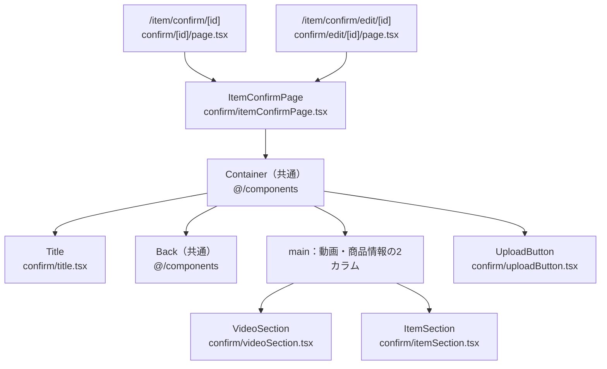
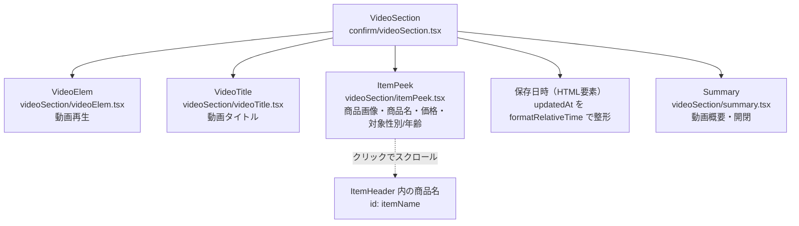
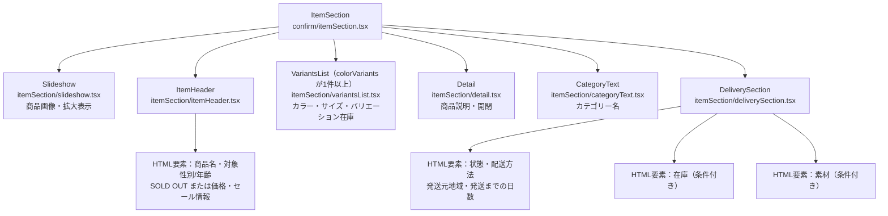
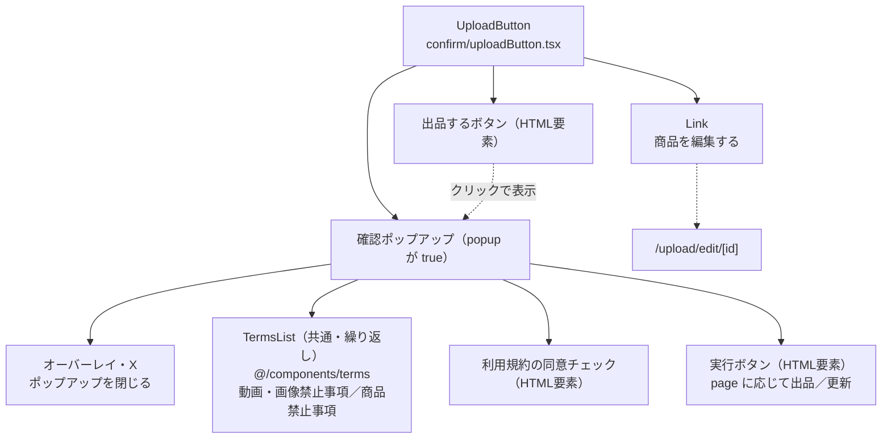

# /item/confirmページ

## 概要

商品アップロード時の入力内容確認ページ。

### /item/confirm/[id]

新規出品する商品の入力内容を確認する。

### /item/confirm/edit/[id]

出品中商品の更新する商品情報を確認する。

## 各コンポーネント役割

### コンポーネント構成図

図中のパスは `client/src/app/item/` を基準とする。実線はコンポーネントの包含関係、点線は操作による参照先を示す。HTML要素は構造の説明に必要なものだけ記載する。

#### ページ全体

両ルートはセッション・所有者を確認し、`confirm/api/server.ts` の `fetchItemConfirmPage` で取得した `itemEditing` と `id`、`page` を渡す。現行コードでは両ルートとも `page="normal"` を指定している。`ItemConfirmPage` は `attributes.inventory?.current === 0` で `soldout` を算出し、両セクションへ渡す。

#### 動画セクション

子コンポーネントはすべて `/item/videoSection` の共有部品を使用する。`VideoElem` は `normalPage={false}`、`Summary` は `page="confirm"`・`itemId: null` で表示する。

#### 商品セクション

子コンポーネントはすべて `/item/itemSection` の共有部品を使用する。`ItemHeader` と `Detail` は `page="confirm"` で表示し、`Detail` の `itemId` は `null`。商品名・価格は `ItemHeader` 内で描画し、`ItemName`・`Price` は呼び出さない。レコメンドマークは確認画面では表示しない。在庫欄は初期在庫が2以上、素材欄は素材が存在し割合の合計が100の場合に表示する。

#### 出品・更新操作

実行ボタンは同意を確認し、`confirm/api/client.ts` の `fetchCreateItem`（`page="normal"`）または `fetchEditItem`（`page="edit"`）を呼ぶ。成功時はそれぞれ `/upload/ok/[itemId]`、`/item/[itemId]` へ遷移する。

### Title

ページタイトル。

### ItemConfirmPage

ページの大枠。画面に表示する内容の全体像。

### VideoSection

動画と動画に関連する情報。

- 動画
- 動画概要
- 商品情報欄へスクロール（itemPeek）
- 保存日時
- 動画タイトル

### ItemSection

商品と配送に関連する情報。

- 商品画像
- 商品名
- （レコメンドマーク）
- （SOLD OUT）
- 価格
- （セール情報）
- 対象性別・年齢
- （カラー・サイズ等）
- 商品説明
- カテゴリー
- 配送情報
    - 状態
    - 配送方法
    - 発送元地域
    - 発送までの日数
    - （在庫）
    - （素材）
