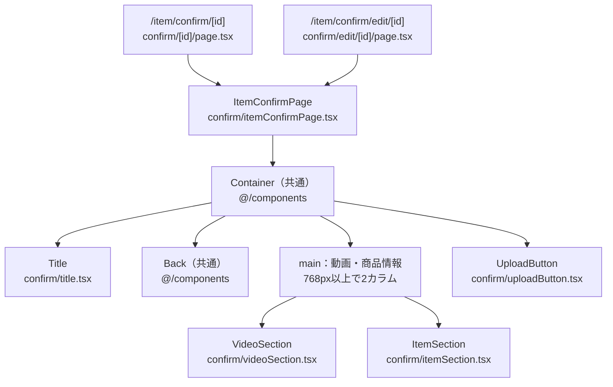
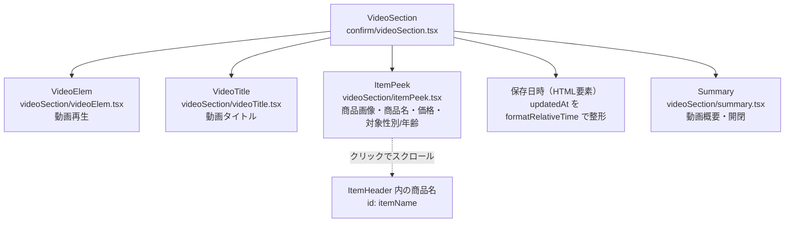
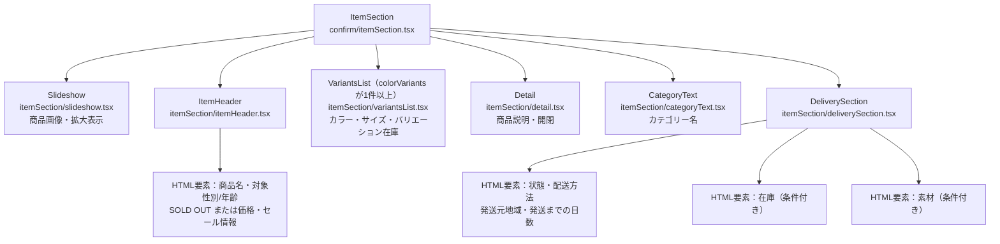
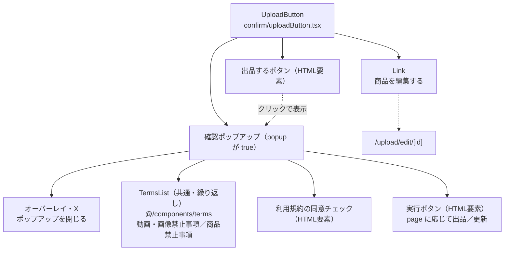

# /item/confirmページ

## 概要

商品編集データ（`ItemEditing`）を使い、新規出品または商品情報の更新前に入力内容を確認するページ。

この文書では `confirm` 配下のページ・専用コンポーネント・API・CSSを説明する。共有コンポーネントは構成図の参照先として示し、詳細は各配置先のAGENTS.mdで扱う。

### /item/confirm/[id]

新規出品する商品の入力内容を確認する。

### /item/confirm/edit/[id]

既存商品の更新内容を確認するためのルート。

`ItemConfirmPage` に `page="edit"` を渡し、更新用のタイトルと商品更新処理を使用する。

---

## 各コンポーネント役割

### コンポーネント構成図

図中のパスは `client/src/app/item/` を基準とする。実線はコンポーネントの包含関係、点線は操作による参照先を示す。HTML要素は構造の説明に必要なものだけ記載する。

#### ページ全体



両ルートはセッション・所有者を確認し、`confirm/api/server.ts` の `fetchItemConfirmPage` で取得した `itemEditing` と `id`、`page` を渡す。新規出品ルートは `page="normal"`、更新ルートは `page="edit"` を指定する。`ItemConfirmPage` は `attributes.inventory?.current === 0` で `soldout` を算出し、両セクションへ渡す。

#### 動画セクション



子コンポーネントはすべて `/item/videoSection` の共有部品を使用する。`VideoElem` の `normalPage` は省略し、`Summary` は `itemId: null` を渡して `normalPage` を省略する。再生数・閲覧加点APIは呼ばない。

#### 商品セクション



子コンポーネントはすべて `/item/itemSection` の共有部品を使用する。`ItemHeader` は `page="confirm"` で表示し、`Detail` は `itemId: null` を渡して `normalPage` を省略するため、閲覧加点APIを呼ばない。商品名・価格の表示は `ItemHeader` に委ねる。確認画面ではレコメンドマークを表示しない。共有部品内の表示条件の詳細は、配置先の文書で扱う。

#### 出品・更新操作



実行ボタンは同意を確認し、`confirm/api/client.ts` の `fetchCreateItem`（`page="normal"`）または `fetchEditItem`（`page="edit"`）を呼ぶ。成功時はそれぞれ `/upload/ok/[itemId]`、`/item/[itemId]` へ遷移する。

### Title

`confirm/title.tsx`。`page` に応じて確認画面のタイトルを表示する。

| page     | 表示文言               |
| -------- | ---------------------- |
| `normal` | 出品する商品の確認     |
| `edit`   | 更新する商品情報の確認 |

### ItemConfirmPage

`confirm/itemConfirmPage.tsx`。`id`（商品編集ID）、`itemEditing`（表示データ）、`page`（`normal` / `edit`）を受け取り、ページ全体を組み立てる。

- `Container` 内にタイトル、戻る操作、動画・商品情報の `main`、出品操作を順に配置する。
- `attributes.inventory?.current === 0` を `soldout` として両セクションに渡す。
- `id` と `page` を `UploadButton` に渡す。表示データの取得は各ルートで行う。

### VideoSection

`confirm/videoSection.tsx`。`itemEditing` と `soldout` を受け取り、動画側の共有部品へ必要なデータを渡す。

- 動画URL・サムネイル、動画タイトル、商品概要、保存日時、動画概要を表示順に配置する。
- 保存日時には `updatedAt` を使い、`formatRelativeTime` で整形する。
- `summary` が `null` の場合は空文字を渡す。
- 動画の `normalPage` は省略し、概要には `itemId: null` と `soldout` を渡す。概要の `normalPage` も省略する。

### ItemSection

`confirm/itemSection.tsx`。`itemEditing` と `soldout` を受け取り、商品側の共有部品へ必要なデータを渡す。

- 商品画像、商品ヘッダー、バリエーション、商品説明、カテゴリー、配送情報を順に配置する。
- `attributes.colorVariants` が1件以上ある場合だけ `VariantsList` を配置する。
- 商品ヘッダーに `page="confirm"` を指定し、割引率・割引額が `null` の場合は `0` を渡す。
- 商品説明に `itemId: null` と `soldout` を渡し、`normalPage` は省略する。説明やカテゴリー名がない場合は空文字、配送関連の選択肢名がない場合は `"-"` を渡す。

### UploadButton・出品確認ポップアップ

`confirm/uploadButton.tsx`。`id` と `page` を受け取るClient Component。ポップアップは独立したコンポーネントではなく、このファイル内で描画する。

- 「出品する」ボタンで `popup` を `true` にし、確認ポップアップを表示する。
- 「商品を編集する」リンクは `/upload/edit/${id}` へ遷移する。
- ポップアップに動画・画像禁止事項、商品禁止事項、利用規約への同意チェック、実行ボタンを配置する。
- native `dialog.showModal()` のtop layerで背景操作を抑止する。名前付きの閉じるボタン・Escape・背景クリックで閉じ、開いたボタンへfocusを戻す。同意状態 `check` は閉じる際にリセットしない。
- 開く時は閉じるボタンへfocusを移し、Tab/Shift+Tabはdialog内を循環する。背景スクロールも開いている間は停止し、閉じる際に元へ戻す。
- 未同意で実行した場合はアラートを表示し、APIを呼ばない。同意済みの場合は `page` に応じて出品・更新処理を呼ぶ。
- 送信開始から成功後の1.5秒待機・遷移要求まで同期ガードを維持し、実行ボタン・同意変更・編集リンクを無効にする。確認の閉じる・再表示は可能だが送信状態は維持する。
- 成功時はトーストを表示し、1.5秒待って完了先へ一度だけ遷移する。`ApiError` はエラートースト、それ以外の例外はアラートで通知し、失敗時のみ送信・編集を復旧する。
- unmount後に応答・待機が完了しても通知・遷移・state更新を行わない。サーバー処理の取消や永続化の重複防止はフロントのガードで保証しない。

現行のボタン・ポップアップの文言は `page` にかかわらず「出品する」。API処理と成功時の通知・遷移先には出品用と更新用の分岐がある。

---

## API

APIパスは共通fetch関数へ渡す相対パスを記載する。URLの `id` は商品編集IDであり、作成・更新APIが返す `itemId` とは区別する。

### SSR 商品編集データ取得

`confirm/api/server.ts` の `fetchItemConfirmPage(itemEditingId)` を両ルートのServer Componentから呼ぶ。

| 項目           | 内容                                         |
| -------------- | -------------------------------------------- |
| 共通関数       | `apiFetchServer`（`@/lib/api/server`）       |
| メソッド・パス | `GET /item-editing/${itemEditingId}/confirm` |
| キャッシュ     | `cache: "no-store"`                          |
| 戻り値の型     | `{ itemEditing: ItemEditing }`               |

ルートでは未ログインなら `/login` へ遷移する。取得後、セッションのユーザーIDと `itemEditing.seller_id` を文字列化・前後の空白除去後に照合し、不一致なら `/` へ遷移する。一致した場合だけ `ItemConfirmPage` を表示する。

共通fetch関数は認証付きで取得し、401ではログイン画面へ、404ではNot Foundへ、それ以外のHTTPエラーでは例外を送出する。

### SSR メタデータ取得

両ルートの `generateMetadata` はセッションを確認し、未ログインなら `/login` へ遷移する。その後、`confirm/api/server.ts` の `fetchItemConfirmPageMetadata(id)` を呼ぶ。

| 項目           | 内容                                                    |
| -------------- | ------------------------------------------------------- |
| 共通関数       | `apiFetchServer`                                        |
| メソッド・パス | `GET /item-editing/${itemEditingId}/metadata`           |
| キャッシュ     | `cache: "no-store"`                                     |
| 戻り値の型     | `{ itemEditing: { id: number; name: string \| null } }` |

商品編集IDで取得する所有者限定のAPIを使用する。名前が空文字またはnullなら「商品名未入力」を使う。本文用の取得とは別に呼び出し、メタデータ処理内ではseller_idの照合を行わない。

- 新規出品：タイトルは `${name} | 出品する商品の確認`、説明は `「${name}」のアップロード確認`。
- 更新：タイトルは `${name} | 更新する商品の確認`、説明は `「${name}」の更新内容確認`。
- 両ルートとも `robots` は `index: false`・`follow: false`。共通fetchの認証・HTTPエラー処理は本文取得と同じ。

### CSR 商品作成・更新API

`confirm/api/client.ts` の関数を `UploadButton` から呼ぶ。共通関数は認証付きの `apiFetch`（`@/lib/api/client`）を使う。

| 関数                             | 分岐            | メソッド・パス | 成功後の遷移先         |
| -------------------------------- | --------------- | -------------- | ---------------------- |
| `fetchCreateItem(itemEditingId)` | `page="normal"` | `POST /items`  | `/upload/ok/${itemId}` |
| `fetchEditItem(itemEditingId)`   | `page="edit"`   | `PUT /items`   | `/item/${itemId}`      |

どちらもリクエスト本文は `JSON.stringify({ itemEditingId: Number(itemEditingId) })`、戻り値の型は `{ itemId: number }`。API呼び出し用のIDは、受け取った文字列を数値へ変換する。

### 表示データの型

`confirm/types.ts` に `ItemEditing` と関連する選択肢・カテゴリー等の型を定義する。商品・動画・セール情報は `ItemEditing` の各フィールド、バリエーションや在庫等は共通の `ItemAttributes` 型を使用する。画面用の `page` はルートから渡し、`itemEditing.status` からは算出しない。

---

## デザイン・CSS

### confirmページ専用CSS

`confirm/confirm.module.css` を `Title`・`VideoSection`・`UploadButton` で使用する。

| 対象                           | 主なクラス                                                                  |
| ------------------------------ | --------------------------------------------------------------------------- |
| ページタイトル                 | `title`                                                                     |
| 保存日時                       | `dateFlex`、`countText`、`countNumber`                                      |
| 出品ボタン・編集リンク         | `uploadButton`、`editButton`                                                |
| ポップアップ・背景・閉じる操作 | `popup`（`::backdrop`を含む）、`x`、`popupTitle`                            |
| 禁止事項・同意欄・実行ボタン   | `termsTitle`、`termsDiv`、`checkLabel`、`check`、`checkText`、`popupButton` |

禁止事項の各領域は高さ150pxで縦スクロールする。背景はnative dialogの `::backdrop`、ポップアップはtop layer上のfixed要素として表示する。小さい画面では高さを制限して内容をスクロール可能にする。

`confirm` 直下のファイルからのインポート例：

```ts
import styles from "./confirm.module.css";
```

### itemページ共通CSSの利用

`item/itemCommon.module.css` を `ItemConfirmPage`・`VideoSection`・`ItemSection` から参照する。`main2column` は画面幅768px以上で動画側と商品側を6:4の比率で横並びにし、それ未満では通常の縦並びとなる。

`confirm` 直下のファイルからのインポート例：

```ts
import CStyles from "../itemCommon.module.css";
```

共有コンポーネント内部のスタイルは各配置先で管理する。
