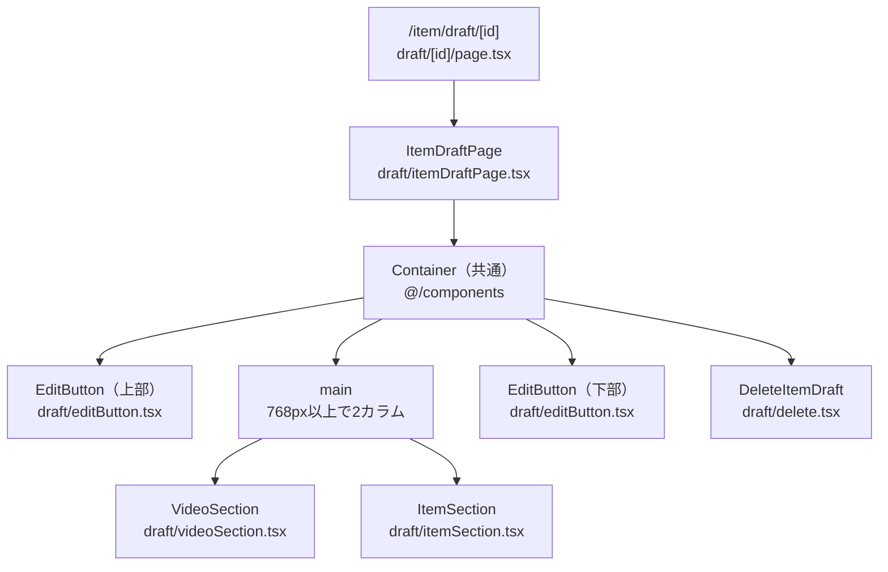
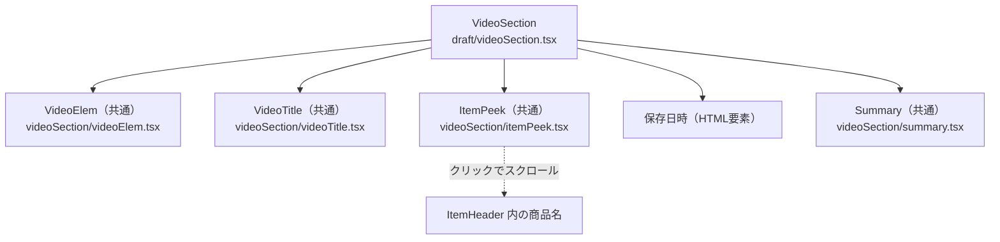
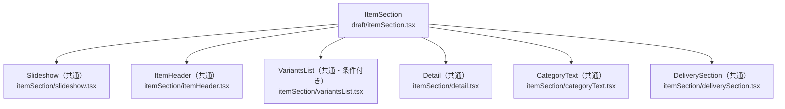
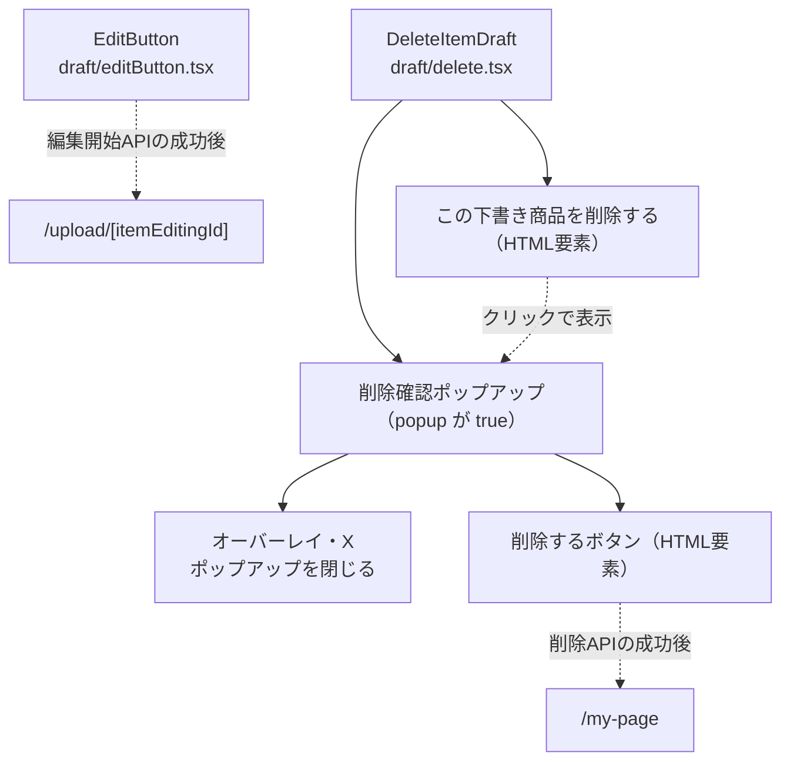

# /item/draftページ

## 概要

下書き商品データ（`ItemDraft`）を使い、保存した商品の内容を確認し、編集の再開や下書きの削除を行うページ。

対象ルートは `/item/draft/[id]` の1つ。`id` は下書きID（`itemDraftId`）であり、編集開始APIが返す商品編集ID（`itemEditingId`）とは区別する。

この文書では `draft` 配下のページ・専用コンポーネント・API・CSSを説明する。共有コンポーネントは構成図の参照先として示し、詳細は各配置先のAGENTS.mdで扱う。

### 実装範囲

認証・所有者照合・データ取得、動画・商品情報の表示、編集開始・下書き削除を画面側に実装している。`../confirm/AGENTS.md` と確認画面の構成を参考に、下書き用の専用セクションから共有部品へ表示データを渡す。

サーバー側の `GET /item-draft/:id` は現行ルートに未実装。以下はこのAPIが `{ itemDraft: ItemDraft }` を返す前提の画面構成であり、実APIとの接続確認は残件。API不足は `docs/todo/P1-bug/implement-item-draft-detail-api.md` に記録する。

---

## 各コンポーネントの役割

### コンポーネント構成図

図中のパスは `client/src/app/item/` を基準とする。実線は包含関係、点線は操作先を示す。

#### ページ全体



ルートはセッションを確認し、`draft/api/server.ts` の `fetchItemDraftPage` で取得した下書きの所有者を照合する。表示時は `ItemDraftPage` に `id` と `itemDraft` を渡す。ページ用の `page` 引数は存在しない。

#### 動画セクション



`confirm/videoSection.tsx` を参考に、共有部品へ下書きの動画・商品情報を渡す。動画と概要には `normalPage={false}`、概要には `itemId: null` を指定する。共有部品自体の詳細は記載対象外。

#### 商品セクション



`confirm/itemSection.tsx` を参考に、共有部品へ下書きの商品・配送情報を渡す。商品ヘッダーには `page="draft"`、商品説明には `normalPage={false}` と `itemId: null` を指定する。現在の `Summary`・`Detail` は `page` ではなく `normalPage` を受け取る。

#### 編集・削除操作



### ItemDraftPage

`draft/itemDraftPage.tsx`。`id`（下書きID）と `itemDraft`（表示データ）を受け取り、ページ全体を組み立てる。

- `Container` 内に上部編集ボタン、`main`、下部編集ボタン、削除操作を順に配置する。
- `attributes.inventory?.current === 0` を `soldout` として算出し、両セクションへ渡す。
- `main` に `VideoSection` と `ItemSection` を配置し、`itemDraft` と `soldout` を渡す。編集・削除操作には下書きIDを渡す。

### VideoSection

`draft/videoSection.tsx`。`itemDraft` と `soldout` を受け取り、動画側の共有部品へ必要なデータを渡す。

- 動画URL・サムネイル、動画タイトル、商品概要、保存日時、動画概要を確認画面と同じ順序で配置する。
- 保存日時は `updatedAt` を `formatRelativeTime` で整形する。
- `summary` が `null` の場合は空文字、未入力の商品名・タイトルには「商品名未入力」「タイトル未入力」を渡す。
- サムネイルがない場合は `/no-image(16x9).png`、商品概要の画像には先頭画像URL・画像一覧の最初の有効なURL・`/no-image(1x1).png` の順で補完する。
- 元動画URLが `null` の場合は空文字を渡す。再生可能なURLがない場合の表示は `VideoElem` に委ねる。
- 動画の再生・概要の展開は下書き表示として扱うため、`normalPage={false}` と概要の `itemId: null` を明示し、再生・展開時の集計APIを呼ばない。

### ItemSection

`draft/itemSection.tsx`。`itemDraft` と `soldout` を受け取り、商品側の共有部品へ必要なデータを渡す。

- 商品画像、商品ヘッダー、バリエーション、商品説明、カテゴリー、配送情報を確認画面と同じ順序で配置する。
- `attributes.colorVariants` が1件以上ある場合だけ `VariantsList` を配置する。
- 説明やカテゴリー名がない場合は空文字、配送関連の選択肢名がない場合は `"-"`、割引率・割引額が `null` の場合は `0` を渡す。
- 未入力価格は表示用に `price ?? "-"` へ整形し、商品ヘッダーと動画側の商品概要で統一する。価格 `0` と未入力を混同しない。
- `ItemDraft.price` は `number | null`。表示先の共有部品が円記号を付けるため、未入力時は `￥-` と表示する。
- 未入力の商品名は「商品名未入力」、画像一覧が空または `null` の場合は `/no-image(1x1).png` を渡す。バリエーション画像も未入力なら同じ画像で補完する。元の下書きデータは変更しない。
- レコメンドの `null` は `false`、セール前価格の `null` は `0` へ補完する。配送方法は自由記述・選択肢名・`"-"` の順で表示する。

### EditButton

`draft/editButton.tsx`。下書きIDを受け取り、編集開始APIを呼ぶClient Component。

- 「編集する」ボタンをページの上下に配置する。
- `loading` が `true` の場合は再実行を止め、ボタンを無効化する。状態は各ボタンのインスタンスごとに管理する。
- 成功時はレスポンスの `itemEditingId` を使って `/upload/${itemEditingId}` へ遷移する。
- 失敗時はエラートーストを表示し、`loading` を解除して再操作できるようにする。

### DeleteItemDraft・削除確認ポップアップ

`draft/delete.tsx`。下書きIDを受け取るClient Component。ポップアップはこのファイル内で描画する。

- 「この下書き商品を削除する」のクリックで `popup` を `true` にし、削除確認を表示する。
- オーバーレイまたは閉じるアイコンで確認を閉じる。「削除する」ボタンで削除APIを呼ぶ。
- 成功時はトーストを表示して確認を閉じ、1.5秒待って `/my-page` へ遷移する。
- `ApiError` はエラートースト、それ以外の例外はアラートで通知し、いずれも確認を閉じる。

---

## API

APIパスは共通fetch関数へ渡す相対パスを記載する。下書きIDは表示取得・編集開始・削除の入力に使い、商品編集IDは編集開始後の遷移に使う。

### SSR 下書きデータ取得

`draft/api/server.ts` の `fetchItemDraftPage(itemDraftId)` をルートのServer Componentから呼ぶ。

| 項目           | 内容                                   |
| -------------- | -------------------------------------- |
| 共通関数       | `apiFetchServer`（`@/lib/api/server`） |
| メソッド・パス | `GET /item-draft/${itemDraftId}`       |
| キャッシュ     | `cache: "no-store"`                    |
| 戻り値の型     | `{ itemDraft: ItemDraft }`             |

未ログインなら `/login` へ遷移する。取得後、セッションのユーザーIDと `itemDraft.seller_id` を文字列化・前後の空白除去後に照合し、不一致なら `/` へ遷移する。一致した場合だけ `ItemDraftPage` を表示する。

`generateMetadata` とページ本体は、同ファイル内のReact `cache` でまとめた `getItemDraft(id)` を利用する。どちらも同じ認証・所有者照合を経て下書きデータを参照し、商品ID用のメタデータAPIは呼ばない。タイトル・説明には下書きの商品名（未入力なら「商品名未入力」）を使い、`robots` は `index: false`・`follow: false` とする。

### CSR 編集開始・下書き削除API

`draft/api/client.ts` の各関数を、対応する操作コンポーネントから呼ぶ。共通関数は認証付きの `apiFetch`（`@/lib/api/client`）を使う。

| 関数                              | 呼び出し元        | メソッド・パス             | 本文・戻り値                                                                                   |
| --------------------------------- | ----------------- | -------------------------- | ---------------------------------------------------------------------------------------------- |
| `fetchEditDraftItem(itemDraftId)` | `EditButton`      | `POST /item-editing/draft` | 本文：`{ itemDraftId: Number(itemDraftId) }` をJSON化。戻り値の型：`{ itemEditingId: number }` |
| `fetchDeleteDraftItem(id)`        | `DeleteItemDraft` | `DELETE /item-draft/${id}` | 本文なし。呼び出し元ではレスポンス値を使用しない                                               |

削除関数の現行の引数名は `itemId` だが、渡している値は下書きID。下書き画面から直接商品作成・商品更新APIは呼ばない。

### 表示データの型

`draft/types.ts` に `ItemDraft` と関連する選択肢・カテゴリー等の型を定義する。商品・動画・セール情報は `ItemDraft` の各フィールド、バリエーションや在庫等は共通の `ItemAttributes` 型を使用する。

`page` は `ItemDraftPage` の引数には存在しない。商品ヘッダーへは専用セクションから `page="draft"` を渡す。`VideoElem`・`Summary`・`Detail` には `normalPage={false}` を指定する。

下書きModelに合わせて商品名・価格・画像・動画・セール前価格等に `null` を許容し、表示時に補完する。日時はJSONレスポンスの文字列、動画の長さは `number | null` として扱う。関連する選択肢等は取得API側で表示用に返す必要がある。

---

## デザイン・CSS

### draftページ専用CSS

`draft/draft.module.css` を `VideoSection`・`EditButton`・`DeleteItemDraft` から使用する。

| 対象                       | 主なクラス                             | 使用状況 |
| -------------------------- | -------------------------------------- | -------- |
| 編集ボタン                 | `editButton`                           | 使用中   |
| 削除操作                   | `deleteText`                           | 使用中   |
| 削除確認・背景・閉じる操作 | `popup`、`overlay`、`x`、`popupTitle`  | 使用中   |
| 確認文・削除実行ボタン     | `text13`、`popupButton`                | 使用中   |
| 保存日時                   | `dateFlex`、`countText`、`countNumber` | 使用中   |

背景と確認ポップアップは `position: fixed` で重ねて表示する。`draft` 直下のファイルからのインポート例：

```ts
import styles from "./draft.module.css";
```

### itemページ共通CSSの利用

`ItemDraftPage` は `item/itemCommon.module.css` の `main2column` を使用する。画面幅768px以上で最初と最後の子要素を6:4の比率で横並びにし、それ未満では通常の縦並びとなる。`main` 内の動画・商品セクションにこのレイアウトを適用する。

`draft` 直下のファイルからのインポート例：

```ts
import CStyles from "../itemCommon.module.css";
```

`VideoSection`・`ItemSection` からも共通CSSを参照する。共有コンポーネント内部のスタイルは各配置先で管理する。
