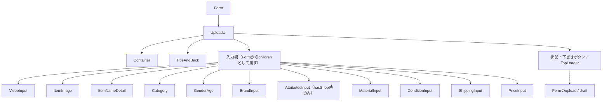
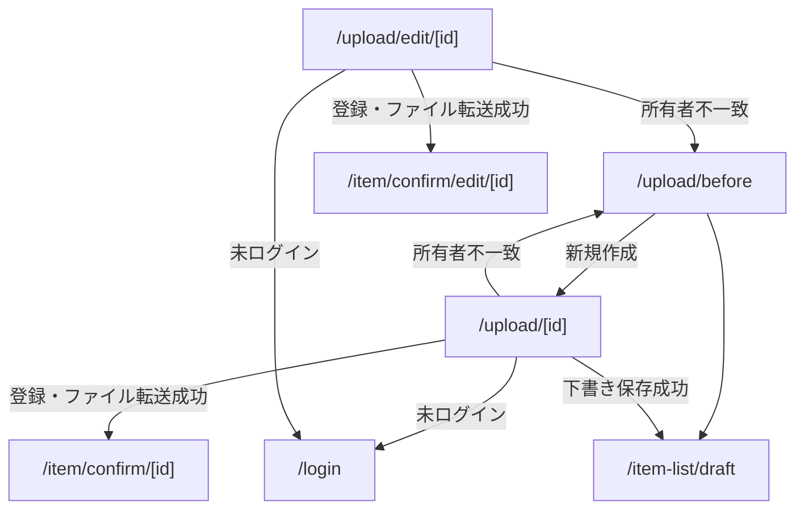

# /uploadページ

## 概要

商品の出品および編集（アップロード）を行うページ。

- 出品ページ: /upload/[id]
- 編集ページ: /upload/edit/[id]

を中心に、

- 出品前リンクページ: /upload/before
- 出品内容確認ページ: /item/confirm/[id]
- 編集内容確認ページ: /item/confirm/edit/[id]
- 出品完了ページ: /upload/ok/[id]

も関係する。

---

## 各コンポーネントの役割

### コンポーネント構成図

実線は包含関係、点線は操作先を示す。ここでは `/upload/[id]` ・ `/upload/edit/[id]` に限定し、`/upload/form.tsx` を基準に構成図を記載する。

#### ページ全体

- `Form` は取得済みの編集データから入力状態を初期化する共通Client Component。`page="normal"` / `"edit"` で確認先と下書きボタンの表示を切り替える。
- `useUpload` は出品・下書きの検証とリクエストbody生成、`useFileUpload` は署名付きURLへの転送と動画変換要求を担当する。
- 出品時は動画・サムネイル・動画タイトル・商品画像・商品名・カテゴリー・着用対象・在庫・状態・配送情報・価格が必須。価格は300〜1,000,000円、商品画像は最大10枚。具体的な検証条件は `hooks/useUpload.ts` を参照する。
- 下書きは必須項目の検証を省略し、素材割合・在庫の検証を行う。編集ページには下書きボタンを表示しない。
- 検証・通信・転送失敗はトースト等で通知し、その時点で処理を中断する。確認ページへの遷移は全転送成功後に行う。

### ページ遷移図

---

## API

### SSR

- 両ページはセッションを確認し、未ログインなら `/login`、取得データの `seller_id` とユーザーIDが不一致なら `/upload/before` へリダイレクトする。
- `api/server.ts` の `fetchUploadPage` → `GET /item-editing/:id/form`（`cache: "no-store"`）で編集データ・カテゴリー・状態・配送候補・`hasShop` を取得する。`:id` は商品IDではなく編集データID。

### CSR

APIパスはバックエンドのベースURLからの相対パス。

| 操作                            | メソッド・パス                     | 呼び出し元                                 |
| ------------------------------- | ---------------------------------- | ------------------------------------------ |
| 編集データ保存・署名付きURL取得 | `PUT /item-editing/:id`            | `api/item.ts`                              |
| 下書き保存・署名付きURL取得     | `POST /item-draft`                 | `api/item.ts`（bodyにitemEditingIdを追加） |
| 動画変換要求                    | `PATCH /item-editing/:id/convert`  | `api/video.ts`                             |
| 下書き動画変換要求              | `PATCH /item-draft/:id/convert`    | `api/video.ts`                             |
| 子カテゴリー取得                | `GET /categories/:parentId/level2` | `category.tsx`                             |
| ブランド候補検索                | `GET /brands/suggest?keyword=...`  | `brandInput.tsx`                           |

- 保存・変換は共通の `apiFetch` を使用する。取得した署名情報で動画はS3へPOST、サムネイル・商品画像・属性画像はPUTする。新規動画の転送後に変換APIを呼ぶ。
- 関連する `/upload/before` では `POST /item-editing` で編集データを作成して出品ページへ進む。

---

## デザイン・CSS

- 共通の入力欄・ボタン・見出しは `upload.module.css`、素材入力は `material.module.css`、属性カードは `attributesCard.module.css` を使用する。
- `UploadUI` が共通の `Container` と `TitleAndBack` を配置し、`layout.tsx` の `ToastBoundary` が通知を提供する。
- 色は既存のCSS変数、余白や画面幅への対応は既存CSS Modulesに合わせる。
