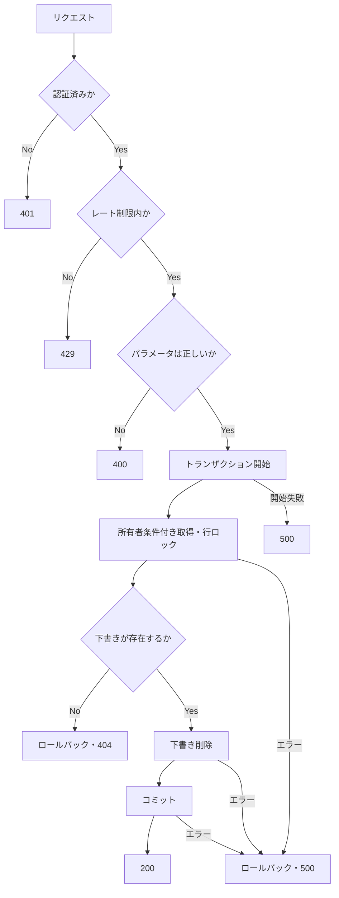

# deleteItemDraft 詳細設計

基本設計: [商品アップロードAPI設計](../../itemUpload.md)

## 1. 概要

認証済みユーザーが所有するItemDraftを物理削除する。

DB処理に失敗した場合はロールバックし、元の下書きを保持する（再作成による復元は行わない）。

## 2. API仕様

- Method: DELETE
- Endpoint: /item-draft/:id
- 認証: 必須
- 認可: ItemDraft所有者のみ（item_draft.seller_idが認証済みuserIdと一致すること）
- Content-Type: application/json（レスポンス。リクエストbodyは不要）
- レート制限: 認証ユーザー単位で5分間に20回

### 分類名称

- 大分類：itemDraft
- 小分類：deleteItemDraft

### ファイル・関数名

以下は `/server/src` 基準。新規・変更予定の箇所を併記する。

- route: /routes/itemDraft.ts（DELETE追加）
- rateLimit: /middleware/rateLimit/itemDraftRateLimit.ts
    - deleteItemDraftRateLimit（新規）
- 認証: /middleware/authMiddleware.ts
    - authenticateToken（既存）
- paramバリデーション: /validators/params/id.ts
    - idParamSchema（既存。上限2147483647を追加予定）
    - wrapper: /middleware/validate/validateParams.ts
        - validateParams（既存）
- controller: /controllers/itemDraft/itemDraft.ts
    - deleteItemDraftController（新規）
- usecase: /usecases/itemDraft/deleteItemDraft.ts
    - deleteItemDraftUseCase（新規）
- service:
    - itemDraft取得: /services/itemDraft/query.ts
        - getMyItemDraft（既存）
        - serviceType: /types/serviceType/itemDraft.ts の ItemDraftUserIdParams
    - item_draft削除: /services/itemDraft/command.ts
        - deleteItemDraft（既存）
        - serviceType: /types/serviceType/itemDraft.ts の ItemDraftTransactionParams

### リクエスト

`DELETE /item-draft/123`（bodyなし）

### バリデーション

- `validateParams(idParamSchema)` で `params.id` を検証し、数値化した値をitemDraftIdとして使用する。
- id: 1〜2147483647の整数、必須（DBのINTEGER範囲）。不正な値は400を返す。
- 既存のidParamSchemaに上限検証を追加する。実装時は、この共通スキーマを利用する既存APIへの影響も確認する。

### レスポンス

成功時: 200 OK（削除完了後に返す）

```json
{
    "message": "下書き商品を削除しました"
}
```

### 三行コメント

```ts
// DELETE /item-draft/:id
// summary: 下書き商品削除
// page: /item/draft/[id]
```

## 3. 認証・認可

`authenticateToken` の認証済みuserIdと、URLのitemDraftIdで所有者の下書きを検索する。未認証は401、存在しない場合・他人の下書きの場合はともに404を返す。

### getMyItemDraft 認可

```ts
where: {
    id: itemDraftId,
    seller_id: userId,
}
```

## 4. 処理フロー

1. 認証を確認する（未認証は401）。
2. レート制限を確認する（超過は429。不正なパラメータも回数に含む）。
3. params.idを検証し、itemDraftIdと認証済みuserIdをusecaseに渡す（不正は400）。
4. トランザクションを開始し、getMyItemDraftで所有者条件付き・更新用行ロック付きで取得する。
5. 見つからなければ404。見つかればdeleteItemDraftで削除する。
6. コミット後に200を返す。途中のエラーはロールバックして共通エラーハンドラーへ渡す。

### 処理フロー図



## 5. DB操作仕様

### 参照テーブル

- item_draft
    - `id = itemDraftId AND seller_id = userId` で取得する。

### 削除テーブル

- item_draft
    - 取得した1件を `itemDraft.destroy({ transaction })` で物理削除する。
    - ItemDraftにはstatus・論理削除の条件はない。参照先のitem・マスター、他の下書き、item_editing、S3上のファイルは削除しない。

## 6. トランザクション設計

- 既存getMyItemDraftの行ロックを利用するため、取得と削除に同一transactionを渡す。成功時のみコミットし、失敗時はロールバックして下書きを保持する。
- ロックは終了まで保持する。同時削除・編集開始と競合した場合、先行処理のコミット後に下書きがなければ404、ロールバックで残っていれば通常どおり削除する。

## 7. エラー設計

| 発生条件                         | HTTP | エラーコード                         |
| -------------------------------- | ---- | ------------------------------------ |
| 未認証                           | 401  | 認証middlewareの既存規約に従う       |
| レート制限超過                   | 429  | レート制限middlewareの既存規約に従う |
| 不正なparams.id                  | 400  | INVALID_PARAMS                       |
| 下書きが存在しない・所有者でない | 404  | ITEM_DRAFT_NOT_FOUND                 |
| DB処理失敗                       | 500  | INTERNAL_SERVER_ERROR                |

存在確認はusecaseで `AppError` に変換し、DB例外は共通エラーハンドラーへ伝播させる。

## 8. テスト設計

### 正常系

- 所有者が削除でき、200とメッセージが返り、対象の下書きだけが消える。

### 異常系

- 未認証は401、不正なIDは400、他人・存在しないIDは404、レート制限超過は429。認証・レート制限・入力の拒否時はDBへアクセスせず、認可拒否時は削除しない。
- 取得・削除失敗時は500。削除後からコミット前の失敗でも下書きが保持される。

### 並行処理

- 同時削除は1件だけ成功し、後続は404。編集開始との競合でも先行コミット後の不存在は404、先行ロールバック後は削除できる。

### 境界値

- IDの1・2147483647を許可し、0・負数・小数・非数値・上限超過を拒否する。
- 同一ユーザーの5分間20回までと21回目の429、期間経過後の再受付、ユーザー間の制限分離を確認する。

### 条件分岐

- 認証→レート制限→パラメータ検証→取得→削除の順序と、失敗時の後続停止を確認する。不正入力も制限回数に含む。

### 状態遷移

- 成功後の再リクエストは404。ロールバック後は再試行でき、対象外の下書き・関連データは変わらない。
- 削除確定後にレスポンスの通信だけが失敗した場合は復元しない。再リクエストは404となる。
