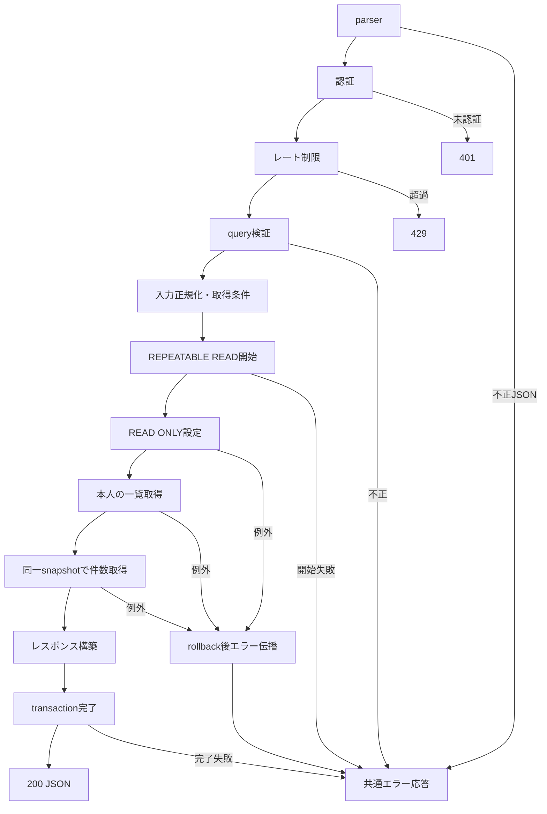

# getItemDraftList 詳細設計

基本設計: [商品リスト取得API設計](../../getItemList.md)

確認日: 2026-11-07。基本設計・現行ItemDraft Model・処理フローに合わせ、出力例と主キーの参照先の転記ミスを修正。ユーザー回答により`_`を通常の文字として扱い、検索語の文字変換は現在の`normalizeJapanese()`に従う仕様を確定。

## 1. 概要

`/item-list/draft`向けに、認証本人が所有するitem_draftの一覧を取得する。
DB変更・通知・S3操作・既存一覧APIの置換・フロント変更は行わない。
正常・失敗ともDBデータは変更しない。

## 2. API仕様

- GET `/api/item-draft/list`。routes/index.tsの`/api/item-draft`登録とRouterの`/list`を使用。
- body不要。成功レスポンスはapplication/json、200。
- authenticateToken → getItemDraftListRateLimit → validateQuery(getItemDraftListQuerySchema) → getItemDraftListController。
- params検証・下書きIDによる認可はない。
- 認証本人単位（`admin:${userId}`）で60000msに50回。専用インスタンス、standardHeaders=true、legacyHeaders=false。
- 認証後の400・500も計上。未認証は非計上。不正JSONは共通parserで先に拒否され非計上。
- 51回目から429、express-rate-limit既定本文とRateLimit/Retry-Afterヘッダー。窓終了後に再受付。

### 入力

例: `GET /api/item-draft/list?page=7&keyword=シャツ`

| query   | 契約                                                                                                        |
| ------- | ----------------------------------------------------------------------------------------------------------- |
| page    | 省略時1。単一文字列をnumberへcoerce、整数1〜10000。空文字・小数・範囲外・配列・オブジェクトは400            |
| keyword | 任意の単一文字列、文字数制限なし。前後空白を除去。省略・null・空文字・空白のみ・URLの文字列`null`は検索なし |

未知キーは除去し、`req.validatedQuery`のみをcontrollerで採用する。userId/seller*idの偽装は採用しない。
keywordはusecaseで既存の`normalizeJapanese()`を使用する（依頼中のnormalizeJapanizeに対応する現行関数名）。
NFKC・小文字化・カタカナ→ひらがな・空白除去後、nameまたはtitleのILIKE部分一致。
正規化するのは入力のみ。保存済みカラムの正規化・書換えは行わない。
検索語の文字変換は現在の`normalizeJapanese()`の仕様に従い、追加の正規表現検索・文字制限は設けない。
正規化後の`%`・`_`・バックスラッシュをILIKE用にエスケープし、通常の文字として検索する。`*`等の正規表現記号も通常の文字として検索する。nullの検索対象列は一致しない。

### 担当ファイル（server/src基準）

| ファイル                                   | 関数・型                                                             | 区分 |
| ------------------------------------------ | -------------------------------------------------------------------- | ---- |
| routes/itemDraft.ts                        | GET /list                                                            | 追加 |
| middleware/authMiddleware.ts               | authenticateToken                                                    | 既存 |
| middleware/rateLimit/itemDraftRateLimit.ts | getItemDraftListRateLimit                                            | 追加 |
| middleware/validate/validateQuery.ts       | validateQuery                                                        | 既存 |
| validators/query/itemDraft.ts              | getItemDraftListQuerySchema / GetItemDraftListQuery                  | 新規 |
| controllers/itemDraft/itemDraft.ts         | getItemDraftListController                                           | 追加 |
| usecases/itemDraft/getItemDraftList.ts     | getItemDraftListUseCase                                              | 新規 |
| services/itemDraft/query.ts                | setItemDraftListReadOnly / getMyItemDraftList / countMyItemDraftList | 追加 |
| types/serviceType/itemDraft.ts             | ItemDraftListRow / GetItemDraftListParams / CountItemDraftListParams | 追加 |

service引数はuserId・where・transaction、一覧取得のみlimit・offsetも受ける。itemDraftIdは不要。

### 出力

```json
{
    "itemDraftList": [
        {
            "itemDraft": {
                "id": 123,
                "name": "商品名",
                "price": 1000,
                "first_image_url": null,
                "title": null,
                "createdAt": "2026-11-06T00:00:00.000Z"
            }
        }
    ],
    "totalPages": 7
}
```

itemDraftの取得列は上記6項目のみ。name・price・first_image_url・titleはModelに従いnullを保持する。
createdAtはDateをJSONのISO日時へ変換する。idはitem_draftの主キー。
limit=20、offset=(page-1)\*20、totalPages=Math.ceil(totalCount/20)。
該当なしは`{"itemDraftList":[],"totalPages":0}`。範囲外ページも200・空配列、totalPagesは全一致件数から算出する。
トランザクション完了後にのみ成功応答する。

### 三行コメント

```ts
// GET /item-draft/list?page=number&keyword=""
// summary: 下書き商品リスト取得
// page: /item-list/draft
```

## 3. 認証・認可

req.user!.idを採用する。各serviceで`AND(seller_id=userId, where)`を構築し、一覧・件数双方を本人に限定する。
呼出し側のwhereでseller_idを上書きできない。他人・所有者nullの行は除外する。
一覧なので不存在・他人の行を理由に404にはしない。ItemDraftにはstatus列がないためstatus条件は設けない。

## 4. 処理フロー

1. アプリ共通parser、認証、レート制限、query検証を順に通す。
2. controllerは認証IDと検証済みpage・keywordをusecaseへ渡す。
3. usecaseで検索語、where、limit、offsetを作る。
4. REPEATABLE READ・readOnly指定のmanaged transactionを開始する。
5. serviceでSET TRANSACTION READ ONLYを実行する。
6. getMyItemDraftList完了後、同一transaction・whereでcountMyItemDraftListを実行する。
7. 行を`{ itemDraft }`で包みtotalPagesを計算する。
8. 外側transaction Promiseが完了した後、controllerが200を返す。
9. 例外はnext(error)から共通errorHandlerへ渡す。途中失敗なら後続処理・成功応答を行わない。



## 5. DB操作仕様

item_draftのみを参照。attributes=id,name,price,first_image_url,title,createdAt。
whereは所有者AND（検索時はname/titleのOR）。countは同じ条件、limit/offsetなし。
orderはcreatedAt DESC,id DESC。関連include・行ロック・更新・削除なし。
Model/既存migrationを参考とするが、DB反映状態は実DBテストのガード・スキーマ検査で確認する。migrationやsyncは行わない。

## 6. トランザクション設計

usecaseがmanaged transactionを管理する。REPEATABLE READで最初の一覧SELECT時点のsnapshotを件数SELECTでも使う。
readOnlyオプションだけに依存せず、serviceからSET TRANSACTION READ ONLYを最初に発行してDB側でも書込みを禁止する。
全serviceへ同一transactionを渡す。失敗時はmanaged rollback、読取元は不変。
開始失敗・callback障害・完了失敗はいずれも成功を返さない。通信断時のrollback成功は保証しない。
別接続の追加・削除・所有者変更をブロックしない。最初のSELECTより後のcommitは当該応答へ反映せず、次回要求で取得する。
ページ間・別要求間のsnapshot共有はしない。再送は毎回新しいsnapshotで取得する。通知等の副作用はない。

## 7. エラー設計

| 条件                              | HTTP・公開応答                                                               |
| --------------------------------- | ---------------------------------------------------------------------------- |
| bodyの不正JSON                    | 400 `{code:"INVALID_JSON",message:"JSONの形式を確認してください。"}`         |
| トークンなし                      | 401 `{message:"トークンがありません。"}`                                     |
| 無効・期限切れトークン            | 401 `{message:"トークンが無効です。"}`                                       |
| レート超過                        | 429 ライブラリ既定本文・ヘッダー                                             |
| query不正                         | AppError INVALID_QUERY/400、`{code:"INVALID_QUERY",message:"INVALID_QUERY"}` |
| DB・transaction等の予期しない例外 | 500 `{error:"INTERNAL_SERVER_ERROR",message:"サーバーエラーが発生しました"}` |

内部DB情報を公開しない。検索0件はエラーではない。

## 8. テスト設計

[テスト設計](../../../../../server/test/docs/architecture/itemDraft/getItemDraftList.md)と[結果](../../../../../server/test/docs/report/itemDraft/getItemDraftList.md)を参照。

- 正常: 入力正規化、OR検索、6列、順序、ページング、null列保持、空結果・範囲外。
- 認証・認可: 401・偽装キー除去、一覧とcount両方の本人限定、他人・所有者null除外。
- 入力境界: pageの上下限前後・小数・型違い、keyword省略・空白・null・配列、未知キー。
- 制限・優先順位: 50/51回、本人別枠、窓再開、未認証・不正JSON非計上、400/500計上。
- 失敗・待機: 各service失敗・保留、後続未実行、transaction完了待機と失敗伝播。
- 再送・並行: 実REPEATABLE READ/READ ONLY、一覧後に別接続で削除をcommitしても件数は同一snapshot、次回は最新状態。
- 更新APIではないため状態遷移・書込みrollback・S3・通知テストは対象外。
