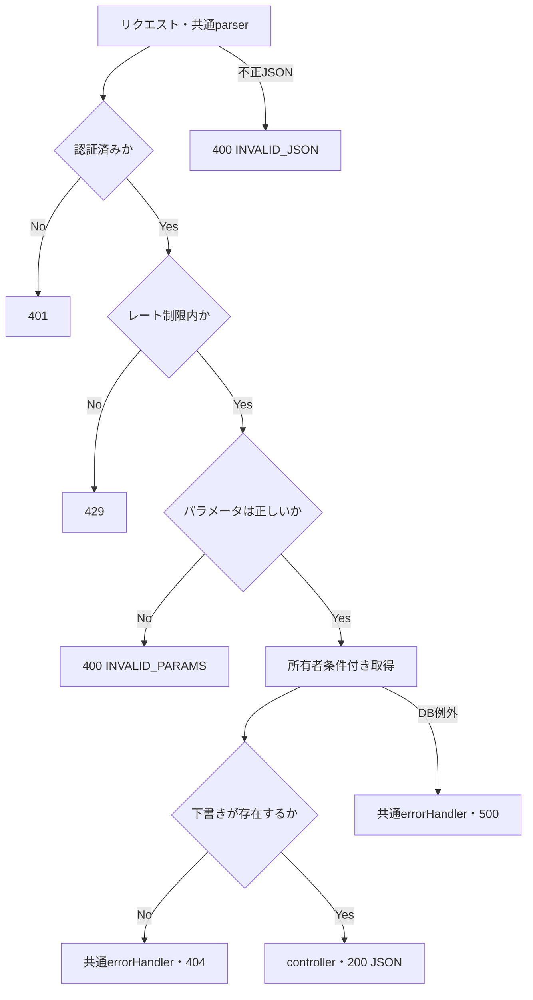

# getItemDraftPageMetadata 詳細設計

基本設計: [商品アップロードAPI設計](../../itemUpload.md)

更新日: 2026-10-30。ユーザー指定の「id/nameだけ」を契約とし、レート制限は回答により1分120回に確定。コピー元の処理名・関連取得・成果物パスを修正した。

## 1. 概要

`client/src/app/item/draft/[id]`ページで使用するメタデータをDBから取得し、フロントエンドにJSONで返す。

参照のみを行い、下書き・関連マスター・item_editing・商品・S3オブジェクトを変更しない。動画変換、編集開始、削除は対象外。

## 2. API仕様

- Method: GET
- Endpoint: /api/item-draft/:id/metadata
- Router内の相対パス: /:id/metadata（`routes/index.ts` の既存 `/api/item-draft` 登録を利用）
- 認証: 必須
- 認可: 下書き商品（ItemDraft）所有者のみ（item_draft.seller_idが認証済みuserIdと一致すること）
- Content-Type: application/json（レスポンス。リクエストbodyは不要）
- レート制限: 認証ユーザー単位で1分間に120回。超過時は429。
- 制限設定: `windowMs: 60000`、`limit: 120`、`standardHeaders: true`、`legacyHeaders: false`。既存形式の `admin:${認証済みuserId}` をキーとするAPI専用インスタンスを追加する。
- 制限計上: 認証後の400・404・500も含む。未認証は計上しない。121回目以降は429と既存ライブラリの既定本文・RateLimit/Retry-Afterヘッダーを返し、窓終了後に再受付する。GETでも不正JSONを送った場合はアプリ共通parserが先に400とし、認証・制限へ到達しない。
- 順序: authenticateToken → getItemDraftPageMetadataRateLimit → validateParams(idParamSchema) → getItemDraftPageMetadataController

### ファイル・関数名

以下のパスは `server/src` 基準。既存ファイルへ追加し、usecaseのみ新規作成する。

- route: /routes/itemDraft.ts
- rateLimit: /middleware/rateLimit/itemDraftRateLimit.ts
    - getItemDraftPageMetadataRateLimit（新規）
- 認証: /middleware/authMiddleware.ts
    - authenticateToken（既存）
- paramバリデーション: /validators/params/id.ts
    - idParamSchema（既存）
    - wrapper: /middleware/validate/validateParams.ts
        - validateParams（既存）
- controller: /controllers/itemDraft/itemDraft.ts
    - getItemDraftPageMetadataController（新規）
- usecase: /usecases/itemDraft/getItemDraftPageMetadata.ts
    - getItemDraftPageMetadataUseCase（新規）
- service:
    - itemDraft取得: /services/itemDraft/query.ts
        - getMyItemDraftPageMetadata（新規）
        - 引数型: `Pick<ItemDraftUserIdParams, "itemDraftId" | "userId">` をservice内で定義する

### リクエスト

`GET /item-draft/123/metadata`（bodyなし）

### バリデーション

- `validateParams(idParamSchema)` で `params.id` を検証し、数値化した値をitemDraftIdとして使用する。
- `z.coerce.number()` による数値化後の値を `req.validatedParams` から取得する。認証IDは `req.user!.id` のみを採用し、body/queryのuserId・seller_idは採用しない。
- id: 1〜2147483647の整数、必須（DBのINTEGER範囲）。不正な値は400を返す。先頭0・指数表記・16進数・前後空白等もcoerce後に整数範囲内なら許可する。paramsの未知キーは検証済み値から除去され、body/queryの検証・採用はしない。

### レスポンス

成功時: 200 OK

取得完了後に `{ "itemDraft": ... }` の1キーを返す。nullableな保存値は加工せず返す。

```json
{
    "itemDraft": {
        "id": 123,
        "name": null
    }
}
```

### フロントエンド接続

`client/src/app/item/draft/api/server.ts` に `fetchItemDraftPageMetadata(itemDraftId)` を追加し、認証付き `apiFetchServer` に `/item-draft/${itemDraftId}/metadata` と `cache: "no-store"` を渡す。戻り値は `{ itemDraft: { id: number; name: string | null } }`。`[id]/page.tsx` のgenerateMetadataはセッション確認後にこの関数を使う。所有者判定はAPIが行う。未入力名の補完・タイトル・説明・robotsは維持する。ページ本体は既存の詳細APIを使う。

### 三行コメント

```ts
// GET /item-draft/:id/metadata
// summary: 下書き商品ページ メタデータ取得
// page: /item/draft/[id]
```

## 3. 認証・認可

`authenticateToken` の認証済みuserIdと、URLのitemDraftIdで所有者の下書きを検索する。未認証は401、存在しない場合・他人の下書きの場合はともに404を返す。

### getMyItemDraftPageMetadata 認可

```ts
where: {
    id: itemDraftId,
    seller_id: userId,
}
```

## 4. 処理フロー

1. 認証を確認する（未認証は401）。
2. レート制限を確認する（超過は429。不正なパラメータも回数に含む）。
3. params.idを検証し、itemDraftIdと認証済みuserIdをusecaseに渡す（不正は400）。
4. serviceで下書きを所有者条件付きで取得する。
5. nullならusecaseで `new AppError("ITEM_DRAFT_NOT_FOUND", 404)` を送出する。DB例外はそのまま伝播させる。
6. 下書きがあればusecaseからcontrollerへ返し、controllerが200で `{ itemDraft }` を返す。
7. controllerは例外を `next(err)` へ渡し、共通errorHandlerが公開応答を生成する。

### 処理フロー図



## 5. DB操作仕様

### 参照テーブル

- item_draft
    - `id = itemDraftId AND seller_id = userId` で取得する。

### 取得データ・レスポンス詳細

公開項目は `id: number` と `name: string | null` のみ。nameはnull・空文字・空白を含め保存値を保持する。usecaseは取得Modelから `{ id: itemDraft.id, name: itemDraft.name }` を明示して返す。seller_idは検索条件のみに使い、関連・画像・JSONB・日時を取得／公開しない。

Modelにはstatus・論理削除列がないため条件を追加しない。既存Model・associate・migrationを確認済み。スキーマ変更・migrationは不要。実DBとの差異は専用DBテストのガード・スキーマ検査で確認し、結果をレポートへ記録する。

- getMyItemDraftPageMetadataのattributes:

```ts
attributes: [
    "id",
    "name",
];
```

## 6. トランザクション設計

- item_draftの単一行の参照であり、明示的なtransaction・行ロック・更新は行わない。更新用ロックを持つ既存 `getMyItemDraft` は利用しない。
- 繰返し取得はその時点の保存値を返す。並行する更新・削除との厳密な直列化や、取得後も行が残ることは保証しない。取得時点で存在しなければ404。
- 書込み・外部通信・通知がないため、rollback・補償・副作用の再送は該当しない。

## 7. エラー設計

| 発生条件                                  | HTTP | 公開応答                                                                          |
| ----------------------------------------- | ---- | --------------------------------------------------------------------------------- |
| bodyの不正JSON（共通parser）              | 400  | `{ "code": "INVALID_JSON", "message": "JSONの形式を確認してください。" }`         |
| Bearerトークンなし                        | 401  | `{ "message": "トークンがありません。" }`                                         |
| トークン不正・期限切れ                    | 401  | `{ "message": "トークンが無効です。" }`                                           |
| 認証後の制限超過                          | 429  | express-rate-limitの既定本文・ヘッダー                                            |
| id検証失敗                                | 400  | `{ "code": "INVALID_PARAMS", "message": "INVALID_PARAMS" }`                       |
| 下書き不存在・他人の所有・seller_idがnull | 404  | `{ "code": "ITEM_DRAFT_NOT_FOUND", "message": "ITEM_DRAFT_NOT_FOUND" }`           |
| 予期しないDB等の例外                      | 500  | `{ "error": "INTERNAL_SERVER_ERROR", "message": "サーバーエラーが発生しました" }` |

400/404は既存AppError、予期しない例外は元の例外を共通errorHandlerへ渡す。認証・制限の応答をAppError形式へ変更しない。拒否時は後続処理を実行せず、500に内部エラー内容を含めない。

## 8. テスト設計

- 正常: 所有者の取得、id/nameの取得列・nameのnull/空文字/空白/値ありの保持、対象外カラムの非公開、取得完了後の200を確認する。公開レスポンスは第2・5章に合わせる。
- 認証・認可: 未認証/不正JWTの401、他人・不存在・所有者nullの404、body/queryへの所有者偽装の無視。認証拒否時は制限・DBが未実行であることを確認する。
- 入力境界: 1/2147483647を許可し、0/負数/小数/非数値/上限超過を拒否する。数値coerceの実契約と検証済みparamsの採用を確認する。
- 制限・優先順位: 同じユーザーの120回と121回目、他ユーザーとの分離、窓終了後の再開、不正paramsと404の計上、制限超過と不正idが重なる場合の429を確認する。parser拒否は別経路として確認する。
- 失敗・待機: DB失敗の伝播と500、usecase/controllerの完了待ち、取得失敗時の成功応答未実行を確認する。
- 再送・並行: 参照に副作用がなく対象・他人の下書きとマスターが不変であること、別リクエスト間で結果が混ざらないことを確認する。書込みの状態遷移・rollback・ロック待機は本APIには該当しない。
- 検証レベル: service/usecase/controller単体、実Router・認証・schema・制限・errorHandlerのHTTP接続、実DBによる所有者絞込み・公開列限定・非対象不変を分ける。DB検証はtest_dbガードと必要スキーマ確認後に自作IDで行う。
- 次工程成果物: `server/test/docs/architecture/itemDraft/getItemDraftPageMetadata.md` と `server/test/docs/report/itemDraft/getItemDraftPageMetadata.md`。実行結果はレポートに記録する。
