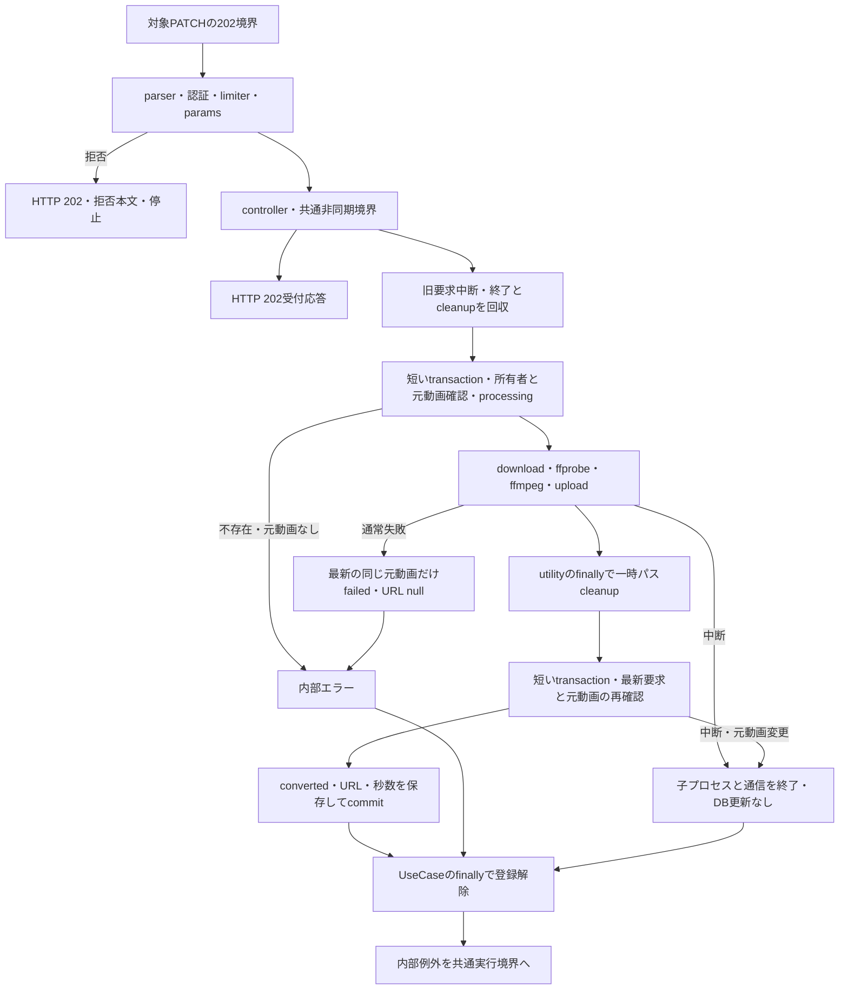

# convertItemEditingVideo 詳細設計

基本設計: [商品アップロードAPI設計](../../itemUpload.md)

更新日: 2026-10-22。ユーザー回答を優先し、旧案のdone・失敗時DB不変・処理中409を廃止。
本ファイルconvertItemEditingVideo.mdを継続使用する。旧Video APIは変更しない。
設計検証: API契約・責務・Model列・受付順・中断・保存条件を照合済み。
現在の状態: 実装・必要テスト・静的検査は完了。名称をconvertItemEditingVideoへ統一し、DB非接続263件と実DB36件が成功した。
旧中断のUser日時制約はユーザー指示の新規migrationを両DBへ適用して解消。詳細は[レポート](../../../../../server/test/docs/report/itemEditing/convertItemEditingVideo.md)を参照。

## 1. 概要

item_editing.original_urlの動画をHLSへ変換し、S3のplaylist公開URLと秒数を同じ編集行に保存する。
成功時video_statusはconverted。失敗時failed・converted_url=null・duration維持（ユーザー確認済み）。
original_urlと他の商品情報は編集しない。本APIはvideo_statusにnullを書き込まない。既存nullは受付禁止条件ではない。
処理中・変換済み・失敗済みからも再変換可能。同じ認証所有者・編集IDの新要求は旧処理を中断する。
HTTP 202は変換完了・永続ジョブ登録を保証しない。商品/Video/下書きの作成・削除、通知は対象外。

## 2. API仕様

- PATCH /api/item-editing/:id/convert。Router相対パスは/:id/convert。
- 認証必須。idは既存idParamSchemaによるcoerce後の1〜2147483647の整数。格納先req.validatedParams。
- body/queryは使用しない。bodyなしで要求Content-Typeは不要。応答はJSON。
- フロント向けHTTPはすべて202。認証・入力検証・レート制限の拒否もHTTPだけ202にし、処理自体は実行しない。
- 既存middlewareの拒否本文・必要ヘッダーと内部statusは維持する。
- 認証ユーザー単位・専用limiterで10分5回。失敗も到達分を消費。窓終了後再開。
- parser拒否と未認証はlimiterへ到達しない。params不正・業務失敗は到達分を消費する。
- controller到達時はDB・変換・commitを待たず、202と次の受付本文を返す。

```http
PATCH /api/item-editing/123/convert
Authorization: Bearer <token>
```

```json
{ "message": "変換処理を受け付けました" }
```

### 配置と責務（server/src基準）

| 層         | ファイル・関数                                                                               | 区分・責務                                                           |
| ---------- | -------------------------------------------------------------------------------------------- | -------------------------------------------------------------------- |
| 初期化     | app.ts、middleware/itemEditingVideoResponse.ts                                               | 変更/新規。対象PATCHの202境界をparserより前に接続。他APIは変更しない |
| route      | routes/itemEditing.ts                                                                        | 新規PATCH。authenticateToken→専用limiter→validateParams→controller   |
| 認証・検証 | middleware/authMiddleware.ts、middleware/validate/validateParams.ts、validators/params/id.ts | 既存利用                                                             |
| limiter    | middleware/rateLimit/itemEditingRateLimit.ts、convertItemEditingVideoRateLimit               | 新規export                                                           |
| controller | controllers/itemEditing/itemEditing.ts、convertItemEditingVideoController                    | 新規export。認証IDと検証済みidをrunDetachedTaskへ渡し202応答         |
| usecase    | usecases/itemEditing/convertItemEditingVideo.ts、convertItemEditingVideoUseCase              | 新規。要求差替え・所有者/元動画確認・transaction・状態遷移           |
| query      | services/itemEditing/query.ts、getMyItemEditing                                              | 既存。所有者条件、transaction指定時UPDATEロック                      |
| command    | services/itemEditing/command.ts、updateItemEditingVideo                                      | 新規。動画3列だけのDTOとtransactionを受けてインスタンス更新          |
| 型         | types/serviceType/itemEditing.ts                                                             | 更新DTO。video_statusはprocessing/converted/failedのみ               |
| utility    | utils/itemEditingVideoConversion.ts、convertItemEditingVideo                                 | 新規。AbortSignal対応の子プロセス・通信・cleanup                     |
| S3         | utils/s3/videoConvert.ts                                                                     | 既存download/uploadへ任意AbortSignal追加。旧呼出しの契約を維持       |
| 非同期境界 | utils/runDetachedTask.ts                                                                     | 既存利用。内部例外の捕捉・記録。HTTP再送信なし                       |

route/controller/usecaseの三行コメント:

```ts
// PATCH /item-editing/:id/convert
// summary: 編集セッション動画HLS変換
// page: /upload/[id]
```

## 3. 認証・認可

req.user.idのみを所有者に採用する。body/queryの所有者・IDは無視する。
取得・更新前再取得ともwhere: { id: itemEditingId, seller_id: userId }。
不存在・他人・所有者nullは内部ITEM_EDITING_NOT_FOUND/404で停止し、S3・更新を実行しない。
元動画なしは内部ORIGINAL_URL_NOT_FOUND/400で停止。業務確認はHTTP応答後のためフロント応答は受付202のまま。
中断キーは認証userIdと編集IDの組とし、他人のIDを指定して所有者のジョブを中断できない。
最終保存・失敗記録でも所有者を再確認し、削除・所有者変更後の行を更新・復元しない。

## 4. 処理フロー

1. 対象PATCHのHTTP 202境界をparserより前に設定。parser→認証→limiter→paramsの拒否は後続未実行。
2. controllerはrunDetachedTaskでUseCase全体を起動し202応答。UseCase内部のPromiseは回収・awaitする。
3. 最初のawait前に所有者/編集IDの新ジョブを登録し旧ジョブをabort。旧処理の終了とcleanupを回収する。
4. 自身が既に中断済みなら開始しない。短いtransactionでgetMyItemEditingをロック取得し、元動画を確認してprocessingを保存、commitを待つ。
5. ロックを保持せずdownload→ffprobe→ffmpeg→S3 upload。各段階とファイルごとの前後で中断確認。子プロセスclose・通信終了を回収し、utilityのfinallyで自作一時パスだけcleanupしてから結果を返す。
6. 短いtransactionで所有者・元URLを再確認し、最新要求かつ同じ元動画のときだけconverted・URL・durationを保存してcommitを待つ。
7. 通常失敗は同じ条件をロック再確認し、failed・converted_url=nullを保存、duration維持。
8. 中断・元動画差替えは通常失敗と区別し、旧処理からDBを更新しない。
9. UseCaseのfinallyで自分が現行ジョブの場合だけ登録解除。utilityのcleanupは成功保存前に完了しており、DB障害からの再cleanupは不要。
10. 内部エラーは共通実行境界へ伝播。主エラーと失敗記録/cleanupエラーが重なる場合は両方を保持する。



## 5. DB操作仕様

本APIは既存ItemEditing Modelの列だけを使用し、Model・associateの変更は不要。
前提検査で発見したUser日時列のNULL制約は、明示依頼された20261022080000-enforce-user-timestamps-not-null.jsをneondb/test_dbへ適用してModelと整合させた。
全3接続のtest_dbと必要スキーマの検査完了後に実DBテストを実行済み。Model存在だけをDB反映済みの根拠にしていない。

| 段階         | 更新列                                                                            | 保持列                                        |
| ------------ | --------------------------------------------------------------------------------- | --------------------------------------------- |
| 開始         | video_status=processing                                                           | converted_url、duration、original_url、他全列 |
| 成功         | video_status=converted、converted_url=今回のplaylist URL、duration=今回の整数秒数 | original_url、他全列                          |
| 通常失敗     | video_status=failed、converted_url=null                                           | duration、original_url、他全列                |
| 中断・差替え | 旧要求からの更新なし                                                              | 新要求の値を保持                              |

updatedAtはSequelize通常更新に従う。ID・所有者・createdAtは保持。Video.statusやItemは更新しない。
S3キー: video/converted/item-editing/{userId}/{itemEditingId}/{requestUUID}/index.m3u8とseg\_%03d.ts。
一時パスもUUIDで分離し、生成した元動画と出力ディレクトリだけを削除する。
MIMEはplaylistがapplication/vnd.apple.mpegurl、segmentがvideo/mp2t。
HLSは既存参考API同様H264 baseline・AAC・最大幅1280・偶数高さ・10秒segment・vod。音声トラックは任意。
ffprobe値は有限・非負の数を整数へ切り捨て。取得失敗は0で隠さず変換失敗とする。
元S3オブジェクトは複製・削除しない。失敗・中断時の部分アップロードはDBへ公開しない。
S3はDB rollbackの対象外で、既送信オブジェクトの一括削除・補償削除は追加しない。

## 6. トランザクション設計

UseCaseが開始・成功・通常失敗をそれぞれ独立した短いtransactionで管理する。
ロック取得と更新serviceへ同一transactionを渡し、外側Promiseをawaitする。変換・通信中はロックを保持しない。
通常失敗でも開始時processingは既に確定済みであり、失敗記録は別transactionの補償更新。
callback内の取得後・更新後に中断確認し、判明すればrollback。実COMMIT応答喪失を必ずrollbackとは断定しない。
HTTP送信失敗で確定済みDBを戻さない。失敗記録の障害は元原因とともに上位へ伝える。

### 排他・再送

現行docker-compose.prod.ymlは単一serverサービス、npm startは単一Node.jsプロセス。
プロセス内で所有者/編集ID別にAbortController・完了Promiseを保持し、新要求は旧処理中断と回収後に実行する。
3要求以上は最後の要求だけ継続する。別IDは独立。別所有者のID偽装では所有者ジョブを中断できない。
旧要求の結果は新要求へ混入させない。失敗は各要求の共通境界が捕捉する。

spawn直後、最初のawait前にerror/close listener登録。完了は一度だけ確定。
中断・5分timeoutでは子プロセスを停止してcloseを待つ。S3とdownload streamにもAbortSignalを渡す。
cleanupは子プロセス・通信終了後。旧callbackは中断後に成功・failedを保存しない。
中断できないDB commitが既に開始済みなら終了を回収し、新要求はその後開始。確定済みcommitの取消しは保証しない。
最終ロック取得時にoriginal_urlも比較し、差替え後の行へ旧動画結果を保存しない。

逐次再送も新たに変換する。永続キュー・複数プロセス間中断・プロセス再起動後の再開は導入しない。
現行の単一プロセスを越える運用には共有ジョブ管理が必要。

## 7. エラー設計

公開HTTPはすべて202。内部statusCodeと公開HTTPを区別し、内部例外の詳細は公開しない。

| 条件                           | 内部の扱い                     | 公開本文と効果                                |
| ------------------------------ | ------------------------------ | --------------------------------------------- |
| JWTなし・不正                  | 既存401                        | 既存message。変換開始なし                     |
| 制限超過                       | limiter429、Retry-After        | 既存limiter応答。変換・中断なし               |
| params不正                     | INVALID_PARAMS/400             | 既存errorHandler JSON。変換開始なし           |
| 不正JSON                       | parser400、INVALID_JSON        | 既存errorHandler JSON。認証前に停止           |
| 不存在・他人                   | ITEM_EDITING_NOT_FOUND/404     | 受付本文のまま。DB・S3変更なし                |
| 元動画なし                     | ORIGINAL_URL_NOT_FOUND/400     | 受付本文のまま。DB・S3変更なし                |
| 変換失敗・出力不備             | VIDEO_CONVERSION_FAILED/422    | 受付本文のまま。最新要求だけfailed            |
| timeout                        | VIDEO_CONVERSION_TIMEOUT/408   | 同上                                          |
| 新要求による中断・元動画差替え | VIDEO_CONVERSION_CANCELLED/409 | 受付本文のまま。旧要求からDB更新なし          |
| DB・S3・ファイル障害           | 元例外                         | 受付本文のまま。可能な範囲の失敗記録とcleanup |

cleanupだけの失敗も隠さない。主エラーとの重複は両方を保持する。
utilityのcleanupは成功保存より前であり、失敗時は最新要求だけfailedを記録する。確定済みconvertedの後からcleanupを実行する設計ではない。

## 8. テスト設計

詳細ID・fixture・実行コマンドはserver/test/docs/architecture/itemEditing/convertItemEditingVideo.mdへ記載する。

- 正常: processing→converted、URL・秒数対応、original_urlと非対象情報保持、HTTPの非待機。
- 状態: original/processing/converted/failed/nullから受付、null書込み禁止、逐次再変換。
- 認可: 他人・不存在・所有者null・偽装入力、途中の所有者変更と削除。
- HTTP: parserより前の202境界、認証・params・limiter、全202と拒否後停止、他APIのstatus維持。
- 境界: ID上下限と範囲外、元動画欠落、秒数0/小数/不正、playlist欠落、音声なし。
- 失敗: download/probe/spawn/close/timeout/upload/DB/失敗記録/cleanupの個別障害、主原因保持。
- 競合: 各変換段階での差替え、連続3要求、別ID独立、他人ジョブへの中断不可、旧結果の保存抑止。
- 解放: close・stream終了後のcleanup、全Promise回収、timer/listener解除、対象外ファイル保持。
- 実DB: 保存値・所有者限定・非対象不変・rollback・元URL変更・実ロック待機。
- DBガード: .env.test由来、全接続test_db、必要スキーマ検査、自作ID限定cleanupとclose。
- 外部AWSはモック境界。実アップロード・配信は保証しない。実ffmpeg実行有無はレポートへ明記。

## 9. 未決定事項

業務仕様の確認待ちと必要DB前提の不一致は解消済み。
初回はUser日時列のNULL制約で中断したが、2026-10-22の明示依頼によるmigration適用後に全接続ガード・保存・rollback・競合・cleanup・closeを確認した。
他Modelと両DBのNULL制約棚卸しは依頼どおり[Todo](../../../../todo/done/user-video-timestamps-db-nullability.md)へ記録し、今回のAPI実装範囲へ広げていない。
