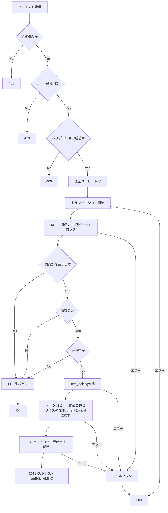

# createItemEditingCopy 詳細設計

基本設計: [itemUpload.md](../../itemUpload.md)

更新: 2026-10-23。基本設計と変更依頼に従い、statusクエリを必須とし保存値へ反映する。追加指示により、edit時はコピー元itemIdをitem_idへ保存する。

## 1. 概要

販売中の商品（item）からレコードをコピーして商品編集セッション（item_editing）を生成する。

コピー元のitemは保持し、同じitemIdへの後続リクエスト・再リクエストでも、レート制限内で作成条件を満たす場合は新しいitem_editingを生成する。

処理途中で失敗した場合は、編集セッションの作成を取り消す。

## 2. API仕様

- Method: POST
- Endpoint: /item-editing/copy?status=normal（またはstatus=edit）
- 認証: 必須
- 認可: コピー元のItem所有者のみ（item.seller_idが認証済みuserIdと一致すること）
- Content-Type: application/json
- レート制限: 10分間に5回

### ファイル・関数名

/server/src

- route: /routes/itemEditing.ts
- rateLimit: /middleware/rateLimit/itemEditingRateLimit
    - createItemEditingCopyRateLimit
- 認証: /middleware/authMiddleware.ts
    - authenticateToken
- bodyバリデーション: /validators/body/itemEditing.ts
    - createItemEditingCopyBodySchema
    - type: CreateItemEditingCopyBody
    - wrapper: /middleware/validate/validateBody.ts
        - validateBody
- queryバリデーション: /validators/query/itemEditing.ts
    - createItemEditingCopyQuerySchema
    - type: CreateItemEditingCopyQuery
    - wrapper: /middleware/validate/validateQuery.ts
        - validateQuery
- controller: /controllers/itemEditing/itemEditing.ts
    - createItemEditingCopyController
- usecase: /usecases/itemEditing/createItemEditingCopy/createItemEditingCopy.ts
    - createItemEditingCopyUseCase
- service:
    - item取得: /services/items/index.ts
        - getMyItemWithVideoSaleShipping（既存）
    - item_editing生成: /services/itemEditing/command.ts
        - createItemEditingCopy
        - serviceType: /types/serviceType/itemEditing.ts
            - CreateItemEditingCopyParams

### queryリクエスト

- status: `"normal" | "edit"`、必須。省略時のdefaultは設けない。
- URL例: `POST /api/item-editing/copy?status=normal`。値に引用符を含めない。
- フロントのコピー出品はnormal、商品編集ボタンはeditを指定し、返されたitemEditingIdでそれぞれ `/upload/[id]`、`/upload/edit/[id]` へ遷移する。

### bodyリクエスト

```json
{
    "itemId": 123
}
```

### バリデーション

- validateQueryでstatusを先に検証し、validateBodyでitemIdを検証する。検証結果はreq.validatedQuery / req.validatedBodyへ保存する。
- controllerは検証済みstatusをusecaseへ渡し、item_editing.statusへそのまま保存する。bodyのstatusやraw queryは採用しない。
- statusの欠落・空文字・許可値以外・配列・オブジェクトは400（INVALID_QUERY）。未知キーは除去する。
- itemId: 1〜2147483647の整数、必須（DBのINTEGER範囲）
- 不正なリクエストは400を返す

### レスポンス

成功時: 201 Created

```json
{
    "itemEditingId": 456
}
```

※レスポンス形式は実装時の共通API規約に合わせて確定する。

### 三行コメント

```ts
// POST /item-editing/copy
// summary: 販売中商品からitem_editingへのコピー
// page: /item/[id]
```

## 3. 認証・認可

所有者確認の対象はコピー元のItemとし、ItemDraftは使用しない。

1. 認証ミドルウェア（authenticateToken）からuserIdを取得する
2. itemIdをもとにitemを取得する
3. item.seller_idとuserIdを比較する
4. 一致しない場合は404を返す

存在しないitemに対しては404を返す。

### getMyItem 認可

```ts
where: {
    id: itemId,
    seller_id: userId,
}
```

## 4. 処理フロー

前提: authenticateTokenで認証済みであること。未認証の場合は401を返し、以下の処理を実行しない。

1. レート制限を確認（認証ユーザー単位で10分間に5回、超過時は429を返す）
2. query、bodyの順でリクエストを検証（両方が不正な場合はINVALID_QUERYを優先）
3. 認証ユーザーの取得
4. DBトランザクション開始
5. itemを行ロック付きで取得
6. 存在確認・所有者認可を確認
7. item.statusが"active"でない場合は404。コピー取得ではロック検索・関連再取得の両方でdeleted_at=nullを条件にし、論理削除済みも404
8. 検証済みstatusをitem_editing.statusに設定して新規レコードを作成
9. itemの対象データをitem_editingへコピー
10. トランザクションをコミット
11. 作成したitemEditingIdを返却

レート制限はバリデーションより前に実行するため、不正なリクエストも回数に含める。超過時はDBトランザクションを開始しない。

### 処理フロー図



## 5. DB操作仕様

### 参照テーブル

- item

### 書き込みテーブル

- item_editing

### コピー仕様

- 保存済みattributesの在庫構造が不正な場合はITEM_ATTRIBUTES_INVALID・500で作成前に停止する。商品/色のinventoryとcolorVariants/sizesの欠落は許容するが、各サイズのinventoryは必須。在庫オブジェクトのinitial/current/low_stock_ratioは有限数値とする。元データの補完・補正は行わない。
- statusは検証済みstatusクエリの値（normalまたはedit）をそのまま使用する。コピー元item.statusは引き継がない。
- item_idはstatus=editなら検証済みbody.itemId、status=normalならnull。itemIdは両モードとも必須の正整数で、欠落/nullは既存validateBodyが400・INVALID_BODYで拒否し、DB処理を開始しない。
- seller_idは認証済みユーザーのIDを使用する
- item_editing.idは新規採番する
- createdAt、updatedAtは新規生成する
- 商品入力データはitemから引き継ぐ
- attributesの在庫情報は、コピー時に以下の各inventory.currentを同じinventory内のinitialに戻す
    - 商品: attributes.inventory.current
    - 色: attributes.colorVariants[].inventory.current
    - サイズ: attributes.colorVariants[].sizes[].inventory.current
    - initialおよびその他の在庫情報は引き継ぐ
- 関連レコードの外部キーは新しいitem_editing.idに対応させる

### コピー対応

- item → item_editing

```
{
    item_id: status === "edit" ? itemId : null,
    name,
    detail,
    image_url,
    item_condition_id,
    seller_id（認証済みユーザーのID）,
    first_image_url,
    gender_type,
    age_type,
    recommend,
    category_id,
    brand_id,
    brand_aliases_id,
    attributes,
}
```

- video → item_editing

```
{
    thumbnail_url,
    title,
    summary,
    duration,
    original_url,
    converted_url,
    status → video_status,
}
```

- sale → item_editing

```
{
    before_price → before_price・price,
    discount_rate: null,
    discount_amount: null,
    sale_flag: false,
}
```

※ 注：sale.before_priceの値をitem_editing.before_priceとitem_editing.priceにコピーする。item.priceからitem_editing.priceにコピーしない。

- item_shipping_profile → item_editing

```
{
    shipping_day_id,
    shipping_service_id,
    shipping_place_id,
    shipping_service_free_text,
}
```

- 見方：カラム名のみ記載のところは同名の対応するカラムあり、→記載の箇所は右側がitem_editingのカラム、左側がコピー元のカラム、値が入っているカラムは記載の値の通りに入力する。

## 6. トランザクション設計

以下の処理を同一トランザクション内で実行する。

- item取得（行ロック）
- item_editing作成

### 成功時

すべてのDB操作が成功した場合のみコミットする。

### 失敗時

いずれかの処理で失敗した場合はロールバックする。

- item_editingの作成を取り消し、すでに作成した場合は削除する

### 排他制御

同一itemIdへの同時リクエストは行ロックで順番に処理し、各リクエストで新しい編集セッションを生成する。既存の編集セッションがある場合も追加生成を許可する。

- item取得時に更新用の行ロックを取得し、トランザクション終了まで保持する
- ロック取得後に存在確認・認可を実施する
- 同じitemを取得する後続リクエストはロック解放を待機する。
- ロック解放後はitemの存在・所有者・販売中の状態を再確認し、作成条件を満たす場合は新しいitem_editingを生成する。

### item取得　行ロック

```ts
const item = await Item.findOne({
    where: {
        id: itemId,
        seller_id: userId,
    },
    transaction,
    lock: transaction.LOCK.UPDATE,
});
```

## 7. エラー設計

| 発生条件                 | HTTP | エラーコード例                     |
| ------------------------ | ---- | ---------------------------------- |
| 未認証                   | 401  | UNAUTHORIZED                       |
| レート制限超過           | 429  | レート制限ミドルウェアの規約に従う |
| statusクエリの欠落・不正 | 400  | INVALID_QUERY                      |
| 不正なitemId             | 400  | INVALID_BODY                       |
| Itemが存在しない         | 404  | ITEM_NOT_FOUND                     |
| DB操作失敗               | 500  | INTERNAL_SERVER_ERROR              |
| 保存済み在庫構造が不正   | 500  | ITEM_ATTRIBUTES_INVALID            |

※エラーコードは既存のAppError規約に合わせる。

## 8. テスト設計

### 正常系

- status=normal / editのそれぞれで指定値がitem_editing.statusに保存され、item_idはnormalならnull、editならコピー元itemIdとなる
- status=editでもitemIdの欠落/nullは400・INVALID_BODYでDB未開始となる
- 所有者がitemからitem_editingを生成できる
- itemのデータが正しく引き継がれる
- 新しいitemEditingIdが返却される

### 異常系

- 存在しないitemIdを指定した場合
- 他人のitemIdを指定した場合
- statusクエリの欠落・空文字・許可値以外・重複指定時は400でusecase/DB未開始。bodyのstatusでは補完しない
- itemIdの型が不正な場合
- item_editing作成中にDBエラーが発生した場合

### 並行処理

- 同じitemIdに同時リクエストを送った場合、行ロックで順番に処理され、成功した各リクエストにつきitem_editingが1件生成される
- 先行処理のコミット後、待機していた後続処理も作成条件を満たす場合は成功し、それぞれ異なるitemEditingIdが返却される
- 先行処理がロールバックした場合、待機していた後続処理はitemから生成できる
- itemの更新・削除と競合した場合も、ロック取得後のデータに基づいてコピーまたは404となり、取得済みの古いデータから生成しない

### 境界値

- itemIdの下限・整数条件を確認する
- レート制限の上限回数と期間の切り替わりを確認する
- コピー対象の未入力値・空値・最大長が正しく引き継がれる

### 条件分岐

- 認証・入力値・itemの存在・所有者に応じた処理を確認する
- レート制限がユーザー単位で適用され、不正なリクエストも回数に含まれる
- 任意項目の有無や値にかかわらず、itemの値が正しく引き継がれる
- 各DB処理の失敗時にロールバックされる

### 状態遷移

- 成功時にitem_editingが生成される
- 失敗時に途中作成したデータが残らない
- 認証・入力・認可・レート制限のエラー時にDB状態が変わらない
- 成功後の再リクエストでも、レート制限内で作成条件を満たす場合は新しいitem_editingが追加生成される
- ロールバック後に再試行できる
- コピー元を含むitem・既存item_editingが変更されない
