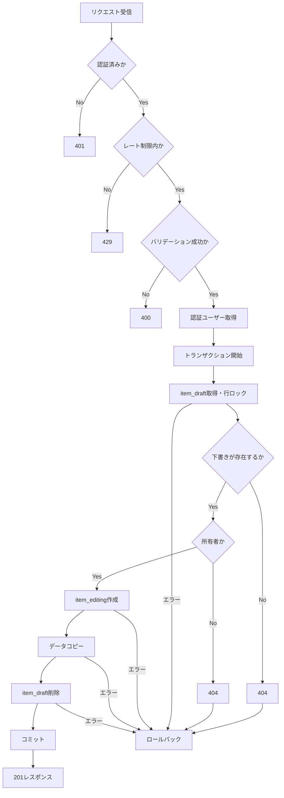

# createItemEditingDraft 詳細設計

基本設計: ../../itemUpload.md

## 1. 概要

下書き保存された商品（item_draft）から商品編集セッション（item_editing）を生成する。

編集セッションの作成に成功した場合、元の下書きデータを削除する。

処理途中で失敗した場合は、下書きデータを保持し、編集セッションの作成を取り消す。

## 2. API仕様

- API名:
    - usecase: createItemEditingDraftUseCase
    - controller: createItemEditingDraftController
    - service:
        - itemDraft取得: getMyItemDraft
            - serviceType: ItemDraftUserIdParams
        - itemEditing生成: createItemEditingDraft
            - serviceType: CreateItemEditingDraftParams
        - itemDraft削除: deleteItemDraft
            - serviceType: ItemDraftTransactionParams
- Method: POST
- Endpoint: /item-editing/draft
- 認証: 必須
- 認可: ItemDraft所有者のみ
- Content-Type: application/json
- レート制限: 10分間に5回

### ファイル・関数名

/server/src

- route: /routes/itemEditing.ts
- rateLimit: /middleware/rateLimit/itemEditingRateLimit
    - createItemEditingDraftRateLimit
- 認証: /middleware/authMiddleware.ts
    - authenticateToken
- bodyバリデーション: /validators/body/itemEditing.ts
    - createItemEditingDraftBodySchema
    - type: CreateItemEditingDraftBody
    - wrapper: /middleware/validate/validateBody.ts
        - validateBody
- controller: /controllers/itemEditing/itemEditing.ts
    - createItemEditingDraftController
- usecase: /usecases/itemEditing/createItemEditingDraft.ts
    - createItemEditingDraftUseCase
- service:
    - item_draft取得: /services/itemDraft/query.ts
        - getMyItemDraft
        - serviceType: /types/serviceType/itemDraft.ts
            - ItemDraftUserIdParams
    - item_editing生成: /services/itemEditing/command.ts
        - createItemEditingDraft
        - serviceType: /types/serviceType/itemEditing.ts
            - CreateItemEditingDraftParams
    - item_draft削除: /services/itemDraft/command.ts
        - deleteItemDraft
        - serviceType: /types/serviceType/itemDraft.ts
            - ItemDraftTransactionParams

### リクエスト

```json
{
    "itemDraftId": 123
}
```

### バリデーション

- validatedBody使用（既存関数）
    - validatedBody内でzodを適用
- itemDraftId: 正の整数、必須
- 不正なリクエストは400を返す

### レスポンス

成功時: 201 Created

```json
{
    "itemEditingId": 456
}
```

※レスポンス形式は実装時の共通API規約に合わせて確定する。

## 3. 認証・認可

1. 認証ミドルウェア（authenticateToken）からuserIdを取得する
2. itemDraftIdをもとにitem_draftを取得する
3. itemDraft.seller_idとuserIdを比較する
4. 一致しない場合は404を返す

存在しない下書きに対しては404を返す。

※所有者以外への情報漏洩を防ぐため、他人の下書きも404とする方式を採用するかは要検討。

### getMyItemDraft 認可

```ts
where: {
    id: itemDraftId,
    seller_id: userId,
}
```

## 4. 処理フロー

前提: authenticateTokenで認証済みであること。未認証の場合は401を返し、以下の処理を実行しない。

1. レート制限を確認（認証ユーザー単位で10分間に5回、超過時は429を返す）
2. リクエストのバリデーション
3. 認証ユーザーの取得
4. DBトランザクション開始
5. item_draftを行ロック付きで取得
6. 存在確認・所有者認可を確認
7. item_editingの新規レコードを作成
8. item_draftの対象データをitem_editingへコピー
9. item_draftを削除
10. トランザクションをコミット
11. 作成したitemEditingIdを返却

レート制限はバリデーションより前に実行するため、不正なリクエストも回数に含める。超過時はDBトランザクションを開始しない。

### 処理フロー図



## 5. DB操作仕様

### 参照テーブル

- item_draft

### 書き込みテーブル

- item_editing

### 削除テーブル

- item_draft
    - 参照テーブルで取得したitem_draft

### コピー仕様

- seller_idは認証済みユーザーのIDを使用する
- item_editing.idは新規採番する
- createdAt、updatedAtは新規生成する
- 商品入力データはitem_draftから引き継ぐ
- 関連レコードの外部キーは新しいitem_editing.idに対応させる
- item_draftとitem_editingの共通カラムのうち、id、createdAt、updatedAtおよび移行対象外の管理用カラムを除いてコピーする。seller_idは認証済みユーザーIDを設定する。コピー対象は両Modelの定義に基づいて明示する。

## 6. トランザクション設計

以下の処理を同一トランザクション内で実行する。

- item_draft取得・必要なロック
- item_editing作成
- 商品関連データのコピー
- item_draft削除

### item_draft取得をトランザクション内に置く理由

コピー元の取得と削除を同じトランザクション内で扱い、取得からコミット・ロールバックまで行ロックを保持する。取得をトランザクション外に置くと、コピー前に別リクエストが下書きを更新・削除し、古いデータのコピーや編集セッションの重複生成につながる。

トランザクションを開始するだけでは排他制御にならない。取得には更新用の行ロックを使用し、取得・作成・コピー・削除の各serviceへ同一のtransactionを渡す。存在確認と所有者認可は、そのトランザクション内で取得したデータをもとに行う。

認証・レート制限・入力バリデーションはトランザクション開始前に完了させ、ロック保持時間を短くする。

### 成功時

すべてのDB操作が成功した場合のみコミットする。

### 失敗時

いずれかの処理で失敗した場合はロールバックする。

- item_editingの作成を取り消す
- コピーした関連レコードを取り消す
- item_draftを保持する

### 排他制御

同一itemDraftIdへの同時リクエストによって複数の編集セッションが生成されないようにする。

- item_draft取得時に更新用の行ロックを取得し、トランザクション終了まで保持する
- ロック取得後に存在確認・認可を実施する
- 同じ下書きを取得する後続リクエストはロック解放を待機する。先行処理がコミットして下書きが削除済みなら404、ロールバックして下書きが残っていれば通常の存在確認・認可・作成処理を行う
- 下書きの更新・削除を行う別処理も含め、同じ行への変更と競合した場合の動作を確認する

### item_draft取得　行ロック

```ts
const itemDraft = await ItemDraft.findOne({
    where: {
        id: itemDraftId,
        seller_id: userId,
    },
    transaction,
    lock: transaction.LOCK.UPDATE,
});
```

## 7. エラー設計

| 発生条件           | HTTP | エラーコード例                     |
| ------------------ | ---- | ---------------------------------- |
| 未認証             | 401  | UNAUTHORIZED                       |
| レート制限超過     | 429  | レート制限ミドルウェアの規約に従う |
| 不正なitemDraftId  | 400  | INVALID_BODY                       |
| 下書きが存在しない | 404  | ITEM_DRAFT_NOT_FOUND               |
| DB操作失敗         | 500  | INTERNAL_SERVER_ERROR              |

※エラーコードは既存のAppError規約に合わせる。

## 8. テスト設計

### 正常系

- 所有者が下書きから編集セッションを生成できる
- 下書きの入力データが正しく引き継がれる
- 成功後に元の下書きが削除される
- 新しいitemEditingIdが返却される

### 異常系

- 存在しないitemDraftIdを指定した場合
- 他人のitemDraftIdを指定した場合
- itemDraftIdの型が不正な場合
- 編集セッション作成中にDBエラーが発生した場合
- 下書き削除に失敗した場合

### 並行処理

- 同じitemDraftIdに同時リクエストを送っても、編集セッションが重複生成されない
- 先行処理のコミット後、待機していた後続処理は404となり、編集セッションは1件だけ生成される
- 先行処理がロールバックした場合、待機していた後続処理は残っている下書きから生成できる
- 下書きの更新・削除と競合した場合も、ロック取得後のデータに基づいてコピーまたは404となり、取得済みの古いデータから生成しない

### 境界値

- itemDraftIdの下限・整数条件・上限（仕様確定後）を確認する
- レート制限の上限回数と期間の切り替わりを確認する
- コピー対象の未入力値・空値・最大長が正しく引き継がれる

### 条件分岐

- 認証・入力値・下書きの存在・所有者に応じた処理を確認する
- レート制限がユーザー単位で適用され、不正なリクエストも回数に含まれる
- 任意項目の有無や値にかかわらず、下書きデータが正しく引き継がれる
- 各DB処理の失敗時にロールバックされる

### 状態遷移

- 成功時に下書きが削除され、編集セッションが生成される
- 失敗時に下書きが保持され、途中作成したデータが残らない
- 認証・入力・認可・レート制限のエラー時にDB状態が変わらない
- 成功後の再リクエストで編集セッションが追加生成されない
- ロールバック後に再試行できる
- 対象外の下書き・既存編集セッションが変更されない

## 9. 未決定事項

- 編集セッション生成後のフロント遷移先
- itemDraftIdの上限値と、上限超過時のバリデーション仕様
