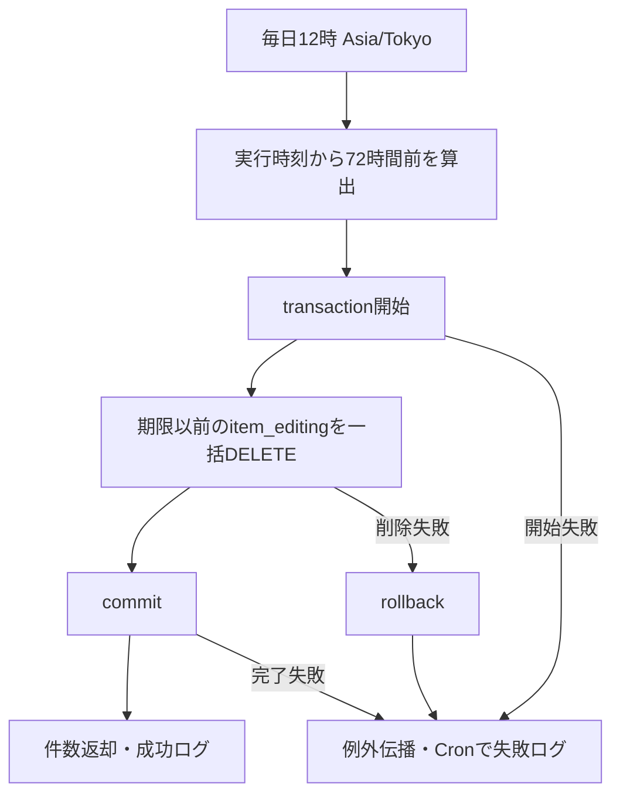

# cronDeleteItemEditing 詳細設計

基本設計: [itemUpload](../../itemUpload.md#crondeleteitemediting)

確認日: 2026-10-21。基本設計の作成から3日・毎日昼12時・失敗時復元を詳細化した。
参照実装: `server/src/cron/buyDelete.ts`。以下のパスはリポジトリルート基準。

## 1. 概要

作成から3日（72時間）以上経過した商品編集セッションを、所有者にかかわらず物理削除する。
実行開始時刻を一度取得し、`createdAt <= 実行開始時刻 - 72時間` を対象とする。
更新があっても期限は延長しない。実カラム名は `createdAt`（旧記述のCreatedAtを訂正）。
成功時は対象行がなくなり、commit完了後に実削除件数を返す。0件も成功。
失敗時は同一transactionをrollbackし、削除前の状態を保持する。復元用INSERTは行わない。
商品・下書き・マスター・動画等の別テーブル、S3のファイルは変更しない。

## 2. cron仕様

- 日時: `0 12 * * *`、timezone: `Asia/Tokyo`。
- 大分類: itemEditing、小分類: cronDeleteItemEditing。
- HTTP Method・URL・Content-Type・入力body・公開レスポンス・レート制限はない。
- 起動時に登録し、次の定刻に実行する。起動直後の即時削除、停止中の実行補完、ジョブ内自動再試行はない。

| ファイル                                                           | 関数・役割                                                                                            |
| ------------------------------------------------------------------ | ----------------------------------------------------------------------------------------------------- |
| `server/src/cron/index.ts`（変更）                                 | `startAllCrons`から開始関数を呼ぶ                                                                     |
| `server/src/cron/itemEditingDelete.ts`（新規）                     | `startItemEditingDeleteCron`。schedule、usecase待機、結果ログ・例外捕捉                               |
| `server/src/usecases/itemEditing/cronDeleteItemEditing.ts`（新規） | `cronDeleteItemEditingUseCase(): Promise<number>`。期限算出・transaction管理                          |
| `server/src/services/itemEditing/command.ts`（追加）               | `destroyExpiredItemEditings({ createdBefore, transaction }): Promise<number>`。期限条件付き一括DELETE |

serviceの引数型 `DestroyExpiredItemEditingsParams` はcommand.ts内に定義する。
`createdBefore: Date`、`transaction: Transaction` は必須。原案のservice名は動詞から始まる命名規約に合わせた。
Cronの追加にroute・controller・middleware・validator・新しいModelは不要。
実DB検査で発見したitemの日時NULL制約不一致は、2026-10-21のユーザー指示により別途解消した。
`server/migrations/20261021071500-enforce-item-timestamps-not-null.js` を実DB neondbとtest_dbへ適用し、item.createdAt・updatedAtのNOT NULLと適用履歴を確認済み。既存値は変更していない。

処理直上のコメントは `// cron 3日経過ItemEditing削除`。
成功ログ（0件を含む）と失敗ログ:

```ts
console.log(`[cron] ${deleteCount}件の3日経過ItemEditingを削除しました。`);
console.error("[cron] ItemEditing削除エラー", err);
```

失敗ログはCron規約に従い、原案のconsole.logから訂正した。

## 3. 認証・認可

サーバー内部の定期処理で、HTTPの認証・所有者チェックは適用しない。
全所有者・seller_id=nullも期限のみで選ぶ。外部から条件やユーザーIDを入力する経路は作らない。
ItemEditingにはstatus・deleted_at・item_idがなく、これらの条件を追加しない。

## 4. 処理フロー

1. startAllCronsからCronを登録する。
2. 定刻のcallbackでusecaseを呼び、実行時刻から72時間前の期限を一度算出する。
3. Sequelize managed transactionを開始する。
4. serviceからItemEditing.destroyを1回呼ぶ。whereはcreatedAtの期限のみ、同じtransactionを渡す。
5. 削除件数をcallbackから返し、外側のtransaction（commit完了）を待つ。
6. 成功件数をCronでログ出力する。
7. callback内の失敗はrollback後に上位へ伝播し、Cronで捕捉して失敗ログを出す。成功ログは出さない。



## 5. DB操作仕様

- 対象Model: `server/src/models/item_editing.ts`、実テーブル: `item_editing`。
- 事前SELECT、JOIN、行ごとのループは行わない。
- DELETE条件: `{ createdAt: { [Op.lte]: createdBefore } }`。境界一致を含む。
- 一括削除の戻り値（実削除件数）をそのまま返す。limit・batch分割はしない。
- createdAtより新しい行は全列保持する。updatedAt、seller_id、video_status、sale_flag、入力項目の完成度は選択条件にしない。
- 参照先User・カテゴリー等を削除しない。ItemEditingのassociateはbelongsToのみで、今回リレーション変更はない。
- スキーマ確認は実DBテストの事前ガードで行う。2026-10-21に必要な3テーブルの列・NULL制約、item_editingの主キー・日時型・参照されるFKがないことを確認済み。
- itemのcreatedAt・updatedAtについては、両DBでNOT NULL・既存NULL0件・新migrationの適用履歴を直接確認した。Model・migrationの存在だけでDB反映済みとはみなさない。

## 6. トランザクション設計

すべての対象行を一つのmanaged transactionで削除する。Serviceはtransactionを開始・終了しない。
削除処理の例外では全対象行をrollbackし、途中成功件数を返さない。
commit応答喪失など通信障害で成否不明の場合は、必ず復元済みとは保証しない。次回実行で残存する期限行を処理する。

### 排他・再実行

PostgreSQLの通常のDELETEの行ロックを使い、事前SELECT FOR UPDATEやSKIP LOCKEDは追加しない。
同じ期限行の更新・公開・別Cronの削除とは行ロックで待機する。先行transactionのcommit/rollback後、DBの条件評価に従って残存する対象を削除する。
公開処理が先にロックして削除・commitした行はCronの件数に含まない。Cronが先に削除した編集行は公開側の再取得で不存在になる。
updatedAtだけの変更は削除対象から外れない。待機中も期限を再計算しない。
同時起動の全プロセスにまたがるジョブロックは設けない。競合エラーは失敗として扱い自動再試行しない。
同じ時刻で再実行すると削除済み行は0件、失敗後なら残存対象を再処理できる。

## 7. エラー設計

DB削除・transaction開始/完了の例外は元のままCronへ伝播する。
業務上の拒否条件やHTTP応答がないため、新しいAppError・公開エラーコードは追加しない。
Cronでtry/catchし、次回の定期実行を妨げる未処理rejectionを残さない。
0件を不存在エラーとしない。ログは内部運用向けであり、HTTPへ例外を公開しない。

## 8. テスト設計

[テスト設計書](../../../../../server/test/docs/architecture/itemEditing/cronDeleteItemEditing.md)と
[結果レポート](../../../../../server/test/docs/report/itemEditing/cronDeleteItemEditing.md)でケース・実行結果を管理する。

- 単体: 固定時刻の期限算出、同一transaction、削除件数/0件、削除と外側transaction完了の待機、各失敗の伝播。
- Service単体: 実Modelメソッド境界でwhere（lte）・transaction・呼出し回数・返却・失敗を確認。
- Cron単体: schedule・timezone、起動登録、callbackの成功/0件/失敗ログ、usecase待機を確認。実timerは開始しない。
- 実DB: 期限直前/一致/直後、updatedAtが新しい古い行、所有者null、複数件削除、非対象行保持、再実行。
- 実DB transaction: 削除後の例外による全行復元・再試行、commit前後の別接続可視性。
- 実DB制約: 自作itemのcreatedAt・updatedAtへSQLでNULL代入を試み、SQLSTATE 23502とrollback後の全列保持を確認。
- 実DB競合: 先行の行ロックに対するDELETE待機を観測し、先行commit/rollback後の件数・行状態を確認。
- HTTP入力/認証偽装・公開応答は経路が存在しないため対象外。S3実通信、通信断時のcommit成否、実時計で翌日まで待つ検証は行わない。
