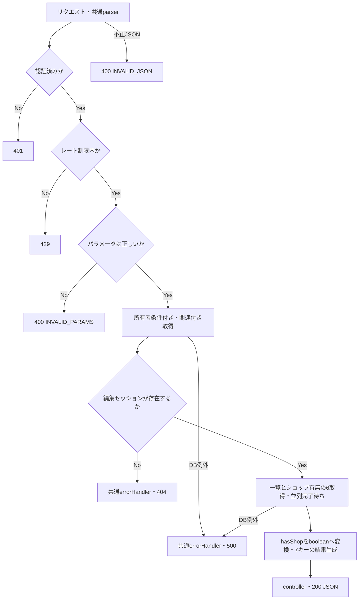

# getItemEditingForm 詳細設計

基本設計: [商品アップロードAPI設計](../../itemUpload.md)

更新日: 2026-11-04。ユーザー確認により追加一覧をトップレベルで返し、`hasShop`をbooleanとする。カテゴリー一覧は既存`getAllLevel1()`の全カラム取得を維持する。毎分80回、`updatedAt`・`item_id`非公開の契約は維持する。

## 1. 概要

`client/src/app/upload/[id]`ページで表示するデータをDBから取得し、フロントエンドにJSONで返す。

## 2. API仕様

- Method: GET
- Endpoint: /api/item-editing/:id/form
- Router内の相対パス: /:id/form（`routes/index.ts` の既存 `/api/item-editing` 登録を利用）
- 認証: 必須
- 認可: 商品編集セッション（ItemEditing）所有者のみ（item_editing.seller_idが認証済みuserIdと一致すること）
- Content-Type: application/json（レスポンス。リクエストbodyは不要）
- レート制限: 認証ユーザー単位で1分間に80回。超過時は429。
- 制限設定: `windowMs: 60000`、`limit: 80`、`standardHeaders: true`、`legacyHeaders: false`。既存形式の `admin:${認証済みuserId}` をキーとするAPI専用インスタンスを追加する。
- 制限計上: 認証後の400・404・500も含む。未認証は計上しない。81回目以降は429と既存ライブラリの既定本文・RateLimit/Retry-Afterヘッダーを返し、窓終了後に再受付する。GETでも不正JSONを送った場合はアプリ共通parserが先に400とし、認証・制限へ到達しない。
- 順序: authenticateToken → getItemEditingFormRateLimit → validateParams(idParamSchema) → getItemEditingFormController

### ファイル・関数名

以下のパスは `server/src` 基準。上書き・新規・拡張の記載は初回設計時の区分である。

- route: /routes/itemEditing.ts
- rateLimit: /middleware/rateLimit/itemEditingRateLimit.ts
    - getItemEditingFormRateLimit（新規）
- 認証: /middleware/authMiddleware.ts
    - authenticateToken（既存）
- paramバリデーション: /validators/params/id.ts
    - idParamSchema（既存）
    - wrapper: /middleware/validate/validateParams.ts
        - validateParams（既存）
- controller: /controllers/itemEditing/itemEditing.ts
    - getItemEditingFormController（新規）
- usecase: /usecases/itemEditing/getItemEditingForm.ts
    - getItemEditingFormUseCase（新規）
- service:
    - itemEditing取得: /services/itemEditing/query.ts
        - getMyItemEditingForm（新規）
        - 引数型: `Pick<ItemEditingUserIdParams, "itemEditingId" | "userId">`
    - 全カテゴリー取得: /services/categories/categories.ts
        - getAllLevel1（既存）
    - 全コンディション取得: /services/itemConditionOption/itemConditionOption.ts
        - getAllCondition（既存）
    - 全配送予定日取得: /services/shippingDayOption/shippingDayOption.ts
        - getAllShippingDay（既存）
    - 全配送サービス取得: /services/shippingServiceOption/shippingServiceOption.ts
        - getAllShippingService（既存）
    - 全都道府県取得: /services/todouhukenOption/todouhukenOption.ts
        - getAllTodouhuken（既存）
    - ショップ有無取得: /services/users/query.ts
        - getUserHasShop（既存）

### リクエスト

`GET /item-editing/123/form`（bodyなし）

### バリデーション

- `validateParams(idParamSchema)` で `params.id` を検証し、数値化した値をitemEditingIdとして使用する。
- `z.coerce.number()` による数値化後の値を `req.validatedParams` から取得する。認証IDは `req.user!.id` のみを採用し、body/queryのuserId・seller_idは採用しない。
- id: 1〜2147483647の整数、必須（DBのINTEGER範囲）。不正な値は400を返す。

### レスポンス

成功時: 200 OK

編集セッションと追加データの取得完了後に、`itemEditing`・`category`・`allCondition`・`allDay`・`allService`・`allPlace`・`hasShop`の7キーをトップレベルで返す。usecaseはこれらを持つ結果オブジェクトを返し、controllerは`res.status(200).json(result)`で応答する。

```json
{
    "itemEditing": {
        "id": 123,
        "status": "normal",
        "seller_id": 7,
        "name": "商品名",
        "detail": null,
        "price": 1000,
        "image_url": [],
        "first_image_url": "https://example.test/item.jpg",
        "gender_type": "unisex",
        "age_type": "both",
        "attributes": {},
        "thumbnail_url": "https://example.test/thumbnail.jpg",
        "title": "動画タイトル",
        "summary": null,
        "duration": null,
        "original_url": "https://example.test/original.mp4",
        "converted_url": null,
        "before_price": 1000,
        "shipping_service_free_text": null,
        "Category": null,
        "Brand": null,
        "ItemConditionOption": null,
        "ShippingDayOption": null,
        "ShippingServiceOption": null,
        "TodouhukenOption": null
    },
    "category": [
        {
            "id": 123,
            "name": "カテゴリー",
            "level": 1,
            "sort_order": 0,
            "allowed_gender": "unisex",
            "allowed_age": "both",
            "parent_id": null,
            "body_category": null,
            "lifestyle_category": null,
            "layer": "middle",
            "path": "category"
        }
    ],
    "allCondition": [
        {
            "id": 123,
            "name": "新品"
        }
    ],
    "allDay": [
        {
            "id": 123,
            "name": "5日～7日"
        }
    ],
    "allService": [
        {
            "id": 123,
            "name": "ゆうパック"
        }
    ],
    "allPlace": [
        {
            "id": 123,
            "name": "東京都"
        }
    ],
    "hasShop": false
}
```

- `category`, `allCondition`, `allDay`, `allService`, `allPlace`, `hasShop` 取得例

```ts
const [category, allCondition, allDay, allService, allPlace, userHasShop] = await Promise.all([
    getAllLevel1(),
    getAllCondition(),
    getAllShippingDay(),
    getAllShippingService(),
    getAllTodouhuken(),
    getUserHasShop({ userId }),
]);

const hasShop = !!userHasShop?.ShopInfo;
```

参照元は `client/src/app/upload/types/types.ts`。`itemEditing`内のBrand/Optionはid/name、Category・parent・childrenはid/name/allowed_gender/allowed_age/parent_idを取得する。Category/parentや任意関連の未設定はnull、childrenがなければ空配列。Categoryのchildren順序は保証しない。

トップレベルの`category`は編集データのCategoryとは別の一覧であり、既存`getAllLevel1()`を変更せず使用する。`level = 1`の全カテゴリーを全カラム取得し、`sort_order ASC`で返す。同順位の順序は保証しない。各Option一覧も既存の全件・全カラム取得を維持し、順序は保証しない。一覧に該当行がなければ空配列を返す。

`hasShop`は`!!userHasShop?.ShopInfo`によるboolean。`getUserHasShop({ userId })`は認証ユーザーに紐づく`verified: true`のShopInfoだけを任意関連として取得するため、承認済みショップがあればtrue、未登録・未承認・ユーザー取得結果nullならfalse。User/ShopInfoの取得内容そのものはレスポンスへ含めない。フロント型そのものは今回変更しない。

### 三行コメント

```ts
// GET /item-editing/:id/form
// summary: 商品アップロード入力フォーム初期値取得
// page: /upload/[id]・/upload/edit/[id]
```

## 3. 認証・認可

`authenticateToken` の認証済みuserIdと、URLのitemEditingIdで所有者の編集セッションを検索する。未認証は401、存在しない場合・他人の編集セッションの場合はともに404を返す。

### getMyItemEditingForm 認可

```ts
where: {
    id: itemEditingId,
    seller_id: userId,
}
```

## 4. 処理フロー

1. 認証を確認する（未認証は401）。
2. レート制限を確認する（超過は429。不正なパラメータも回数に含む）。
3. params.idを検証し、itemEditingIdと認証済みuserIdをusecaseに渡す（不正は400）。
4. serviceで編集セッションと関連を所有者条件付きで取得する。
5. nullならusecaseで `new AppError("ITEM_EDITING_NOT_FOUND", 404)` を送出する。DB例外はそのまま伝播させる。
6. 編集セッションがあれば、usecaseでカテゴリー・コンディション・配送予定日・配送サービス・都道府県・認証ユーザーのショップ有無の6取得を`Promise.all`で並列実行し、すべての完了を待つ。編集セッションの取得失敗・404時には開始しない。
7. `hasShop`をbooleanへ変換し、usecaseから7キーの結果をcontrollerへ返す。controllerが200で第2章のJSONを返す。追加取得のいずれかが失敗した場合も元例外を伝播し、成功応答を返さない。開始済み並列処理の取消しは保証しない。
8. controllerは例外を `next(err)` へ渡し、共通errorHandlerが公開応答を生成する。

### 処理フロー図



## 5. DB操作仕様

### 参照テーブル

- item_editing
    - `id = itemEditingId AND seller_id = userId` で取得する。

- 関連参照: categories（Category・parent・children）、brands（Brand）、item_condition_option、shipping_day_option、shipping_service_option、todouhuken_option。aliasはModelのassociate定義に合わせる。
- `status`（"normal" | "edit"）を取得する。`item_id`・`updatedAt`は公開しない。
- `itemEditing`の取得列・関連は以下を確定契約とする。createdAt・video_status・各FKなど列挙しない編集列は公開しない。
- 追加一覧はcategories（`level = 1`、`sort_order ASC`）と4つのOptionテーブルを全件・全カラム参照する。既存の一覧取得serviceを変更しない。
- ショップ判定はuserを認証済みuserIdで取得し、shop_infoの`verified = true`を条件とする任意関連ShopInfoを参照する。結果はbooleanだけを公開する。
- 実DBの検証結果は本APIのテストレポートに記録し、他APIの検証結果で代替しない。

### 取得データ・レスポンス詳細

取得データの記載は `client/src/app/upload/types/types.ts` の `ItemEditing` を参考とする。

- getItemEditingFormのattributes:

```ts
attributes: [
    "id",
    "status",
    "seller_id",
    "name",
    "detail",
    "price",
    "image_url",
    "first_image_url",
    "gender_type",
    "age_type",
    "attributes",
    "thumbnail_url",
    "title",
    "summary",
    "duration",
    "original_url",
    "converted_url",
    "before_price",
    "shipping_service_free_text",
];
```

- getItemEditingFormのinclude:

```ts
include: [
    {
        model: Categories,
        as: "Category",
        attributes: ["id", "name", "allowed_gender", "allowed_age", "parent_id"],
        required: false,
        include: [
            {
                model: Categories,
                attributes: ["id", "name", "allowed_gender", "allowed_age", "parent_id"],
                as: "children",
                required: false,
            },
            {
                model: Categories,
                attributes: ["id", "name", "allowed_gender", "allowed_age", "parent_id"],
                as: "parent",
                required: false,
            },
        ],
    },
    {
        model: Brands,
        as: "Brand",
        attributes: ["id", "name"],
        required: false,
    },
    { model: ItemConditionOption, attributes: ["id", "name"], required: false },
    { model: ShippingDayOption, attributes: ["id", "name"], required: false },
    { model: ShippingServiceOption, attributes: ["id", "name"], required: false },
    { model: TodouhukenOption, attributes: ["id", "name"], required: false },
];
```

## 6. トランザクション設計

- 編集セッションの関連付き参照後に追加6取得を行う。すべて参照処理であり、明示的なtransaction・行ロック・更新は行わない。更新用ロックを持つ既存 `getMyItemEditing` は利用しない。
- 各取得は同一transactionのsnapshotへ固定しないため、編集データ・マスター・ショップ有無の厳密な同時点整合は保証しない。
- 繰返し取得はその時点の保存値を返す。並行する更新・削除との厳密な直列化や、取得後も行が残ることは保証しない。取得時点で存在しなければ404。
- 書込み・外部通信・通知がないため、rollback・補償・副作用の再送は該当しない。

## 7. エラー設計

| 発生条件                                          | HTTP | 公開応答                                                                          |
| ------------------------------------------------- | ---- | --------------------------------------------------------------------------------- |
| bodyの不正JSON（共通parser）                      | 400  | `{ "code": "INVALID_JSON", "message": "JSONの形式を確認してください。" }`         |
| Bearerトークンなし                                | 401  | `{ "message": "トークンがありません。" }`                                         |
| トークン不正・期限切れ                            | 401  | `{ "message": "トークンが無効です。" }`                                           |
| 認証後の制限超過                                  | 429  | express-rate-limitの既定本文・ヘッダー                                            |
| id検証失敗                                        | 400  | `{ "code": "INVALID_PARAMS", "message": "INVALID_PARAMS" }`                       |
| 編集セッション不存在・他人の所有・seller_idがnull | 404  | `{ "code": "ITEM_EDITING_NOT_FOUND", "message": "ITEM_EDITING_NOT_FOUND" }`       |
| 予期しないDB等の例外                              | 500  | `{ "error": "INTERNAL_SERVER_ERROR", "message": "サーバーエラーが発生しました" }` |

400/404は既存AppError、予期しない例外は元の例外を共通errorHandlerへ渡す。認証・制限の応答をAppError形式へ変更しない。拒否時は後続処理を実行せず、500に内部エラー内容を含めない。

## 8. テスト設計

- 正常: 所有者の取得、取得列・関連・任意項目のnull/値あり・画像配列・JSONBの保持、編集データの対象外カラム非公開、7キーの応答を確認する。Category/parent/childrenの5列、独立したlevel1カテゴリー一覧の全カラムと順序、各Option一覧の全件を確認する。公開レスポンスは第2・5章に合わせる。
- ショップ有無: 認証ユーザーの未登録・未承認はfalse、承認済みはtrueとし、他人の承認済みショップが混入しないこと、User/ShopInfo本体を公開しないことを確認する。
- 認証・認可: 未認証/不正JWTの401、他人・不存在・所有者nullの404、body/queryへの所有者偽装の無視。認証拒否時は制限・DBが未実行であることを確認する。
- 入力境界: 1/2147483647を許可し、0/負数/小数/非数値/上限超過を拒否する。数値coerceの実契約と検証済みparamsの採用を確認する。
- 制限・優先順位: 同じユーザーの80回と81回目、他ユーザーとの分離、窓終了後の再開、不正paramsと404の計上、制限超過と不正idが重なる場合の429を確認する。parser拒否は別経路として確認する。
- 失敗・待機: 編集データの取得失敗・404時には追加取得を開始しない。追加6取得の各失敗で元例外を伝播し500となること、各保留中に成功結果を返さず、すべて完了してからusecase/controllerが返すことを確認する。
- 再送・並行: 参照に副作用がなく対象・他人の編集セッションとマスターが不変であること、別リクエスト間で結果が混ざらないことを確認する。書込みの状態遷移・rollback・ロック待機は本APIには該当しない。
- 検証レベル: service/usecase/controller単体、実Router・認証・schema・制限・errorHandlerのHTTP接続、実DBによる所有者絞込み・関連取得・非対象不変を分ける。DB検証はtest_dbガードと必要スキーマ確認後に自作IDで行う。
- 次工程成果物: `server/test/docs/architecture/itemEditing/getItemEditingForm.md` と `server/test/docs/report/itemEditing/getItemEditingForm.md`。実行結果はレポートに記録する。

検証結果: [テスト設計](../../../../../server/test/docs/architecture/itemEditing/getItemEditingForm.md)・[テストレポート](../../../../../server/test/docs/report/itemEditing/getItemEditingForm.md)を参照。
