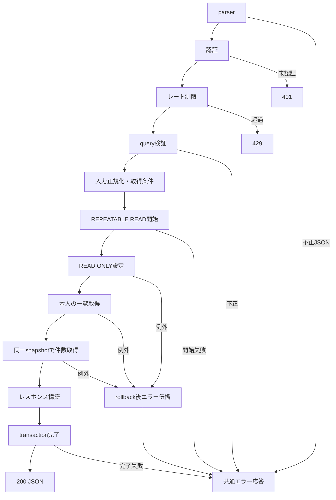

# getItemLikeList 詳細設計

基本設計: [商品リスト取得API設計](../../getItemList.md)

確認・更新日: 2026-11-10。ユーザー回答に基づき、出品者を限定しない本人のいいね取得、ItemLike起点の件数集計、`{ item }`形式、いいね日時・ID降順、uploaded_at非返却を確定。担当ファイルは実装済み。

## 1. 概要

`/item-list/like`向けに、認証本人が所有するitem_likeから参照されているitemの一覧を取得する。
DB変更・通知・S3操作・既存一覧APIの置換・フロント変更は行わない。
正常・失敗ともDBデータは変更しない。

## 2. API仕様

- GET `/api/item-like/item-list`。routes/index.tsの`/api/item-like`登録とRouterの`/item-list`を使用。
- body不要。成功レスポンスはapplication/json、200。
- authenticateToken → getItemLikeListRateLimit → validateQuery(getItemLikeListQuerySchema) → getItemLikeListController。
- params検証・ItemLikeIDによる認可はない。
- 認証本人単位（`admin:${userId}`）で60000msに50回。専用インスタンス、standardHeaders=true、legacyHeaders=false。
- 認証後の400・500も計上。未認証は非計上。不正JSONは共通parserで先に拒否され非計上。
- 51回目から429、express-rate-limit既定本文とRateLimit/Retry-Afterヘッダー。窓終了後に再受付。

### 入力

例: `GET /api/item-like/item-list?page=7&status=active&keyword=シャツ`

| query   | 契約                                                                                                        |
| ------- | ----------------------------------------------------------------------------------------------------------- |
| page    | 省略時1。単一文字列をnumberへcoerce、整数1〜10000。空文字・小数・範囲外・配列・オブジェクトは400            |
| status  | "active"・"soldout"のみ採用、その他の入力はundefined                                                        |
| keyword | 任意の単一文字列、文字数制限なし。前後空白を除去。省略・null・空文字・空白のみ・URLの文字列`null`は検索なし |

未知キーは除去し、`req.validatedQuery`のみをcontrollerで採用する。userId/seller*idの偽装は採用しない。
statusは `active` `soldout` 以外の入力（配列・オブジェクト・nullを含む）やクエリ無しが来たら、すべてundefined扱いにする。undefinedを許可する。
keywordはusecaseで既存の`normalizeJapanese()`を使用する（現行関数名）。
NFKC・小文字化・カタカナ→ひらがな・空白除去後、item.search_textのILIKE部分一致。
正規化するのは入力のみ。保存済みカラムの正規化・書換えは行わない。
検索語の文字変換は現在の`normalizeJapanese()`の仕様に従い、追加の正規表現検索・文字制限は設けない。
正規化後の`%`・`*`・バックスラッシュをILIKE用にエスケープし、通常の文字として検索する。`\*`も通常の文字として検索する。`\*`等の正規表現記号も通常の文字として検索する。nullの検索対象列は一致しない。

### 担当ファイル（server/src基準）

| ファイル                                  | 関数・型                                                          | 区分     |
| ----------------------------------------- | ----------------------------------------------------------------- | -------- |
| routes/itemLike.ts                        | GET /item-list                                                    | 実装済み |
| middleware/authMiddleware.ts              | authenticateToken                                                 | 既存     |
| middleware/rateLimit/itemLikeRateLimit.ts | getItemLikeListRateLimit                                          | 実装済み |
| middleware/validate/validateQuery.ts      | validateQuery                                                     | 既存     |
| validators/query/itemLike.ts              | getItemLikeListQuerySchema / GetItemLikeListQuery                 | 実装済み |
| controllers/itemLike/itemLike.ts          | getItemLikeListController                                         | 実装済み |
| usecases/itemLike/getItemLikeList.ts      | getItemLikeListUseCase                                            | 実装済み |
| services/itemLike/query.ts                | setItemLikeListReadOnly / getMyItemLikeList / countMyItemLikeList | 実装済み |
| types/serviceType/itemLike.ts             | ItemLikeListRow / GetItemLikeListParams / CountItemLikeListParams | 実装済み |

service引数はuserId・where・transaction、一覧取得のみlimit・offsetも受ける。itemIdは不要。

### 出力

```json
{
    "itemList": [
        {
            "item": {
                "id": 123,
                "name": "商品名",
                "price": 1000,
                "status": "active",
                "first_image_url": null,
                "gender_type": "unisex",
                "age_type": "both",
                "Video": {
                    "title": null
                },
                "Sale": {
                    "before_price": 2000,
                    "sale_flag": true,
                    "discount_rate": 0,
                    "discount_amount": 1000
                }
            }
        }
    ],
    "totalPages": 7
}
```

uploaded_atは取得・返却しない。idはitemの主キーで、いいねIDではない。
Video/SaleはLEFT JOINし、欠落時はnullを返す。存在する関連のnullable列はnullを保持する。
usecaseはJSON例の項目のみ明示的に選択し、seller_id・search_text・関連のid等は返さない。
limit=20、offset=(page-1)\*20、totalPages=Math.ceil(totalCount/20)。
該当なしは`{"itemList":[],"totalPages":0}`。範囲外ページも200・空配列、totalPagesは全一致件数から算出する。
トランザクション完了後にのみ成功応答する。

### item_likeからitem抽出

各いいね行のItemからJSON例の公開項目を明示的に選択し、`{ item: 公開項目 }`へ変換する。
Itemのモデルインスタンスをそのまま返さない。

### limit・offset・where参考例

```ts
const limit = 20;
const offset = (page - 1) * limit;

const where: ItemWhere = {};

// status分岐
if (status === "active" || status === "soldout") {
    where.status = status;
} else {
    // デフォルト
    where.status = { [Op.in]: ["active", "soldout"] };
}

const normalizedKeyword = keyword ? normalizeJapanese(keyword) : "";
if (normalizedKeyword) {
    const escapedKeyword = normalizedKeyword.replace(/[\\%_]/g, "\\$&");
    where.search_text = {
        [Op.iLike]: `%${escapedKeyword}%`,
    };
}
```

- このwhereはincludeのItemに使用する。
- limit・offsetはItemLikeに使用する。

### 三行コメント

```ts
// GET /item-like/item-list?page=number&status=""&keyword=""
// summary: いいねした商品リスト取得
// page: /item-list/like
```

## 3. 認証・認可

req.user!.idを採用する。各serviceでItemLikeの`where: { user_id: userId }`を固定し、一覧・件数双方を本人に限定する。usecaseのwhereは関連Itemの絞り込みにのみ使用する。
呼出し側のwhereでuser_idを上書きできない。他人のいいねは除外する。ItemLike.user_idはNOT NULLのため所有者nullの行は正常スキーマでは存在しない。商品のseller_idは他人・nullを含め限定しない。
一覧なので不存在・他人の行を理由に404にはしない。

## 4. 処理フロー

1. アプリ共通parser、認証、レート制限、query検証を順に通す。
2. controllerは認証IDと検証済みpage・status・keywordをusecaseへ渡す。
3. usecaseで検索語、where、limit、offsetを作る。
4. REPEATABLE READ・readOnly指定のmanaged transactionを開始する。
5. serviceでSET TRANSACTION READ ONLYを実行する。
6. getMyItemLikeList完了後、同一transaction・whereでcountMyItemLikeListを実行する。
7. getMyItemLikeListで取得した各行のItemから公開項目のみを選択し、`{ item }`で包んでitemListを作成する。
8. totalPagesを全一致件数から計算する。
9. 外側transaction Promiseが完了した後、controllerが200を返す。
10. 例外はnext(error)から共通errorHandlerへ渡す。途中失敗なら後続処理・成功応答を行わない。



## 5. DB操作仕様

item_like・item・video・saleのみを参照。item_likeのattributesはid,item_idのみ。
itemのattributesはid,name,price,status,first_image_url,gender_type,age_type。
Videoはtitle、Saleはbefore_price,sale_flag,discount_rate,discount_amountをrequired:falseでincludeする。
ItemLikeのwhereは`{ user_id: userId }`。関連Itemはrequired:trueでINNER JOINし、usecase指定whereのみを適用する。seller_id条件は設けない。usecaseはstatusの指定値、未指定時はactive/soldoutのIN、検索時はエスケープ済みsearch_textのILIKEを指定する。
countはItemLikeを起点に、Itemをattributes:[]・required:trueでINNER JOINする。本人のuser_idと関連Itemのwhereは一覧と同じ。limit/offset/orderとVideo/Saleのincludeは付けない。belongsTo関連により親の重複はない。
orderはItemLike.createdAt DESC, ItemLike.id DESC。行ロック・更新・削除なし。
Model/既存migrationを参考とするが、2026-11-10にtest_dbの対象列・型・NULL・FK等を実DBテストのガード・スキーマ検査で確認済み。本番DBの反映状態は未確認。migrationやsyncは行わない。

## 6. トランザクション設計

usecaseがmanaged transactionを管理する。REPEATABLE READで最初の一覧SELECT時点のsnapshotを件数SELECTでも使う。
readOnlyオプションだけに依存せず、serviceからSET TRANSACTION READ ONLYを最初に発行してDB側でも書込みを禁止する。
全serviceへ同一transactionを渡す。失敗時はmanaged rollback、読取元は不変。
開始失敗・callback障害・完了失敗はいずれも成功を返さない。通信断時のrollback成功は保証しない。
別接続の追加・削除・所有者変更をブロックしない。最初のSELECTより後のcommitは当該応答へ反映せず、次回要求で取得する。
ページ間・別要求間のsnapshot共有はしない。再送は毎回新しいsnapshotで取得する。通知等の副作用はない。

## 7. エラー設計

| 条件                              | HTTP・公開応答                                                               |
| --------------------------------- | ---------------------------------------------------------------------------- |
| bodyの不正JSON                    | 400 `{code:"INVALID_JSON",message:"JSONの形式を確認してください。"}`         |
| トークンなし                      | 401 `{message:"トークンがありません。"}`                                     |
| 無効・期限切れトークン            | 401 `{message:"トークンが無効です。"}`                                       |
| レート超過                        | 429 ライブラリ既定本文・ヘッダー                                             |
| query不正                         | AppError INVALID_QUERY/400、`{code:"INVALID_QUERY",message:"INVALID_QUERY"}` |
| DB・transaction等の予期しない例外 | 500 `{error:"INTERNAL_SERVER_ERROR",message:"サーバーエラーが発生しました"}` |

内部DB情報を公開しない。検索0件はエラーではない。

## 8. テスト設計

[テスト設計](../../../../../server/test/docs/architecture/itemLike/getItemLikeList.md)と[結果](../../../../../server/test/docs/report/itemLike/getItemLikeList.md)を参照。

- 正常: 入力正規化、search_text検索、公開項目・関連、順序、ページング、null列保持、空結果・範囲外。
- 認証・認可: 401・偽装キー除去、一覧とcount両方の本人限定、他人のいいね除外・他人/null出品者の商品は対象。
- 入力境界: pageの上下限前後・小数・型違い、keyword省略・空白・null・配列、未知キー。
- 制限・優先順位: 50/51回、本人別枠、窓再開、未認証・不正JSON非計上、400/500計上。
- 失敗・待機: 各service失敗・保留、後続未実行、transaction完了待機と失敗伝播。
- 再送・並行: 実REPEATABLE READ/READ ONLY、一覧後に別接続で削除をcommitしても件数は同一snapshot、次回は最新状態。
- 更新APIではないため状態遷移・書込みrollback・S3・通知テストは対象外。
