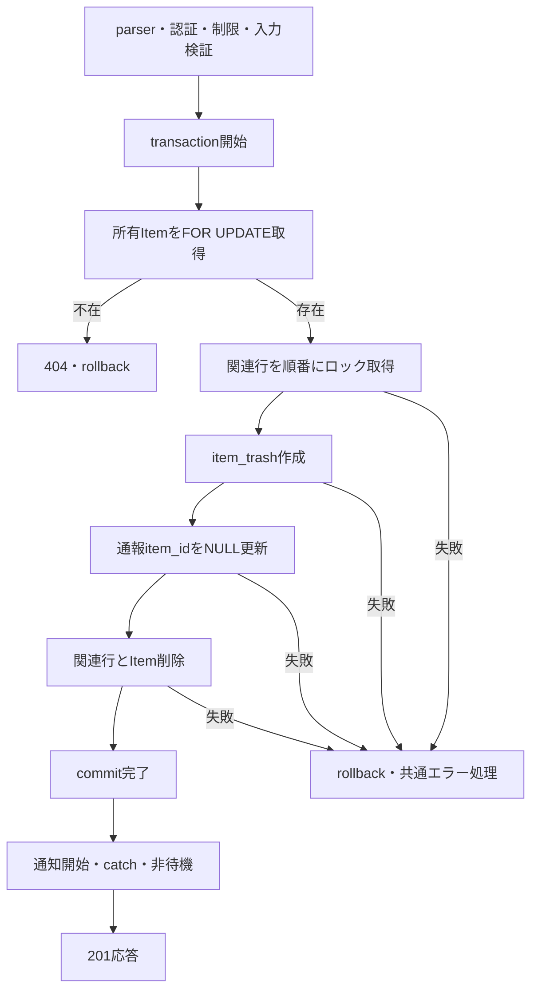

# createItemTrash 詳細設計

基本設計: [商品削除API設計](../../itemDelete.md)

確認日: 2026-11-05。ユーザー回答を反映した確定仕様。外部キー廃止による元ID保持、注文・購入セッション・編集中データのSET NULL、通報の明示NULL更新、関連欠落許可、sale.before_price採用、通知文維持を根拠とする。
ユーザーの明示許可により新規migration 2件をtest_dbへ適用し、実DBテストのスキーマ検査まで確認済み。test_db以外へは適用していない。

## 1. 概要

所有商品をitem_trashへ退避し、video・sale・item_shipping_profileとItemを物理削除する。
active/soldoutのいずれも対象。注文・購入セッション・編集中データ・通報が存在しても削除できる。
画像・動画はURL文字列を保持し、S3実体の複製・削除は行わない。復元API、期限削除cron、旧削除APIの再開は対象外。
失敗時は同一transactionをrollbackし、再作成による補償は行わない。

## 2. API仕様

- POST `/api/item-trash`（Router内 `/`、共通prefix `/api`）
- Bearer認証必須、Item所有者のみ。
- リクエスト・レスポンス: application/json。
- body: `{ "itemId": 123 }`。params/queryは採用しない。
- `z.object({ itemId: z.number().int().positive().max(2147483647) })`。必須、nullable不可、coerceなし、未知キーは除去。検証値はreq.validatedBodyへ格納。
- 成功: commit完了後201 `{ "message": "商品を削除しました" }`。退避IDは応答しない。
- 認証ユーザー単位10分10回。keyは既存形式`admin:<userId>`、このAPI専用MemoryStore。standardHeaders有効、legacyHeaders無効。超過429、ライブラリ既定本文`Too many requests, please try again later.`とRetry-After。失敗要求も計上し、窓終了後再開。
- parser→認証→rateLimit→validateBody→controller。不正JSONは認証前に400。未認証は制限消費なし、schema/業務失敗は消費する。

### 担当ファイル・関数（server/src基準）

| 層 | ファイル | 関数・型 |
| --- | --- | --- |
| route | routes/itemTrash.ts（新規）、routes/index.ts（登録追加） | default Router、registerRoutes |
| 認証 | middleware/authMiddleware.ts（既存） | authenticateToken |
| 制限 | middleware/rateLimit/itemTrashRateLimit.ts（新規） | createItemTrashRateLimit |
| validator | validators/body/itemTrash.ts（新規） | createItemTrashBodySchema、CreateItemTrashBody |
| 検証middleware | middleware/validate/validateBody.ts（既存） | validateBody |
| controller | controllers/itemTrash/itemTrash.ts（新規） | createItemTrashController |
| usecase | usecases/itemTrash/createItemTrash.ts（新規） | createItemTrashUseCase |
| 取得 | services/itemTrash/query.ts（新規） | getMyItemForTrash |
| 退避 | services/itemTrash/command.ts（新規） | createItemTrash |
| 型 | types/serviceType/itemTrash.ts（新規） | CreateItemTrashParams、GetMyItemForTrashParams、ItemForTrash |
| 通報参照解除 | services/itemReport/itemReport.ts（追加） | detachItemReports |
| 関連削除 | services/video/video.ts、services/sale/sale.ts、services/itemShippingProfile/itemShippingProfile.ts（追加） | deleteVideo、deleteSale、deleteShipping |
| 元削除 | services/items/index.ts（既存） | deleteItem |
| 通知 | services/notification/notification.ts（既存） | createNotification |

関連削除引数はそれぞれVideoTransactionParams、SaleTransactionParams、ShippingTransactionParamsを対応serviceTypeへ定義する。
既存getMyItemWithVideoSaleShippingの取得列は変更しない。削除対象関連をロックして取得する専用serviceで既存利用元への影響を避ける。

```ts
// POST /item-trash
// summary: 論理削除商品作成
// page: /item/[id]
```

## 3. 認証・認可

認証済みreq.user.idだけを採用する。bodyのuserId/seller_idは除去し、管理者も所有者条件を迂回しない。
transaction内でItemを`id=itemId AND seller_id=userId`、FOR UPDATEで取得する。不在・他人・削除済みはいずれも404 ITEM_NOT_FOUND。
状態による追加拒否はしない。関連欠落は許容し、存在する関連のみ取得・削除する。

## 4. 処理フロー

1. parser、認証、制限、schema検証を順に通す。
2. controllerが検証済みitemIdと認証userIdをusecaseへ渡す。
3. managed transaction開始。所有Itemをロックして取得。不在なら404。
4. ItemのFKを使いvideo→sale→shippingの順で存在する行をFOR UPDATE取得する。
5. 対応表どおりitem_trashを1行作成する。
6. 対象item_idの通報を明示NULL更新する。
7. 存在するvideo→sale→shippingを削除し、Itemを削除する。
8. 外側transaction Promiseの完了（commit）を待つ。
9. 退避IDを用いて通知を開始し、失敗をcatchする。通知完了を待たず201応答。



## 5. DB操作仕様

取得列は対応表の元列、ItemのID・所有者・status・video_id・sale_id・shipping_idと関連のID。Itemは所有条件付き、関連はそのFKで検索する。
ItemTrashのid・createdAt・updatedAtは新規生成。item_idは元ItemのIDを保持するINTEGERで、外部キーとItemへのbelongsToを廃止する。
画像配列・attributesは値をそのまま退避する。在庫の初期化・復元・新規ID混入はしない。Itemの管理列・販売状態・閲覧数・検索文字列・元の日時・セール割引列は保存対象外。
価格はsale.before_priceだけを採用し、関連なし/NULLならNULL。Item.priceへフォールバックしない。
video・sale・shippingがなければ、その関連に対応する退避列はすべてNULL。任意列のNULLもそのまま保存する。

### 関連行の保持・削除

- Orders・PurchaseSession・ItemEditingのitem_idをnullable・ON DELETE SET NULLに変更する。商品削除時はDBが参照だけをNULLにし、行と他の保存値を保持する。
- ItemReport.item_idはnullable・ON DELETE NO ACTION。商品削除前に`where: { item_id: itemId }`の行を一括NULL更新する。報告者・理由・日時等は維持し、別商品/NULL参照の通報は更新しない。自動updatedAt更新はSequelize既定に従う。
- cart・item_like・comment・watch_history・coupon_item等は既存ON DELETE CASCADEの範囲で削除される。既存制約は変更しない。
- Item・video・sale・shipping各最大1行を削除する。関連がなければ削除serviceを呼ばない。他人の商品・無関係の関連・下書きは対象外。
- 削除ログへの追加記録は基本設計で指定されておらず追加しない。

### item_trashカラム例

元テーブル → item_trash

```ts
{
    id（自動生成）,
    item.id → item_id,
    item.name → name,
    item.detail → detail,
    item.image_url → image_url,
    item.first_image_url → first_image_url,
    sale.before_price → price,
    item.item_condition_id → item_condition_id,
    item.seller_id → seller_id,
    item.gender_type → gender_type,
    item.age_type → age_type,
    item.recommend → recommend,
    item.category_id → category_id,
    item.brand_id → brand_id,
    item.brand_aliases_id → brand_aliases_id,
    item.attributes → attributes,
    video.title → title,
    video.summary → summary,
    video.thumbnail_url → thumbnail_url,
    video.duration → duration,
    video.original_url → original_url,
    video.converted_url → converted_url,
    video.status → video_status,
    item_shipping_profile.shipping_day_id → shipping_day_id,
    item_shipping_profile.shipping_service_id → shipping_service_id,
    item_shipping_profile.shipping_place_id → shipping_place_id,
    item_shipping_profile.shipping_service_free_text → shipping_service_free_text,
    createdAt（自動生成）,
    updatedAt（自動生成）,
}
```

### 更新通知

コミット後にcreateNotificationをtransactionなしで呼び出す。Promiseをawaitせずcatchでエラーを処理する。失敗を成功済み商品のロールバックや500応答へ変換しない。

| 項目          | 値                                                                                                                                                    |
| ------------- | ----------------------------------------------------------------------------------------------------------------------------------------------------- |
| read_user_id  | 認証済みuserId                                                                                                                                        |
| url           | `/item/deleted/${item_trash.id}`                                                                                                                      |
| message_image | item_trash.first_image_url                                                                                                                            |
| message       | `商品「${item_trash.name}」が削除されました。削除された商品の詳細はこちらのページからご確認ください。なお、復元される場合は削除日から30日以内に行ってください。` |
| type          | `ITEM`                                                                                                                                                |

## 6. トランザクション設計

usecaseのsequelize.transaction callback内で取得・退避・通報更新・全削除へ同一transactionを渡す。
callback内失敗時は新規退避行が消え、元Item・関連・通報参照・SET NULL/CASCADEの変更が戻る。
開始失敗は後続なし、commit不成立では通知なし。実COMMIT応答喪失は成否不明であり、常にrollbackできるとは保証しない。commit後のHTTP送信失敗はDBへ戻さない。
ItemのFOR UPDATEを最初に取得し、関連もvideo→sale→shippingの順でロックしてcommit/rollbackまで保持する。READ COMMITTEDを前提に、同一対象の後続は待機後に再評価され、先行commit後は404、先行rollback後は取得・再試行可能。
同じ商品への再送は404、新たな退避や通知なし。別商品はItem行ロックで相互に直列化しない。親ItemのFK参照追加と削除のDB競合を含む全APIの厳密な直列化や、COMMIT応答喪失後の冪等な再実行は保証しない。
通報の新規参照が処理と競合してNO ACTION違反となった場合は例外を伝播して全体rollbackする。通報を取りこぼして部分削除成功とはしない。

### スキーマ変更

新規migrationでItemTrashのitem_id FKを削除し、Orders/PurchaseSession/ItemEditingの削除アクションをSET NULL、ItemReportをnullableへ変更する。onUpdateは従来値を維持。
downは旧制約へ戻すが、削除済みItemへの履歴参照やPurchaseSession/ItemReportのNULLがあると復元できない。既存データを削除・補正せずtransaction全体を失敗させる。
実DBテスト前には適用済みスキーマを検査し、不一致なら書込み前に停止する。
20261105100000に加え、Sequelize 6のREFERENCES付きchangeColumnによるNULL許可反映漏れを補う20261105101000でPurchaseSession/ItemReport.item_idのNOT NULLを明示解除する。適用済みmigrationは変更しない。両方ともtest_dbへ適用済み。

## 7. エラー設計

| 条件 | HTTP・公開本文 | 停止位置 |
| --- | --- | --- |
| 不正JSON | 400 `{code:"INVALID_JSON",message:"JSONの形式を確認してください。"}` | parser、認証/制限前 |
| トークンなし/無効 | 401 `{message:"トークンがありません。"}` / `{message:"トークンが無効です。"}` | 認証、制限前 |
| 回数超過 | 429 ライブラリ既定本文、Retry-After | 制限、schema前 |
| body不正 | 400 INVALID_BODY、既存validateBodyの公開メッセージ | transaction前 |
| 所有Item不在 | AppError ITEM_NOT_FOUND・404・`{code:"ITEM_NOT_FOUND",message:"商品が見つかりません。"}` | transaction内、後続なし |
| Model validation/DB制約/予期しない例外 | 500 `{error:"INTERNAL_SERVER_ERROR",message:"サーバーエラーが発生しました"}` | 元例外を共通errorHandlerへ伝播、内部値非公開 |
| commit後通知失敗 | 成功201を維持 | catchし、確定済みDBへ影響させない |

保存済みデータの独自再検証や値域制約を追加せず、退避時のModel validation/DB制約へ委ねる。通知の非待機・失敗許容はユーザー指定と本設計に基づく。

## 8. テスト設計

[テスト設計書](../../../../../server/test/docs/architecture/itemTrash/createItemTrash.md)と[実行レポート](../../../../../server/test/docs/report/itemTrash/createItemTrash.md)へ詳細ケースと実績を集約する。

- 単体: 全列対応、NULL関連、active/soldout、元データ非破壊、同一transaction引渡し、各段階失敗時の後続未実行、commit後だけ通知、通知失敗・保留でも成功。
- HTTP: 正常201、所有者偽装除去、入力境界、認証/schema/制限の順序、JSON不正、404/500公開応答、10回制限・ユーザー分離・窓終了。
- 実DB: 全値保存、元と関連の消費、通報保持と明示NULL、注文・購入セッション・編集のSET NULL保持、非対象不変、実SQL失敗rollbackと再試行、再送、同一商品競合の実待機。
- 実DBのガードは.env.test由来test_dbだけを許可し、全接続の実DB名と必要スキーマ検査後に書き込む。自作ID限定cleanupと接続終了を確認する。新規migration未反映は自動補正しない。
- 復元API・期限削除・S3実体処理は今回対象外。実COMMIT応答喪失・外部通知永続化はモックによる検証範囲と区別する。

関連Todo: [商品アーカイブ処理の移行](../../../../todo/P1-bug/remove-item-deleted-columns-service-references.md)。復元・期限削除は未完了のまま残す。
