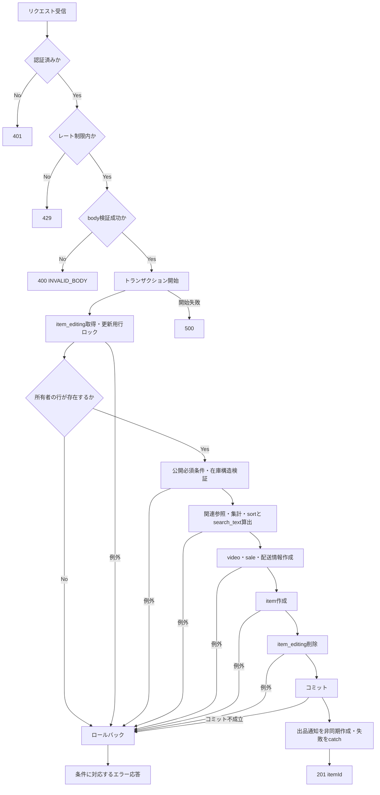

# createItem 詳細設計

基本設計: [商品アップロードAPI設計](../../itemUpload.md)

参照実装: `server/src/usecases/items/upload/publish.ts` の `patchPublishUseCase`。以下は新APIの実装予定仕様であり、旧APIの実装済み動作とは区別する。

## 1. 概要

商品編集セッション（item_editing）から公開商品（item）を生成する。

商品関連データ（video, sale, item_shipping_profile）も商品編集セッション（item_editing）からコピーして生成する。

成功時はコピー元のitem_editingを削除し、生成したitemIdを返す。失敗時はitem_editingを保持する。

処理途中で失敗した場合は、公開商品（item）および商品関連データ（video, sale, item_shipping_profile）の作成を取り消す。

## 2. API仕様

- Method: POST
- Endpoint: /items
- 認証: 必須
- 認可: 商品編集セッション（ItemEditing）所有者のみ（item_editing.seller_idが認証済みuserIdと一致すること）
- Content-Type: application/json
- レート制限: 認証ユーザー単位で10分間に5回（既存の10回から変更予定）。超過時は429。
- 順序: authenticateToken → createItemRateLimit → validateBody(createItemBodySchema) → createItemController
- 不正なbodyも回数に含める。認証・レート制限・body検証で拒否した場合はトランザクションを開始しない。
- JSON構文エラーは共通JSONパーサーで先に拒否されるため、この回数計上の対象外。

### ファイル・関数名

以下のパスは `server/src` 基準。上書き・新規・拡張の記載はすべて実装時の予定。

- route: /routes/items.ts
- rateLimit: /middleware/rateLimit/itemsRateLimit.ts
    - createItemRateLimit（上書き）
- 認証: /middleware/authMiddleware.ts
    - authenticateToken（既存）
- bodyバリデーション: /validators/body/items.ts（ファイル新規）
    - createItemBodySchema（新規）
    - type: CreateItemBody（新規）
    - wrapper: /middleware/validate/validateBody.ts
        - validateBody（既存）
- controller: /controllers/items/items.ts
    - createItemController（上書き）
- usecase: /usecases/itemEditing/createItem.ts（ファイル新規）
    - createItemUseCase（新規）
- service:
    - itemEditing取得: /services/itemEditing/query.ts
        - getMyItemEditing（既存）
    - フォロワー数取得: /services/follow/follow.ts
        - countFollower（既存）
    - 出品商品数取得: /services/items/items.count.ts
        - countSellItem（既存）
    - video生成: /services/video/video.ts
        - createVideo（上書き）
    - sale生成: /services/sale/sale.ts
        - createSale（上書き）
    - item_shipping_profile生成: /services/itemShippingProfile/itemShippingProfile.ts
        - createShipping（上書き）
    - item生成: /services/items/command/create.ts
        - createItem（上書き）
    - itemEditing削除: /services/itemEditing/command.ts
        - deleteItemEditing（新規。取得済みModelとtransactionを受け取る）
    - 出品者取得: /services/users/query.ts
        - getUser（既存、transaction対応を拡張）
    - カテゴリー・親カテゴリー取得: /services/categories/categories.ts
        - getCategories（既存、transaction対応を拡張。親はparent_idで取得）
    - 通知作成: /services/notification/notification.ts
        - createNotification（既存。コミット後の失敗許容処理）
- utility: /utils/normalizeJapanese.ts
    - normalizeJapanese（既存）
- 関連型（/types/serviceType以下）:
    - itemEditing.ts: ItemEditingUserIdParams（既存）、ItemEditingTransactionParams（新規予定）
    - items.ts: CreateItemParams（dataとtransactionを受け取る形へ変更）、UserIdParams（countSellItem用のtransaction対応を追加）
    - video.ts: CreateVideoParams、sale.ts: CreateSaleParams、itemShippingProfile.ts: CreateShippingParams（各dataとtransactionを受け取り、作成したModelを返す形へ変更）
    - users.ts: UserIdParams、categories.ts: CategoryIdParams、follow.ts: CountParams（対象取得・集計用に任意transactionを追加予定）
    - notification.ts: CreateNotificationParams（既存）

controllerは `req.user!.id` と `req.validatedBody as CreateItemBody` を取得し、usecaseへ `{ userId, itemEditingId }` を渡す。usecaseは `Promise<number>` としてコミット済みitemIdを返す。業務判定・変換はusecase、DB操作はserviceで行う。

getMyItemEditingはtransaction指定時の更新用行ロックを既存利用する。countFollower・countSellItemは同一transactionを渡せるように拡張する。既存呼び出しへの影響は実装時に確認する。

### bodyリクエスト

```json
{
    "itemEditingId": 123
}
```

### バリデーション

- `validateBody(createItemBodySchema)`（既存middleware）でZodを適用し、結果を `req.validatedBody` に格納する。
- itemEditingId: 1〜2147483647の整数、必須（DBのINTEGER範囲）
- 入力元はbodyのみ。params・queryからitemEditingIdを取得しない。
- `z.object({ itemEditingId: z.number().int().positive().max(2147483647) })` とし、文字列から数値への変換は行わない。未定義キーはparse結果から除外する。
- 未指定・null・文字列・小数・範囲外を含む不正なリクエストは400 / INVALID_BODYを返す。

### レスポンス

成功時: 201 Created

```json
{
    "itemId": 456
}
```

controllerは既存の作成APIと同様、201で `{ itemId }` を直接JSON返却する。成功応答はコミット完了後とする。

### 三行コメント

```ts
// POST /items
// summary: 販売中商品作成
// page: /item/confirm/[id]
```

## 3. 認証・認可

所有者確認の対象はコピー元のItemEditingとする。ItemやItemDraftを認可対象にしない。

1. authenticateTokenが検証したBearerトークンの `req.user.id` を使用する。bodyのseller_id等は使用しない。
2. トランザクション内でgetMyItemEditingへitemEditingId・userId・transactionを渡し、更新用行ロック付きで取得する。
3. 対象が存在しない場合、他人のセッションの場合、先行処理で削除済みの場合はいずれも404 / ITEM_EDITING_NOT_FOUNDとする。
4. ロック取得後の行で認可と公開前提条件を判定する。事前取得した値をコピーしない。

### getMyItemEditing 認可

```ts
where: {
    id: itemEditingId,
    seller_id: userId,
}
```

ItemEditingにはstatus・deleted_atがないため、それらの取得条件は追加しない。item_idが設定された既存商品編集セッションの扱いは9章で確認する。

## 4. 処理フロー

前提: authenticateTokenで認証済みであること。未認証の場合は401を返し、以下の処理を実行しない。

1. 認証 → レート制限 → body検証を完了する。
2. controllerが認証済みuserIdと検証済みitemEditingIdを渡す。
3. usecaseでDBトランザクションを開始する。
4. getMyItemEditingで対象行を更新用ロック付きで取得し、存在・所有者を確認する。
5. 公開必須データを確認し、attributesを検証・複製して在庫を初期化する（5章）。公開必須条件の未確定部分は9章を参照。
6. 出品者・カテゴリー・親カテゴリー・フォロワー数・出品商品数を同一transactionで取得し、sortと正規化したsearch_textを算出する。
7. video → sale → item_shipping_profileを各1件作成してIDを取得する。
8. コピー項目・公開管理値・算出値・関連IDを指定してitemを1件作成する。
9. ロック済みitem_editingをdeleteItemEditingで削除する。
10. すべて成功したらコミットする。3〜9の途中で例外が発生した場合は成功応答せず、開始済みtransactionをロールバックして共通errorHandlerへ渡す。
11. コミット後、旧APIと同じ出品通知の作成を開始する。通知失敗はcatchで処理し、公開結果を取り消さない。
12. 201 / `{ itemId }` を返す。

### 処理フロー図



## 5. DB操作仕様

### 参照テーブル

- item_editing: `id = itemEditingId AND seller_id = userId`。更新用行ロックを取得する。
- user: `id = userId`。user_name・user_introduction・penalty_pointsを使用する。
- categories: `id = itemEditing.category_id`、親は取得したカテゴリーのparent_idで取得する。category_idまたはparent_idがnullなら該当取得を省略する。
- follow: `follower_user_id = userId` の件数（countFollower）。
- item: `seller_id = userId AND status IN ('active', 'soldout')` の件数（countSellItem）。現行serviceにはdeleted_at除外条件がない。計数対象は9章で確認する。

出品者・カテゴリー等は別クエリで取得し、nullableな関連への外部結合全体をFOR UPDATEする設計にはしない。ItemEditingにVideo関連はなく、動画情報は直下カラムを使う。

### 書き込みテーブル

- item
- item_shipping_profile
- sale
- video

### 削除テーブル

- item_editing: ロック・認可済みの1行を同一transactionで物理削除する。item_draftや既存itemは変更しない。

### 公開前提条件

- bodyのID検証とは別に、ロック済みの保存データをusecaseで確認し、作成serviceの呼び出し前に停止する。
- 既存の確認画面保存処理ではoriginal_url・thumbnail_urlが必須、image_urlは1枚以上、priceは整数300〜1000000で検証される。公開時にも保存済み値を確認する。
- Modelはname・price・動画・配送等でnullを許容するため、DB制約だけを公開必須チェックの代用にしない。
- 基本設計の「公開必須項目がすべて存在する」「video等の必須関連データが存在する」は維持する。具体的な文字列の空値、配送・カテゴリーの必須条件、動画変換の完了条件、公開時のマスター再検証範囲は9章で確定する。
- video・sale・item_shipping_profileはitem_editingの直下カラムから新規生成する。元の関連レコードIDやVideoインスタンスの存在を要求しない。

### コピー仕様

- 保存済みattributesの在庫構造が不正な場合はITEM_ATTRIBUTES_INVALID・500で作成前に停止する。商品/色のinventoryとcolorVariants/sizesの欠落は許容するが、各サイズのinventoryは必須。在庫オブジェクトのinitial/current/low_stock_ratioは有限数値とする。元データの補完・補正は行わない。
- seller_idは認証済みユーザーのIDを使用する
- item.idは新規採番する
- createdAt、updatedAtは新規生成する
- 商品入力データはitem_editingから引き継ぐ
- attributesの在庫情報は、コピー時に以下の各inventory.currentを同じinventory内のinitialに戻す
    - 商品: attributes.inventory.current
    - 色: attributes.colorVariants[].inventory.current
    - サイズ: attributes.colorVariants[].sizes[].inventory.current
    - initialおよびその他の在庫情報は引き継ぐ
- video・sale・item_shipping_profileのidはそれぞれ新規採番し、**item.video_id / item.sale_id / item.shipping_idに設定する**。関連側にitem_idを保存しない（現行Modelおよび20261005062153のmigrationに合わせる。DB反映済みとはみなさない）。
- attributesは元データを変更せず深いコピーを作る。トップレベル・色・サイズはオブジェクト、colorVariants・sizesは存在すれば配列とする。nullや不正型、サイズinventory欠落、NaN・Infinity・数値文字列はITEM_ATTRIBUTES_INVALID。空オブジェクト・空配列と任意階層の欠落は許容する。
- materials・body_category・lifestyle_category・layer・uiId・色名・サイズ名・画像URLを含め、current以外のJSON値を維持する。在庫の正負・整数等の公開業務条件は構造検証と区別し、9章で確定する。
- 画像・動画URLは文字列をコピーする。S3実体のコピー・削除や署名URL発行は本処理で行わない。成功後も公開商品が参照するオブジェクトを保持する。

### コピー対応

- item_editing → item

```ts
{
    name,
    detail,
    image_url,
    price,
    item_condition_id,
    seller_id: userId,
    first_image_url,
    gender_type,
    age_type,
    recommend,
    category_id,
    brand_id,
    brand_aliases_id,
    attributes,
    views_count: 0,
    sort_number: sort,
    sort_buzz_number: sort,
    search_text: normalizedSearchText,
    video_id: videoId,
    sale_id: saleId,
    shipping_id: shippingId,
    status: "active",
    uploaded_at: now,
    save_at: now,
    early_sell: true,
    deleted_at: null,
    checked: false,
    report_score: 0,
}
```

itemのuploaded_at・save_atにはusecase内で生成した同じ公開日時を渡す（旧updatePublishItemの動作を継承）。createdAt・updatedAtは各新規レコードの作成日時とする。item_editing.item_id・id・createdAt・updatedAtはコピーしない。関連への参照方向以外の既存Model制約・associate定義は維持する。

- item_editing → video

```ts
{
    thumbnail_url,
    title,
    summary,
    duration,
    play_count: 0,
    original_url,
    converted_url,
    status: video_status,
}
```

- item_editing → sale

```ts
{
    before_price,
    discount_rate: null,
    discount_amount: null,
    sale_flag: false,
}
```

- item_editing → item_shipping_profile

```ts
{
    shipping_day_id,
    shipping_service_id,
    shipping_place_id,
    shipping_service_free_text,
}
```

### sort・search_text

旧patchPublishUseCaseの計算を継承し、動画項目の参照だけをitem_editing直下へ変更する。

```ts
let sort =
    Number(itemEditing.price) / 10 +
    (itemEditing.detail?.length ?? 0) +
    (itemEditing.summary?.length ?? 0) +
    (user.user_introduction?.length ?? 0) +
    followerCount * 10 +
    sellItemCount * 10;

if (Number(user.penalty_points) <= 5) {
    sort += 5000;
}

const searchText = `
    ${itemEditing.name}
    ${itemEditing.title ?? ""}
    ${category?.name ?? ""}
    ${parentCategory?.name ?? ""}
    ${user.user_name ?? ""}
    `;
const normalizedSearchText = normalizeJapanese(searchText);
```

- sort_number・sort_buzz_numberには同じsort、search_textにはnormalizedSearchTextを保存する。
- normalizeJapaneseはNFKC正規化・小文字化・カタカナからひらがなへの変換・空白除去を行う。
- summary・紹介文・カテゴリー名・親カテゴリー名・ユーザー名の欠落は上記fallbackに従う。ただし公開必須条件で要求される項目の欠落を、このfallbackで許容しない。
- user自体が取得できない場合は保存データの不整合として500にし、認可済みIDだけで出品者情報を補完しない。
- 出品商品数の取得は作成前とするが、旧APIとの差異に関する未決定事項は9章を参照する。

### 出品通知

コミット後にcreateNotificationをtransactionなしで呼び出す。旧APIの失敗許容動作を継承し、Promiseをawaitせずcatchでエラーを処理する。失敗を成功済み商品のロールバックや500応答へ変換しない。

| 項目 | 値 |
| --- | --- |
| read_user_id | 認証済みuserId |
| url | `/item/${itemId}`（新規商品ID） |
| message_image | コピーしたfirst_image_url |
| message | `商品「${name}」を出品いただき誠にありがとうございます。商品の詳細はこちらの商品ページからご確認ください。` |
| type | `ITEM` |

expires_at等は既存createNotificationの規約に従う。コミット前の失敗や404の再リクエストでは通知を作成しない。通知の永続化・再送は本APIの成功条件に含めない。

## 6. トランザクション設計

usecaseの `sequelize.transaction(async (transaction) => ...)` を使い、次のすべてに同一transactionを渡す。

- getMyItemEditing（取得と更新用行ロック）
- getUser・getCategories・countFollower・countSellItem（計算用参照）
- createVideo・createSale・createShipping・createItem（各新規生成）
- deleteItemEditing（コピー元の削除）

ロック保持期間はgetMyItemEditingの取得からコミット／ロールバックまで。認証・レート制限・body検証は開始前、通知はコミット後に置く。serviceはtransactionを開始・終了せず、DBエラーをusecaseへ伝播する。

### 成功時・失敗時

- 成功時はitem・video・sale・item_shipping_profileが各1件生成され、元のitem_editingが削除される。
- 作成や削除等が失敗した場合は全DB変更をロールバックし、元のitem_editingを保持する。孤立した関連レコードは残さない。別transactionによる削除補償は行わない。
- transaction開始失敗時も成功応答しない。コミット要求の通信断等で成否を確定できない場合は成功を断定せず、再試行が404になる可能性を考慮する。クライアントへの応答失敗でコミット済みDBを巻き戻すことはできない。

### 排他制御

- 同一itemEditingIdの公開は更新用行ロックで直列化する。トランザクション開始だけでは重複防止にならない。
- 後続リクエストはロック待機後、存在・所有者と公開前提条件を再判定する。先行がコミットして削除済みなら404で追加生成しない。先行がロールバックしたら保持された行から再試行できる。
- 確認画面保存（updateConfirm）や削除・期限切れ削除との競合では、先にロックを取得した処理の結果に従う。更新後なら更新済みデータを公開し、削除後・所有者変更後なら404にする。公開が先なら元行の更新・削除側は公開後の不存在を扱う。
- ロック後に取得した行のみをコピーし、同じセッションからの重複公開を禁止する。異なるセッションからの出品は許容する。
- 集計元のfollow・他item全体はロックしない。別セッションの同時出品やフォロー変更を含む件数の厳密な直列化は保証しない。

## 7. エラー設計

| 発生条件 | HTTP | エラーコード／応答 |
| --- | --- | --- |
| トークンなし・無効・期限切れ | 401 | authenticateTokenの既存message形式（固定codeなし） |
| 10分間の6回目以降 | 429 | 既存express-rate-limitの応答・ヘッダーを使用（固定codeなし） |
| JSON構文不正 | 400 | INVALID_JSON（共通JSONパーサー・errorHandler） |
| itemEditingIdの未指定・型不正・範囲外 | 400 | INVALID_BODY |
| セッション不存在・所有者不一致・消費済み | 404 | ITEM_EDITING_NOT_FOUND |
| original_url欠落 | 400 | VIDEO_URL_NULL（既存コードを利用予定） |
| thumbnail_url欠落 | 400 | THUMBNAIL_URL_NULL（既存コードを利用予定） |
| image_url欠落・空配列 | 400 | ITEM_IMAGE_NULL（既存コードを利用予定） |
| image_urlが10枚超 | 400 | ITEM_IMAGE_LIMIT_EXCEEDED（既存コードを利用予定） |
| その他公開前提条件不成立 | 未確定 | 9章で条件・HTTP・コードを確定する |
| 保存済みattributesの在庫構造不正 | 500 | ITEM_ATTRIBUTES_INVALID |
| 出品者レコード欠落・DB取得／集計／作成／削除失敗等 | 500 | 共通errorHandlerに従う。業務AppErrorの追加コードは未確定 |

業務エラーはAppErrorで表し、controllerがnext(err)へ渡す。AppErrorのJSONは `{ code, message }`。AppError以外の予期しないDB例外等は既存の `{ error: "INTERNAL_SERVER_ERROR", message: "サーバーエラーが発生しました" }` とする。認証・レート制限の応答をこの形式へ変更しない。

```json
{
    "code": "ITEM_EDITING_NOT_FOUND",
    "message": "ITEM_EDITING_NOT_FOUND"
}
```

上記はpublicMessage未指定の場合。個別の案内文を設定する場合も既存AppError規約に従う。トランザクション開始後のエラーはロールバック完了後に応答する。

## 8. テスト設計

以下は実装時の確認項目であり、実行済み結果ではない。未確定の公開条件は9章の確定後に期待値を追加する。

### 正常系・コピー内容

- 所有者のセッションから201 / `{ itemId }` が返り、item・video・sale・item_shipping_profileが各1件生成され、元セッションが削除される。
- 5章の全カラム対応、認証済みseller_id、新規ID・日時、公開status、公開日時・管理初期値、関連IDの参照方向を確認する。
- セール入力値が存在してもdiscount_rate・discount_amountはnull、sale_flagはfalseとなり、before_priceのみ引き継ぐ。
- 商品・色・サイズのinventory.currentだけがinitialへ戻り、initial・low_stock_ratio・その他JSONが保持される。元オブジェクトを変更しない。
- 任意inventory・colorVariants・sizesの欠落、空オブジェクト・空配列、任意カラムのnullを許容する範囲で確認する。
- summary・紹介文の長さ、フォロワー数・出品商品数、penalty_pointsの5以下／超過がsortへ反映され、2つのsort値が一致する。
- search_textが商品名・動画タイトル・カテゴリー・親・ユーザー名から生成され、全半角・英大文字・カタカナ・空白の正規化と任意関連欠落を確認する。
- 通知宛先・新規商品URL・画像・文言が正しく、コミット後だけ呼ばれる。通知失敗でも201と公開済みDB状態を維持する。

### 入力・認証・境界値

- itemEditingIdの1・2147483647を受付可能とし、0・負数・2147483648・小数・文字列・null・未指定・不正bodyを400とする。上限IDに行がなければ404となる。
- JSON構文不正を400 / INVALID_JSONとし、DBを開始しない。正常JSONの不正IDはレート制限回数へ含める。
- 未認証・無効／期限切れトークンは401、他人・不存在・消費済みは同じ404で、作成・通知を行わない。
- 同一ユーザーは5回まで受付、6回目は429、別ユーザーは独立し、期間終了後に再受付できる。429とbody検証失敗ではDBを開始しない。
- 画像枚数0・1・10・11、priceの299・300・1000000・1000001と非整数、公開必須URLの欠落を確認する。未確定の価格エラーコード等は仕様確定後に検証する。

### 保存済みデータ・異常系

- attributesや配列・要素のnull／不正型、各inventoryのnull・キー欠落・数値文字列・非有限数値、サイズinventory欠落は500 / ITEM_ATTRIBUTES_INVALIDで、作成serviceへ進まない。
- 出品者欠落、関連取得・各集計の失敗、video・sale・配送・itemの各作成失敗、item_editing削除失敗、DB制約違反時に成功応答・通知を行わない。
- 各途中失敗で4テーブルへの追加がすべて取り消され、コピー元・他ユーザーのセッション・既存商品・item_draftは変更されない。
- transaction開始失敗・コミット失敗を区別する。コミット不成立を確認できる場合は元行を保持し、成否不明の通信断を単純なロールバック成功扱いにしない。

### 並行処理・状態遷移

- 同じセッションの同時公開は先行のみ成功し、待機後の後続は404、4テーブル各1件・通知開始1回となる。成功後の再送も追加生成しない。
- 先行ロールバック後は後続が保持されたセッションから生成でき、失敗後の再試行も成功する。
- 確認画面保存との競合ではロック後の最新データをコピーする。削除・期限切れ削除・所有者変更との競合ではロック後の存在・所有者に従い、古いデータで生成しない。
- 公開が先の場合、待機中の更新・削除で公開商品や関連行が変更されないことを確認する。
- 異なるセッションの公開はそれぞれ成功する。集計値の同時変更について厳密な件数直列化を期待しない。

単体テストでは入力・変換・分岐・serviceへの同一transactionの引き渡し・通知実行時点を確認する。HTTP結合ではmiddleware順序・応答形式・拒否後のDB未開始を確認する。実DB結合では生成件数・ロールバック・実際のロック待機とコミット後の再判定を確認し、serviceモックだけで排他制御の保証としない。

## 9. 未決定事項

- 公開必須項目の最終定義。name・title・detail・summaryの空文字可否、category_id・item_condition_id・配送各ID・自由記入の必須条件、在庫0の公開可否、動画のduration・converted_url・video_statusとアップロード実体確認の要否を確定する。既存保存APIやModelのnull許容だけで公開可と判断しない。
- 公開時のマスター再検証範囲と、価格・その他公開前提条件不成立時のHTTP・AppErrorコード／案内文。未確定部分を実装時に推測で補わない。
- item_editing.item_idが非nullの既存商品編集セッションを新規出品APIで受け付けるか。基本設計は既存商品更新との区別を定義していないため、対象範囲と拒否時応答を確認する。
- countSellItemの新商品自身の扱い。旧APIは既存itemを公開するため、その行が集計対象に含まれる場合がある。新APIは作成前集計となるため、同値にするための1件加算の要否を確認する。deleted_at非null行を含める現行serviceの条件を変更するかも確認し、独断で変更しない。
- モデル・migrationは参照済みだが、実DBの反映状態は未確認。実装時に反映後DBを正として制約を照合する。本作業ではmigrationを作成・実行しない。

### 旧APIの置き換え予定（実装時のみ）

- usecase: createItemsUseCase
- usecase: patchPublishUseCase
- controller: publishItemController
- route: post("/")
- route: patch("/:id/publish")
- rateLimit: uploadPublishItemRateLimit

POST /itemsはURL自体を削除せず、旧「空の商品作成」handlerを新しい編集セッションからの公開handlerへ置き換える。PATCH /items/:id/publishは廃止予定。呼び出し側・export・旧型の参照確認は実装時に行う。本作業では旧APIの削除・変更は行わない。
