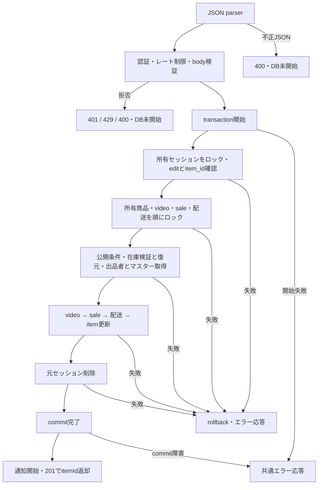

# updateItem 詳細設計

基本設計: [商品アップロードAPI設計](../../itemUpload.md)

更新: 2026-10-23。基本設計と同日のユーザー回答1〜4を根拠に確定。編集セッションのstatusと商品のstatusを区別し、双方を認可対象とする。新規公開createItemのname/title空文字拒否も同回答に基づく。

参照: [編集セッション作成](../itemEditing/createItemEditingCopy.md)、[新規公開](createItem.md)。Model・migrationのみで実DBへ反映済みとは判断しない。必要な実スキーマはテスト接続時のガードで確認し、migration・syncは実行しない。

## 1. 概要

商品編集セッション（item_editing）から公開商品（item）を更新する。

商品関連データ（video, sale, item_shipping_profile）も商品編集セッション（item_editing）からコピーして更新する。

成功時はコピー元のitem_editingを削除し、取得したitemIdを返す。失敗時はitem_editingを保持し、itemは更新しない。

処理途中で失敗した場合は、公開商品（item）および商品関連データ（video, sale, item_shipping_profile）の更新を取り消す。

## 2. API仕様

- Method: PUT
- Endpoint: /items
- 認証: 必須
- 認可: ItemEditingと更新対象Itemの双方のseller_idが認証済みuserIdと一致すること
- Content-Type: application/json
- レート制限: 認証ユーザー単位で10分間に5回。超過時は429。
- 順序: authenticateToken → updateItemRateLimit → validateBody(updateItemBodySchema) → updateItemController
- 不正なbodyも回数に含める。認証・レート制限・body検証で拒否した場合はトランザクションを開始しない。
- JSON構文エラーは共通JSONパーサーで先に拒否されるため、この回数計上の対象外。

### ファイル・関数名

以下のパスは `server/src` 基準。

- route: /routes/items.ts
- rateLimit: /middleware/rateLimit/itemsRateLimit.ts
    - updateItemRateLimit（新規）
- bodyバリデーション: /validators/body/items.ts
    - updateItemBodySchema（新規）
    - type: UpdateItemBody（新規）
    - wrapper: /middleware/validate/validateBody.ts
        - validateBody（既存）
- controller: /controllers/items/items.ts
    - updateItemController（新規）
- usecase: /usecases/items/update/updateItem.ts（ファイル新規）
    - updateItemUseCase（新規）
- service:
    - itemEditing取得: /services/itemEditing/query.ts
        - getMyItemEditing（既存）
    - item取得: /services/items/query/relation.ts
        - getMyItemForUpdate（新規。所有者条件・transaction必須で商品と各関連を順にロック）
    - video更新: /services/video/video.ts
        - updateVideo（既存関数を再利用し、DTO型を拡張。今回の追加前に本番呼出し元なし）
    - sale更新: /services/sale/sale.ts
        - updateSale（変更。既定の割引値をusecaseの明示DTOへ移動。今回の追加前に本番呼出し元なし）
    - item_shipping_profile更新: /services/itemShippingProfile/itemShippingProfile.ts
        - updateShipping（既存。明示DTO・transactionを受け取る既存実装を再利用）
    - item更新: /services/items/command/update.ts
        - updateItem（新規）
    - itemEditing削除: /services/itemEditing/command.ts
        - deleteItemEditing（既存）
    - 出品者取得: /services/users/query.ts
        - getUser（既存）
    - カテゴリー・親カテゴリー取得: /services/categories/categories.ts
        - getCategories（既存のtransaction対応を使用。親はparent_idで取得）
    - 通知作成: /services/notification/notification.ts
        - createNotification（既存。コミット後の失敗許容処理）
    - 必須マスター検証: /usecases/shared/validateMaster.ts（既存。5種類の存在確認）
- service型: /types/serviceType/{items,video,sale,itemShippingProfile}.ts
    - UpdateItemParams・GetMyItemForUpdateParams（新規）、UpdateVideoParams・UpdateSaleParams（変更）
- utility: /utils/normalizeJapanese.ts
    - normalizeJapanese（既存）

### bodyリクエスト

```json
{
    "itemEditingId": 123
}
```

### バリデーション

- `validateBody(updateItemBodySchema)`（既存middleware）でZodを適用し、結果を `req.validatedBody` に格納する。
- itemEditingId: 1〜2147483647の整数、必須（DBのINTEGER範囲）
- 入力元はbodyのみ。params・queryからitemEditingIdを取得しない。
- `z.object({ itemEditingId: z.number().int().positive().max(2147483647) })` とし、文字列から数値への変換は行わない。未定義キーはparse結果から除外する。
- 未指定・null・文字列・小数・範囲外を含む不正なリクエストは400 / INVALID_BODYを返す。

### レスポンス

成功時: 201 Created

```json
{
    "itemId": 456
}
```

### 三行コメント

```ts
// PUT /items
// summary: 商品情報編集
// page: /item/confirm/edit/[id]
```

## 3. 認証・認可

1. authenticateTokenが検証したBearerトークンの`req.user.id`を採用する。bodyのseller_id/userIdやqueryのIDは使わない。
2. 同一transaction内でgetMyItemEditingを`id=itemEditingId AND seller_id=userId`、更新用行ロックで取得。不存在・他人・消費済みは404 / ITEM_EDITING_NOT_FOUND。
3. ロック後のセッションが`status=edit`かつ`item_id`が整数1〜2147483647であること。normal・null・不正IDは400 / ITEM_EDITING_STATE_INVALID。
4. 保存されたitem_idをgetMyItemForUpdateへ渡し、`id=item_id AND seller_id=userId`で更新用ロック。不存在・他人は404 / ITEM_NOT_FOUND。更新前のitem.statusをactiveに限定しない。
5. 商品のvideo_id・sale_id・shipping_idが指す既存行を同じtransactionで順にロックし、欠落は500 / ITEM_RELATION_NOT_FOUND。補完生成しない。下書きは操作しない。

### getMyItemEditing 認可

```ts
where: {
    id: itemEditingId,
    seller_id: userId,
}
```

## 4. 処理フロー

前提: authenticateTokenで認証済みであること。未認証の場合は401を返し、以下の処理を実行しない。

1. 共通JSON parser → 認証 → レート制限 → body検証 → controller。実URLは`/api/items`、Router内相対パスは`/`。
2. controllerは認証済みuserIdとvalidatedBody.itemEditingIdだけをusecaseへ渡す。
3. managed transaction開始 → セッション取得・ロック・所有者/状態確認 → 商品と関連取得・ロック・所有者/関連存在確認。
4. 保存済み公開条件を順に検証 → attributesの構造検証・深いコピー・全階層current復元。
5. getUser（id/user_name）、validateMaster、必要なら親カテゴリを同じtransactionで取得。user欠落は500 / USER_NOT_FOUND。
6. 正規化search_textを計算。video → sale → shipping → itemを順に更新し、同じtransactionで元ItemEditingを削除する。
7. 外側transaction Promiseのcommit完了を待つ。失敗はrollback後に共通errorHandlerへ伝播し、後続更新・通知・成功応答へ進まない。
8. commit成功後のみ更新通知を開始（非待機・失敗捕捉）し、既存item.idを返す。controllerは201 / `{ itemId }`を返す。

### 処理フロー図



## 5. DB操作仕様

### 参照テーブル

- item_editing
- item
- user
- categories（親を含む）、item_condition_option、shipping_day_option、shipping_service_option、todouhuken_option
- video、sale、item_shipping_profile（更新対象の既存関連）

getMyItemEditingはコピー元の全保存列を取得する。getMyItemForUpdateはitemのid/seller_id/status/video_id/sale_id/shipping_idだけを取得し、関連は各idだけを取得する。所有者検索・ロック後のインスタンスへ明示DTOで更新し、未指定の管理列を保存対象へ混入させない。

### 書き込みテーブル

- item
- item_shipping_profile
- sale
- video

### 削除テーブル

- item_editing

### 公開前提条件

判定順は以下。保存済みデータはModelの型だけで検証済みとみなさない。

1. original_url非空（VIDEO_URL_NULL）、thumbnail_url非空（THUMBNAIL_URL_NULL）。
2. image_urlが1〜10枚（0枚/null: ITEM_IMAGE_NULL、11枚以上: ITEM_IMAGE_LIMIT_EXCEEDED）。
3. category_id・item_condition_id・shipping_day_id・shipping_service_id・shipping_place_idは整数1〜2147483647必須。brand_id・brand_aliases_idはそれぞれnull許容、非nullなら同じ整数範囲。不正は400 / INVALID_NUMBER。
4. name・titleは空文字でない文字列、first_image_url非空、priceは300〜1000000の整数。不正は400 / ITEM_PUBLISH_DATA_INVALID。空白だけの文字列のtrim・拒否は追加しない。
5. attributes全体・色・サイズはobject、colorVariants/sizesは存在すれば配列。商品inventoryは必須、色inventoryは任意、サイズinventoryは必須。各inventoryのinitial/current/low_stock_ratioは有限数値。欠落・null・不正構造は500 / ITEM_ATTRIBUTES_INVALID。
6. 各階層のinitialは0以上の整数。不正は400 / ITEM_PUBLISH_DATA_INVALID。構造検証を全体に行ってから値域検証・復元し、元attributesを変更しない。
7. category/condition/day/service/placeのマスター存在をvalidateMasterで順に確認する。不在は既存の個別404。親カテゴリはparent_idがある場合だけ取得、欠落なら検索文字列に空文字を使用する。ブランド対応の追加検証は行わない。

name/titleの空文字拒否はcreateItemにも反映する。他のcreateItem条件は今回変更しない。detail/summary/duration/converted_url/video_status/recommend/配送自由文のnullを保持する。動画変換完了・URL形式・S3所有キー・実体の再検証は行わない。

### コピー仕様

- 保存済みattributesの在庫構造が不正な場合はITEM_ATTRIBUTES_INVALID・500で更新前に停止する。商品inventoryは必須。色inventoryとcolorVariants/sizesの欠落は許容するが、各サイズのinventoryは必須。在庫オブジェクトのinitial/current/low_stock_ratioは有限数値とする。元データの補完・補正は行わない。
- 既存itemとvideo/sale/shippingのid・FK・createdAtを維持し、updatedAtはSequelize更新日時とする。新規関連行は作らない。
- itemのseller_id・views_count・sort_number・sort_buzz_number・uploaded_at・early_sell・checked・report_score、video.play_countを維持する。その他テーブル・他商品・他セッション・下書きは変更しない。
- item.save_atはusecase内の更新日時nowを保存する。
- 商品入力データはitem_editingから引き継ぐ
- attributesの在庫情報は、コピー時に以下の各inventory.currentを同じinventory内のinitialに戻す
    - 商品: attributes.inventory.current
    - 色: attributes.colorVariants[].inventory.current
    - サイズ: attributes.colorVariants[].sizes[].inventory.current
    - initialおよびその他の在庫情報は引き継ぐ
- materials・body_category・lifestyle_category・layer・uiId・色名・サイズ名・画像URLを含め、current以外のJSON値を維持する。
- 画像・動画URLは文字列をコピーする。S3実体のコピー・削除や署名URL発行は本処理で行わない。成功後も公開商品が参照するオブジェクトを保持する。

在庫復元後の**商品階層**currentでitem.statusを決める。色・サイズの合計から商品在庫を再計算しない。編集前の販売済み数量は引き継がず、編集在庫で上書きする。

### コピー対応

- item_editing → item

```ts
{
    name,
    detail,
    image_url,
    price,
    item_condition_id,
    first_image_url,
    gender_type,
    age_type,
    recommend,
    category_id,
    brand_id,
    brand_aliases_id,
    attributes,
    search_text: normalizedSearchText,
    status: attributes.inventory.current >= 1 ? "active" : "soldout",
    save_at: now,
}
```

- item_editing → video

```ts
{
    thumbnail_url,
    title,
    summary,
    duration,
    original_url,
    converted_url,
    status: video_status,
}
```

- item_editing → sale

```ts
{
    before_price,
    discount_rate: null,
    discount_amount: null,
    sale_flag: false,
}
```

- item_editing → item_shipping_profile

```ts
{
    shipping_day_id,
    shipping_service_id,
    shipping_place_id,
    shipping_service_free_text,
}
```

### search_text

```ts
const searchText = `
    ${itemEditing.name}
    ${itemEditing.title ?? ""}
    ${category?.name ?? ""}
    ${parentCategory?.name ?? ""}
    ${user.user_name ?? ""}
    `;
const normalizedSearchText = normalizeJapanese(searchText);
```

### 更新通知

コミット後にcreateNotificationをtransactionなしで呼び出す。旧APIの失敗許容動作を継承し、Promiseをawaitせずcatchでエラーを処理する。失敗を成功済み商品のロールバックや500応答へ変換しない。

| 項目          | 値                                                                                                          |
| ------------- | ----------------------------------------------------------------------------------------------------------- |
| read_user_id  | 認証済みuserId                                                                                              |
| url           | `/item/${itemId}`（商品ID）                                                                             |
| message_image | コピーしたfirst_image_url                                                                                   |
| message       | `商品「${name}」が更新されました。商品の詳細はこちらの商品ページからご確認ください。` |
| type          | `ITEM`                                                                                                      |

expires_at等は既存createNotificationの規約に従う。コミット前の失敗や404の再リクエストでは通知を作成しない。通知の永続化・再送は本APIの成功条件に含めない。

## 6. トランザクション設計

`sequelize.transaction(async (transaction) => ...)`をusecaseで開始し、セッション取得・商品/関連取得・ユーザー/マスター/親取得・4テーブル更新・元行削除まで同じtransactionを渡す。認証・入力拒否は開始前、通知はcommit後。serviceはcommit/rollbackを管理しない。

### 成功時・失敗時

- 成功は既存4行の更新と元セッション1行の物理削除。新規商品・関連生成なし。commit前の更新・元行削除失敗は全変更をrollbackし元セッションを保持する。
- transaction開始失敗も成功応答しない。COMMIT応答喪失等で成否不明の場合はrollback成功と断定しない。commit後のHTTP送信失敗はDBを戻さない。成功後の再送は消費済みセッションの404。

### 排他制御

- ロック順はItemEditing → Item → Video → Sale → ItemShippingProfile。関連外部結合へFOR UPDATEせず、親のFK確定後に個別に取得・ロックする。取得値はロック後の最新行を使う。
- 同一セッションは先行commit後の後続が404、先行rollback後は再実行できる。
- 別セッション・同一商品はItemロックで直列化し、各セッションが所有権/関連条件を満たす場合はそれぞれ成功する。後続の保存内容で上書きし、商品・関連を追加生成しない。編集開始時点からの楽観ロックは設けない。
- セッション保存・削除・所有者変更、および商品所有者変更・削除と競合した場合も待機後に再判定する。所有者変更/削除なら対象404、セッションがnormalへ変われば400。最新のセッションデータをコピーする。
- マスター全体のロックや他API全体のロック順変更は対象外。DBのdeadlock等は例外を伝播し、無制限に自動再試行しない。

## 7. エラー設計

| 条件 | HTTP | 公開コード/応答 |
| --- | --- | --- |
| JSON構文不正（認証前） | 400 | INVALID_JSON |
| 未認証・無効/期限切れJWT | 401 | authenticateTokenの既存message形式 |
| 同一ユーザー10分間6回目 | 429 | express-rate-limit既存応答、標準RateLimit/Retry-After、legacy headersなし |
| 不正itemEditingId/body | 400 | INVALID_BODY |
| セッション不存在・他人・消費済み | 404 | ITEM_EDITING_NOT_FOUND |
| セッションnormal・item_id null/範囲外 | 400 | ITEM_EDITING_STATE_INVALID |
| 商品不存在・他人 | 404 | ITEM_NOT_FOUND |
| video/sale/shipping欠落 | 500 | ITEM_RELATION_NOT_FOUND |
| original_url欠落 / thumbnail_url欠落 | 400 | VIDEO_URL_NULL / THUMBNAIL_URL_NULL |
| 画像0件/null / 11件以上 | 400 | ITEM_IMAGE_NULL / ITEM_IMAGE_LIMIT_EXCEEDED |
| 保存済み必須ID不正、非nullブランドID不正 | 400 | INVALID_NUMBER |
| name/title空文字・型不正、first_image_url欠落、価格不正、initial負数/小数 | 400 | ITEM_PUBLISH_DATA_INVALID |
| attributes構造不正・非有限値・商品inventory欠落 | 500 | ITEM_ATTRIBUTES_INVALID |
| user欠落 | 500 | USER_NOT_FOUND |
| 必須マスター不在 | 404 | CATEGORY_NOT_FOUND / ITEM_CONDITION_NOT_FOUND / SHIPPING_DAY_NOT_FOUND / SHIPPING_SERVICE_NOT_FOUND / PLACE_NOT_FOUND |
| その他DB/transaction例外 | 500 | 共通INTERNAL_SERVER_ERROR形式 |

AppErrorは`{ code, message: publicMessage ?? code }`、予期しない例外は`{ error: "INTERNAL_SERVER_ERROR", message: "サーバーエラーが発生しました" }`。controllerがnextへ渡す。内部SQL・保存値は公開しない。

レート制限は専用storeで`admin:${userId}`キー、成功・body拒否・業務失敗を計上する。認証拒否とparser拒否は非計上。POST /itemsの枠とは独立し、ユーザー変更で独立、token/IP/itemEditingId変更では同じユーザーの枠を共有、窓終了後に再開する。

## 8. テスト設計

[テスト設計書](../../../../../server/test/docs/architecture/items/updateItem.md)にケースID・配置・fixture・実行コマンドをまとめる。[実行レポート](../../../../../server/test/docs/report/items/updateItem.md)へ結果・修正履歴を記録する。本章は実行済みの宣言ではない。

### 正常系・コピー内容

- N01: 201・同じitemId、4行全コピー列・null・配列順・初期化値・保持列・同じ関連IDを確認。元セッションのみ消費、他人/他商品/下書き不変。
- N02: 商品/色/サイズcurrentのみinitialへ復元、JSON追加値・元オブジェクト不変。商品initial 0/1でsoldout/active。更新前soldoutも受理。
- N03: search_textの正規化、親なし/欠落・ユーザー名null。commit後通知の引数・非待機・失敗許容。

### 入力・認証・境界値

- V01/H01: 数値ID下限/上限、欠落/null/文字列/小数/範囲外、未知キー・所有者偽装、bodyのみ採用。
- H02: 認証・parser・レート制限・schemaの順序、5/6回・ユーザー別・POST枠別・窓境界、失敗の計上、エラー形式。
- E01: セッション/商品の不存在・他人、normal/item_idなし、関連欠落。後続更新なし。
- E02: 空name/title・必須URL欠落・画像0/10/11枚・price 299/300/1000000/1000001・ID検証・各マスター不在。
- E03: inventory全階層の欠落/null/型/数値、initial 0/負数/小数、後方要素不正。構造500と業務400を分離。

### 保存済みデータ・異常系

- T01: 各取得/各更新/元行削除/transaction開始と外側完了の失敗・保留で後続停止。同一transaction、commit前の通知/応答なし。
- D01: 実DB新規SELECTで全保存値と保持列・元行消費・非対象不変。
- D02: 各更新・削除後の障害で実rollback、全4行と元行復元、修復再試行。通知をDB保証へ含めない。

### 並行処理・状態遷移

- P01: 同一セッション先行commit/rollback、別セッション同一商品、別商品の独立性。
- P02: セッション最新保存/所有者変更/削除、商品所有者変更/削除の待機後再判定。
- 実ロック待機は独立transactionとobserverのpg_blocking_pidsで確認する。モックだけで排他成功と扱わない。
- DBテストは.env.test由来test_dbの全接続ガード・スキーマ確認後に自作行のみseedし、全処理回収→自作ID限定cleanup→残存0→全接続close。migrationなし。
- 実AWS/URL実体、動画変換、実COMMIT通信断・負荷試験は対象外。createItemの変更は空name/title拒否の回帰のみ。
